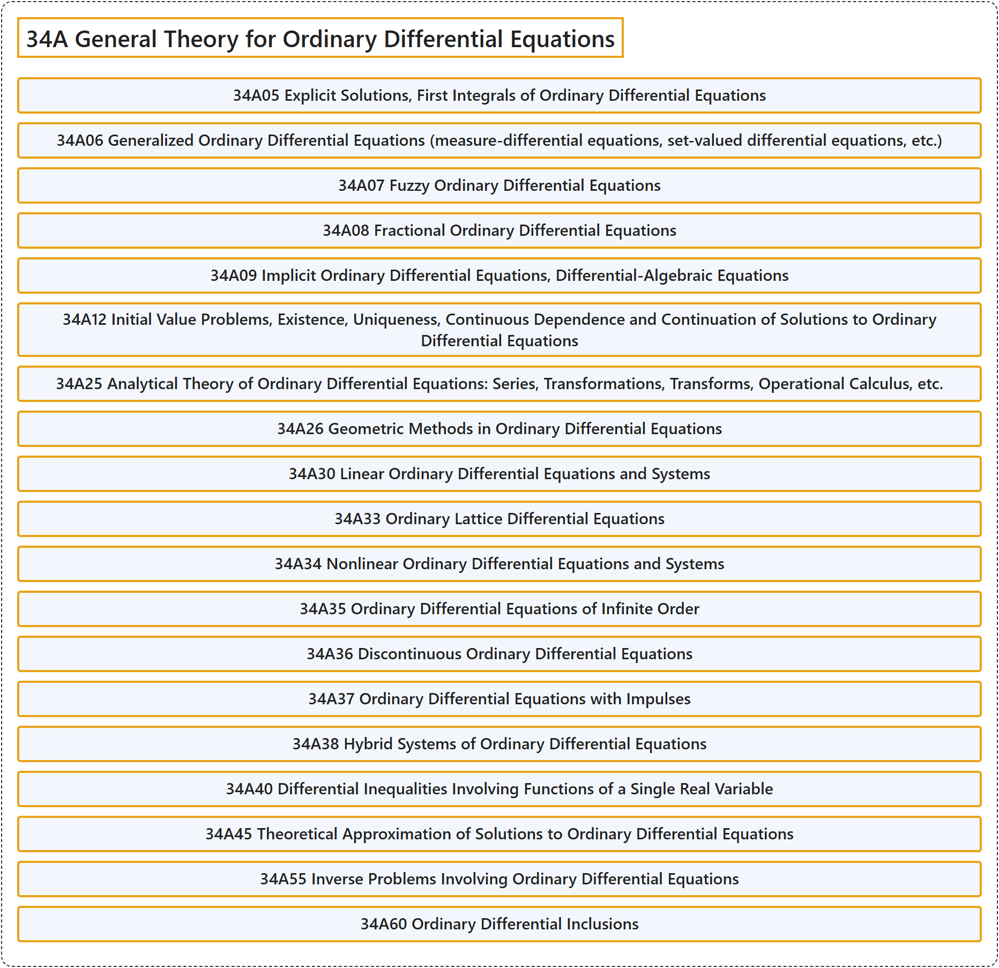

# 34A General Theory for Ordinary Differential Equations

## Classification

## Glossary

| Term | Definition | 中文翻译 | Source |
|---|---|---|---|
| **34A General Theory for Ordinary Differential Equations** 常微分方程一般理论 | (No definition) | （无定义） | [Associate Editors of Mathematical Reviews and zbMATH, 2020](https://msc2020.org/) |
| **34A05 Explicit Solutions, First Integrals of Ordinary Differential Equations** 常微分方程的显式解，首次积分 | (No definition) | （无定义） | [Associate Editors of Mathematical Reviews and zbMATH, 2020](https://msc2020.org/) |
| **34A06 Generalized Ordinary Differential Equations (measure-differential equations, set-valued differential equations, etc.)** 广义常微分方程（测度微分方程、集值微分方程等） | (No definition) | （无定义） | [Associate Editors of Mathematical Reviews and zbMATH, 2020](https://msc2020.org/) |
| **34A07 Fuzzy Ordinary Differential Equations** 模糊常微分方程 | (No definition) | （无定义） | [Associate Editors of Mathematical Reviews and zbMATH, 2020](https://msc2020.org/) |
| **34A08 Fractional Ordinary Differential Equations** 分数阶常微分方程 | (No definition) | （无定义） | [Associate Editors of Mathematical Reviews and zbMATH, 2020](https://msc2020.org/) |
| **34A09 Implicit Ordinary Differential Equations, Differential-Algebraic Equations** 隐式常微分方程，微分代数方程 | (No definition) | （无定义） | [Associate Editors of Mathematical Reviews and zbMATH, 2020](https://msc2020.org/) |
| **34A12 Initial Value Problems, Existence, Uniqueness, Continuous Dependence and Continuation of Solutions to Ordinary Differential Equations** 初值问题，常微分方程解的存在性、唯一性、连续依赖性与延拓 | (No definition) | （无定义） | [Associate Editors of Mathematical Reviews and zbMATH, 2020](https://msc2020.org/) |
| **34A25 Analytical Theory of Ordinary Differential Equations: Series, Transformations, Transforms, Operational Calculus, etc.** 常微分方程的解析理论：级数、变换、积分变换、算子演算等 | (No definition) | （无定义） | [Associate Editors of Mathematical Reviews and zbMATH, 2020](https://msc2020.org/) |
| **34A26 Geometric Methods in Ordinary Differential Equations** 常微分方程中的几何方法 | (No definition) | （无定义） | [Associate Editors of Mathematical Reviews and zbMATH, 2020](https://msc2020.org/) |
| **34A30 Linear Ordinary Differential Equations and Systems** 线性常微分方程与方程组 | (No definition) | （无定义） | [Associate Editors of Mathematical Reviews and zbMATH, 2020](https://msc2020.org/) |
| **34A33 Ordinary Lattice Differential Equations** 常格点微分方程 | (No definition) | （无定义） | [Associate Editors of Mathematical Reviews and zbMATH, 2020](https://msc2020.org/) |
| **34A34 Nonlinear Ordinary Differential Equations and Systems** 非线性常微分方程与方程组 | (No definition) | （无定义） | [Associate Editors of Mathematical Reviews and zbMATH, 2020](https://msc2020.org/) |
| **34A35 Ordinary Differential Equations of Infinite Order** 无穷阶常微分方程 | (No definition) | （无定义） | [Associate Editors of Mathematical Reviews and zbMATH, 2020](https://msc2020.org/) |
| **34A36 Discontinuous Ordinary Differential Equations** 不连续常微分方程 | (No definition) | （无定义） | [Associate Editors of Mathematical Reviews and zbMATH, 2020](https://msc2020.org/) |
| **34A37 Ordinary Differential Equations with Impulses** 带脉冲的常微分方程 | (No definition) | （无定义） | [Associate Editors of Mathematical Reviews and zbMATH, 2020](https://msc2020.org/) |
| **34A38 Hybrid Systems of Ordinary Differential Equations** 常微分方程的混杂系统 | (No definition) | （无定义） | [Associate Editors of Mathematical Reviews and zbMATH, 2020](https://msc2020.org/) |
| **34A40 Differential Inequalities Involving Functions of a Single Real Variable** 涉及单个实变量函数的微分不等式 | (No definition) | （无定义） | [Associate Editors of Mathematical Reviews and zbMATH, 2020](https://msc2020.org/) |
| **34A45 Theoretical Approximation of Solutions to Ordinary Differential Equations** 常微分方程解的理论逼近 | (No definition) | （无定义） | [Associate Editors of Mathematical Reviews and zbMATH, 2020](https://msc2020.org/) |
| **34A55 Inverse Problems Involving Ordinary Differential Equations** 涉及常微分方程的反问题 | (No definition) | （无定义） | [Associate Editors of Mathematical Reviews and zbMATH, 2020](https://msc2020.org/) |
| **34A60 Ordinary Differential Inclusions** 常微分包含 | (No definition) | （无定义） | [Associate Editors of Mathematical Reviews and zbMATH, 2020](https://msc2020.org/) |

## References

Associate Editors of Mathematical Reviews and zbMATH. (2020). *MSC2020: Mathematics Subject Classification system*. Retrieved October 27, 2026, from <https://msc2020.org/>
