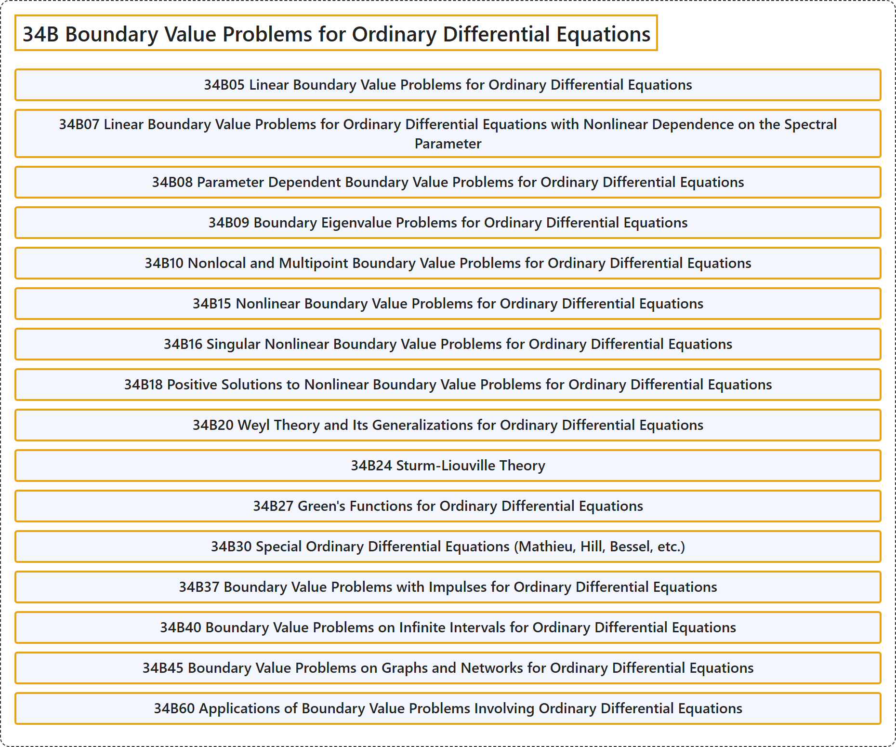

# 34B Boundary Value Problems for Ordinary Differential Equations

## Classification

## Glossary

| Term | Definition | 中文翻译 | Source |
|---|---|---|---|
| **34B Boundary Value Problems for Ordinary Differential Equations** 常微分方程边值问题 | (No definition) | （无定义） | [Associate Editors of Mathematical Reviews and zbMATH, 2020](https://msc2020.org/) |
| **34B05 Linear Boundary Value Problems for Ordinary Differential Equations** 常微分方程的线性边值问题 | (No definition) | （无定义） | [Associate Editors of Mathematical Reviews and zbMATH, 2020](https://msc2020.org/) |
| **34B07 Linear Boundary Value Problems for Ordinary Differential Equations with Nonlinear Dependence on the Spectral Parameter** 对谱参数具有非线性依赖的常微分方程线性边值问题 | (No definition) | （无定义） | [Associate Editors of Mathematical Reviews and zbMATH, 2020](https://msc2020.org/) |
| **34B08 Parameter Dependent Boundary Value Problems for Ordinary Differential Equations** 含参数的常微分方程边值问题 | (No definition) | （无定义） | [Associate Editors of Mathematical Reviews and zbMATH, 2020](https://msc2020.org/) |
| **34B09 Boundary Eigenvalue Problems for Ordinary Differential Equations** 常微分方程的边界特征值问题 | (No definition) | （无定义） | [Associate Editors of Mathematical Reviews and zbMATH, 2020](https://msc2020.org/) |
| **34B10 Nonlocal and Multipoint Boundary Value Problems for Ordinary Differential Equations** 常微分方程的非局部与多点边值问题 | (No definition) | （无定义） | [Associate Editors of Mathematical Reviews and zbMATH, 2020](https://msc2020.org/) |
| **34B15 Nonlinear Boundary Value Problems for Ordinary Differential Equations** 常微分方程的非线性边值问题 | (No definition) | （无定义） | [Associate Editors of Mathematical Reviews and zbMATH, 2020](https://msc2020.org/) |
| **34B16 Singular Nonlinear Boundary Value Problems for Ordinary Differential Equations** 常微分方程的奇异非线性边值问题 | (No definition) | （无定义） | [Associate Editors of Mathematical Reviews and zbMATH, 2020](https://msc2020.org/) |
| **34B18 Positive Solutions to Nonlinear Boundary Value Problems for Ordinary Differential Equations** 常微分方程非线性边值问题的正解 | (No definition) | （无定义） | [Associate Editors of Mathematical Reviews and zbMATH, 2020](https://msc2020.org/) |
| **34B20 Weyl Theory and Its Generalizations for Ordinary Differential Equations** 常微分方程的外尔理论及其推广 | (No definition) | （无定义） | [Associate Editors of Mathematical Reviews and zbMATH, 2020](https://msc2020.org/) |
| **34B24 Sturm-Liouville Theory** 斯图姆-刘维尔理论 | (No definition) | （无定义） | [Associate Editors of Mathematical Reviews and zbMATH, 2020](https://msc2020.org/) |
| **34B27 Green's Functions for Ordinary Differential Equations** 常微分方程的格林函数 | (No definition) | （无定义） | [Associate Editors of Mathematical Reviews and zbMATH, 2020](https://msc2020.org/) |
| **34B30 Special Ordinary Differential Equations (Mathieu, Hill, Bessel, etc.)** 特殊常微分方程（马蒂厄、希尔、贝塞尔等） | (No definition) | （无定义） | [Associate Editors of Mathematical Reviews and zbMATH, 2020](https://msc2020.org/) |
| **34B37 Boundary Value Problems with Impulses for Ordinary Differential Equations** 常微分方程的带脉冲边值问题 | (No definition) | （无定义） | [Associate Editors of Mathematical Reviews and zbMATH, 2020](https://msc2020.org/) |
| **34B40 Boundary Value Problems on Infinite Intervals for Ordinary Differential Equations** 常微分方程的无穷区间上的边值问题 | (No definition) | （无定义） | [Associate Editors of Mathematical Reviews and zbMATH, 2020](https://msc2020.org/) |
| **34B45 Boundary Value Problems on Graphs and Networks for Ordinary Differential Equations** 常微分方程的图与网络上的边值问题 | (No definition) | （无定义） | [Associate Editors of Mathematical Reviews and zbMATH, 2020](https://msc2020.org/) |
| **34B60 Applications of Boundary Value Problems Involving Ordinary Differential Equations** 涉及常微分方程的边值问题的应用 | (No definition) | （无定义） | [Associate Editors of Mathematical Reviews and zbMATH, 2020](https://msc2020.org/) |

## References

Associate Editors of Mathematical Reviews and zbMATH. (2020). *MSC2020: Mathematics Subject Classification system*. Retrieved October 27, 2026, from <https://msc2020.org/>
