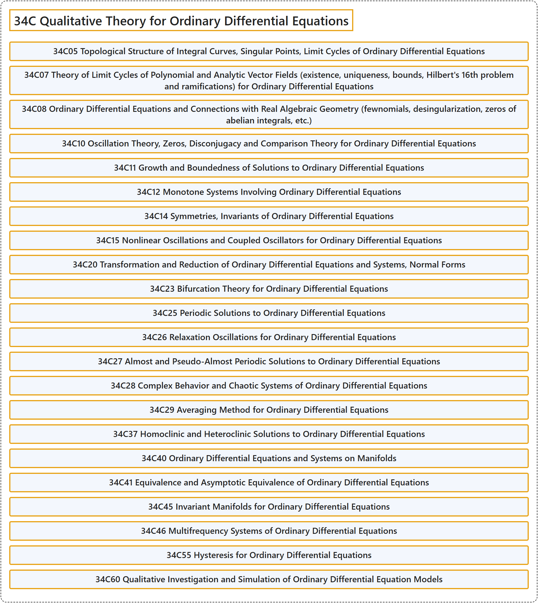

# 34C Qualitative Theory for Ordinary Differential Equations

## Classification

## Glossary

| Term | Definition | 中文翻译 | Source |
|---|---|---|---|
| **34C Qualitative Theory for Ordinary Differential Equations** 常微分方程定性理论 | (No definition) | （无定义） | [Associate Editors of Mathematical Reviews and zbMATH, 2020](https://msc2020.org/) |
| **34C05 Topological Structure of Integral Curves, Singular Points, Limit Cycles of Ordinary Differential Equations** 常微分方程积分曲线的拓扑结构，奇点，极限环 | (No definition) | （无定义） | [Associate Editors of Mathematical Reviews and zbMATH, 2020](https://msc2020.org/) |
| **34C07 Theory of Limit Cycles of Polynomial and Analytic Vector Fields (existence, uniqueness, bounds, Hilbert's 16th problem and ramifications) for Ordinary Differential Equations** 常微分方程中多项式与解析向量场的极限环理论（存在性、唯一性、界、希尔伯特第 16 问题及其分支） | (No definition) | （无定义） | [Associate Editors of Mathematical Reviews and zbMATH, 2020](https://msc2020.org/) |
| **34C08 Ordinary Differential Equations and Connections with Real Algebraic Geometry (fewnomials, desingularization, zeros of abelian integrals, etc.)** 常微分方程与实代数几何的联系（少项式、去奇化、阿贝尔积分的零点等） | (No definition) | （无定义） | [Associate Editors of Mathematical Reviews and zbMATH, 2020](https://msc2020.org/) |
| **34C10 Oscillation Theory, Zeros, Disconjugacy and Comparison Theory for Ordinary Differential Equations** 常微分方程的振动理论，零点，非共轭性与比较理论 | (No definition) | （无定义） | [Associate Editors of Mathematical Reviews and zbMATH, 2020](https://msc2020.org/) |
| **34C11 Growth and Boundedness of Solutions to Ordinary Differential Equations** 常微分方程解的增长与有界性 | (No definition) | （无定义） | [Associate Editors of Mathematical Reviews and zbMATH, 2020](https://msc2020.org/) |
| **34C12 Monotone Systems Involving Ordinary Differential Equations** 涉及常微分方程的单调系统 | (No definition) | （无定义） | [Associate Editors of Mathematical Reviews and zbMATH, 2020](https://msc2020.org/) |
| **34C14 Symmetries, Invariants of Ordinary Differential Equations** 常微分方程的对称性，不变量 | (No definition) | （无定义） | [Associate Editors of Mathematical Reviews and zbMATH, 2020](https://msc2020.org/) |
| **34C15 Nonlinear Oscillations and Coupled Oscillators for Ordinary Differential Equations** 常微分方程的非线性振动与耦合振子 | (No definition) | （无定义） | [Associate Editors of Mathematical Reviews and zbMATH, 2020](https://msc2020.org/) |
| **34C20 Transformation and Reduction of Ordinary Differential Equations and Systems, Normal Forms** 常微分方程与方程组的变换与约化，正规形 | (No definition) | （无定义） | [Associate Editors of Mathematical Reviews and zbMATH, 2020](https://msc2020.org/) |
| **34C23 Bifurcation Theory for Ordinary Differential Equations** 常微分方程的分岔理论 | (No definition) | （无定义） | [Associate Editors of Mathematical Reviews and zbMATH, 2020](https://msc2020.org/) |
| **34C25 Periodic Solutions to Ordinary Differential Equations** 常微分方程的周期解 | (No definition) | （无定义） | [Associate Editors of Mathematical Reviews and zbMATH, 2020](https://msc2020.org/) |
| **34C26 Relaxation Oscillations for Ordinary Differential Equations** 常微分方程的弛豫振荡 | (No definition) | （无定义） | [Associate Editors of Mathematical Reviews and zbMATH, 2020](https://msc2020.org/) |
| **34C27 Almost and Pseudo-Almost Periodic Solutions to Ordinary Differential Equations** 常微分方程的几乎周期解与伪几乎周期解 | (No definition) | （无定义） | [Associate Editors of Mathematical Reviews and zbMATH, 2020](https://msc2020.org/) |
| **34C28 Complex Behavior and Chaotic Systems of Ordinary Differential Equations** 常微分方程的复杂行为与混沌系统 | (No definition) | （无定义） | [Associate Editors of Mathematical Reviews and zbMATH, 2020](https://msc2020.org/) |
| **34C29 Averaging Method for Ordinary Differential Equations** 常微分方程的平均法 | (No definition) | （无定义） | [Associate Editors of Mathematical Reviews and zbMATH, 2020](https://msc2020.org/) |
| **34C37 Homoclinic and Heteroclinic Solutions to Ordinary Differential Equations** 常微分方程的同宿解与异宿解 | (No definition) | （无定义） | [Associate Editors of Mathematical Reviews and zbMATH, 2020](https://msc2020.org/) |
| **34C40 Ordinary Differential Equations and Systems on Manifolds** 流形上的常微分方程与方程组 | (No definition) | （无定义） | [Associate Editors of Mathematical Reviews and zbMATH, 2020](https://msc2020.org/) |
| **34C41 Equivalence and Asymptotic Equivalence of Ordinary Differential Equations** 常微分方程的等价与渐近等价 | (No definition) | （无定义） | [Associate Editors of Mathematical Reviews and zbMATH, 2020](https://msc2020.org/) |
| **34C45 Invariant Manifolds for Ordinary Differential Equations** 常微分方程的不变流形 | (No definition) | （无定义） | [Associate Editors of Mathematical Reviews and zbMATH, 2020](https://msc2020.org/) |
| **34C46 Multifrequency Systems of Ordinary Differential Equations** 常微分方程的多频系统 | (No definition) | （无定义） | [Associate Editors of Mathematical Reviews and zbMATH, 2020](https://msc2020.org/) |
| **34C55 Hysteresis for Ordinary Differential Equations** 常微分方程的滞后 | (No definition) | （无定义） | [Associate Editors of Mathematical Reviews and zbMATH, 2020](https://msc2020.org/) |
| **34C60 Qualitative Investigation and Simulation of Ordinary Differential Equation Models** 常微分方程模型的定性研究与模拟 | (No definition) | （无定义） | [Associate Editors of Mathematical Reviews and zbMATH, 2020](https://msc2020.org/) |

## References

Associate Editors of Mathematical Reviews and zbMATH. (2020). *MSC2020: Mathematics Subject Classification system*. Retrieved October 27, 2026, from <https://msc2020.org/>
