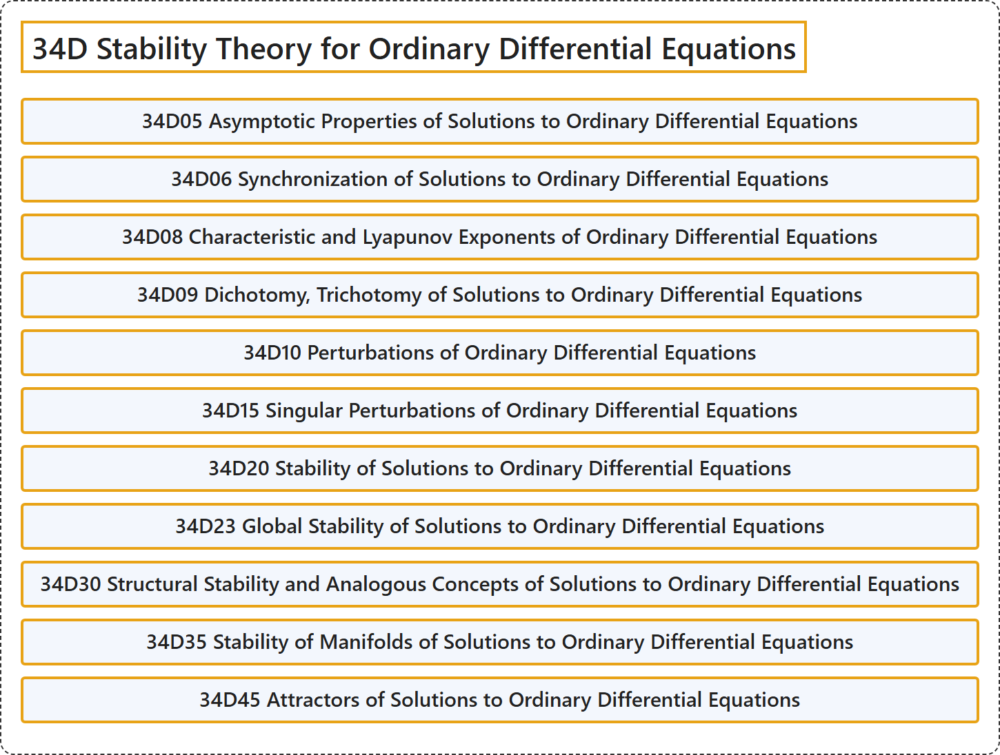

# 34D Stability Theory for Ordinary Differential Equations

## Classification

## Glossary

| Term | Definition | 中文翻译 | Source |
|---|---|---|---|
| **34D Stability Theory for Ordinary Differential Equations** 常微分方程稳定性理论 | (No definition) | （无定义） | [Associate Editors of Mathematical Reviews and zbMATH, 2020](https://msc2020.org/) |
| **34D05 Asymptotic Properties of Solutions to Ordinary Differential Equations** 常微分方程解的渐近性质 | (No definition) | （无定义） | [Associate Editors of Mathematical Reviews and zbMATH, 2020](https://msc2020.org/) |
| **34D06 Synchronization of Solutions to Ordinary Differential Equations** 常微分方程解的同步 | (No definition) | （无定义） | [Associate Editors of Mathematical Reviews and zbMATH, 2020](https://msc2020.org/) |
| **34D08 Characteristic and Lyapunov Exponents of Ordinary Differential Equations** 常微分方程的特征指数与李雅普诺夫指数 | (No definition) | （无定义） | [Associate Editors of Mathematical Reviews and zbMATH, 2020](https://msc2020.org/) |
| **34D09 Dichotomy, Trichotomy of Solutions to Ordinary Differential Equations** 常微分方程解的二分性、三分性 | (No definition) | （无定义） | [Associate Editors of Mathematical Reviews and zbMATH, 2020](https://msc2020.org/) |
| **34D10 Perturbations of Ordinary Differential Equations** 常微分方程的扰动 | (No definition) | （无定义） | [Associate Editors of Mathematical Reviews and zbMATH, 2020](https://msc2020.org/) |
| **34D15 Singular Perturbations of Ordinary Differential Equations** 常微分方程的奇异摄动 | (No definition) | （无定义） | [Associate Editors of Mathematical Reviews and zbMATH, 2020](https://msc2020.org/) |
| **34D20 Stability of Solutions to Ordinary Differential Equations** 常微分方程解的稳定性 | (No definition) | （无定义） | [Associate Editors of Mathematical Reviews and zbMATH, 2020](https://msc2020.org/) |
| **34D23 Global Stability of Solutions to Ordinary Differential Equations** 常微分方程解的全局稳定性 | (No definition) | （无定义） | [Associate Editors of Mathematical Reviews and zbMATH, 2020](https://msc2020.org/) |
| **34D30 Structural Stability and Analogous Concepts of Solutions to Ordinary Differential Equations** 常微分方程解的结构稳定性及类似概念 | (No definition) | （无定义） | [Associate Editors of Mathematical Reviews and zbMATH, 2020](https://msc2020.org/) |
| **34D35 Stability of Manifolds of Solutions to Ordinary Differential Equations** 常微分方程解流形的稳定性 | (No definition) | （无定义） | [Associate Editors of Mathematical Reviews and zbMATH, 2020](https://msc2020.org/) |
| **34D45 Attractors of Solutions to Ordinary Differential Equations** 常微分方程解的吸引子 | (No definition) | （无定义） | [Associate Editors of Mathematical Reviews and zbMATH, 2020](https://msc2020.org/) |

## References

Associate Editors of Mathematical Reviews and zbMATH. (2020). *MSC2020: Mathematics Subject Classification system*. Retrieved October 27, 2026, from <https://msc2020.org/>
