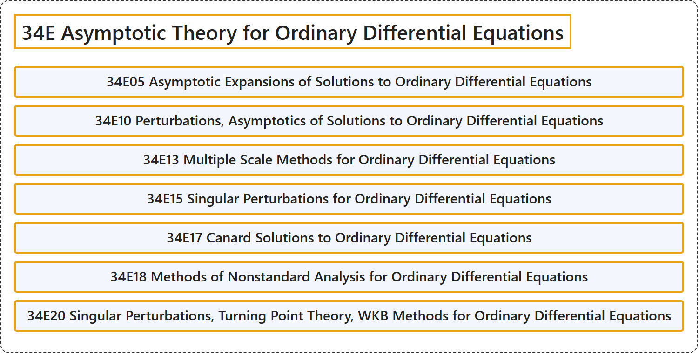

# 34E Asymptotic Theory for Ordinary Differential Equations

## Classification

## Glossary

| Term | Definition | 中文翻译 | Source |
|---|---|---|---|
| **34E Asymptotic Theory for Ordinary Differential Equations** 常微分方程渐近理论 | (No definition) | （无定义） | [Associate Editors of Mathematical Reviews and zbMATH, 2020](https://msc2020.org/) |
| **34E05 Asymptotic Expansions of Solutions to Ordinary Differential Equations** 常微分方程解的渐近展开 | (No definition) | （无定义） | [Associate Editors of Mathematical Reviews and zbMATH, 2020](https://msc2020.org/) |
| **34E10 Perturbations, Asymptotics of Solutions to Ordinary Differential Equations** 常微分方程解的扰动与渐近性 | (No definition) | （无定义） | [Associate Editors of Mathematical Reviews and zbMATH, 2020](https://msc2020.org/) |
| **34E13 Multiple Scale Methods for Ordinary Differential Equations** 常微分方程的多尺度方法 | (No definition) | （无定义） | [Associate Editors of Mathematical Reviews and zbMATH, 2020](https://msc2020.org/) |
| **34E15 Singular Perturbations for Ordinary Differential Equations** 常微分方程的奇异摄动 | (No definition) | （无定义） | [Associate Editors of Mathematical Reviews and zbMATH, 2020](https://msc2020.org/) |
| **34E17 Canard Solutions to Ordinary Differential Equations** 常微分方程的鸭解 | (No definition) | （无定义） | [Associate Editors of Mathematical Reviews and zbMATH, 2020](https://msc2020.org/) |
| **34E18 Methods of Nonstandard Analysis for Ordinary Differential Equations** 常微分方程的非标准分析方法 | (No definition) | （无定义） | [Associate Editors of Mathematical Reviews and zbMATH, 2020](https://msc2020.org/) |
| **34E20 Singular Perturbations, Turning Point Theory, WKB Methods for Ordinary Differential Equations** 常微分方程的奇异摄动，转折点理论，WKB 方法 | (No definition) | （无定义） | [Associate Editors of Mathematical Reviews and zbMATH, 2020](https://msc2020.org/) |

## References

Associate Editors of Mathematical Reviews and zbMATH. (2020). *MSC2020: Mathematics Subject Classification system*. Retrieved October 27, 2026, from <https://msc2020.org/>
