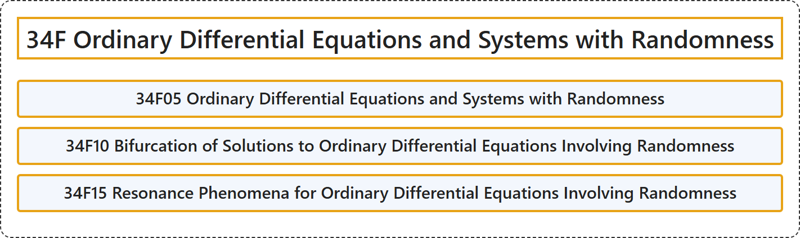

# 34F Ordinary Differential Equations and Systems with Randomness

## Classification

## Glossary

| Term | Definition | 中文翻译 | Source |
|---|---|---|---|
| **34F Ordinary Differential Equations and Systems with Randomness** 带随机性的常微分方程与方程组 | (No definition) | （无定义） | [Associate Editors of Mathematical Reviews and zbMATH, 2020](https://msc2020.org/) |
| **34F05 Ordinary Differential Equations and Systems with Randomness** 带随机性的常微分方程与方程组 | (No definition) | （无定义） | [Associate Editors of Mathematical Reviews and zbMATH, 2020](https://msc2020.org/) |
| **34F10 Bifurcation of Solutions to Ordinary Differential Equations Involving Randomness** 涉及随机性的常微分方程解的分岔 | (No definition) | （无定义） | [Associate Editors of Mathematical Reviews and zbMATH, 2020](https://msc2020.org/) |
| **34F15 Resonance Phenomena for Ordinary Differential Equations Involving Randomness** 涉及随机性的常微分方程的共振现象 | (No definition) | （无定义） | [Associate Editors of Mathematical Reviews and zbMATH, 2020](https://msc2020.org/) |

## References

Associate Editors of Mathematical Reviews and zbMATH. (2020). *MSC2020: Mathematics Subject Classification system*. Retrieved October 27, 2026, from <https://msc2020.org/>
