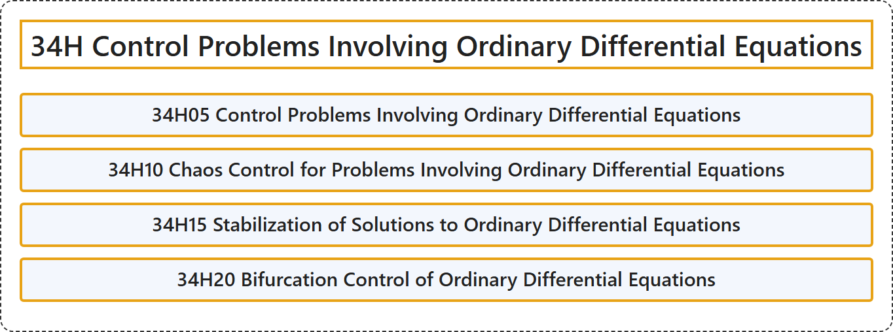

# 34H Control Problems Involving Ordinary Differential Equations

## Classification

## Glossary

| Term | Definition | 中文翻译 | Source |
|---|---|---|---|
| **34H Control Problems Involving Ordinary Differential Equations** 涉及常微分方程的控制问题 | (No definition) | （无定义） | [Associate Editors of Mathematical Reviews and zbMATH, 2020](https://msc2020.org/) |
| **34H05 Control Problems Involving Ordinary Differential Equations** 涉及常微分方程的控制问题 | (No definition) | （无定义） | [Associate Editors of Mathematical Reviews and zbMATH, 2020](https://msc2020.org/) |
| **34H10 Chaos Control for Problems Involving Ordinary Differential Equations** 涉及常微分方程问题的混沌控制 | (No definition) | （无定义） | [Associate Editors of Mathematical Reviews and zbMATH, 2020](https://msc2020.org/) |
| **34H15 Stabilization of Solutions to Ordinary Differential Equations** 常微分方程解的镇定 | (No definition) | （无定义） | [Associate Editors of Mathematical Reviews and zbMATH, 2020](https://msc2020.org/) |
| **34H20 Bifurcation Control of Ordinary Differential Equations** 常微分方程的分岔控制 | (No definition) | （无定义） | [Associate Editors of Mathematical Reviews and zbMATH, 2020](https://msc2020.org/) |

## References

Associate Editors of Mathematical Reviews and zbMATH. (2020). *MSC2020: Mathematics Subject Classification system*. Retrieved October 27, 2026, from <https://msc2020.org/>
