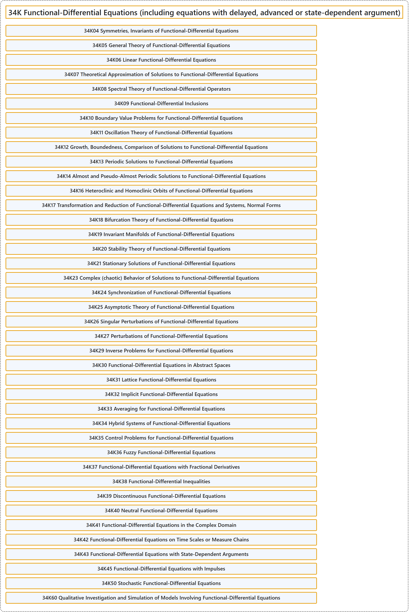

# 34K Functional-Differential Equations (including equations with delayed, advanced or state-dependent argument)

## Classification

## Glossary

| Term | Definition | 中文翻译 | Source |
|---|---|---|---|
| **34K Functional-Differential Equations (including equations with delayed, advanced or state-dependent argument)** 泛函微分方程（包括带滞后、超前或状态依赖变量的方程） | (No definition) | （无定义） | [Associate Editors of Mathematical Reviews and zbMATH, 2020](https://msc2020.org/) |
| **34K04 Symmetries, Invariants of Functional-Differential Equations** 泛函微分方程的对称性，不变量 | (No definition) | （无定义） | [Associate Editors of Mathematical Reviews and zbMATH, 2020](https://msc2020.org/) |
| **34K05 General Theory of Functional-Differential Equations** 泛函微分方程的一般理论 | (No definition) | （无定义） | [Associate Editors of Mathematical Reviews and zbMATH, 2020](https://msc2020.org/) |
| **34K06 Linear Functional-Differential Equations** 线性泛函微分方程 | (No definition) | （无定义） | [Associate Editors of Mathematical Reviews and zbMATH, 2020](https://msc2020.org/) |
| **34K07 Theoretical Approximation of Solutions to Functional-Differential Equations** 泛函微分方程解的理论逼近 | (No definition) | （无定义） | [Associate Editors of Mathematical Reviews and zbMATH, 2020](https://msc2020.org/) |
| **34K08 Spectral Theory of Functional-Differential Operators** 泛函微分算子的谱理论 | (No definition) | （无定义） | [Associate Editors of Mathematical Reviews and zbMATH, 2020](https://msc2020.org/) |
| **34K09 Functional-Differential Inclusions** 泛函微分包含 | (No definition) | （无定义） | [Associate Editors of Mathematical Reviews and zbMATH, 2020](https://msc2020.org/) |
| **34K10 Boundary Value Problems for Functional-Differential Equations** 泛函微分方程的边值问题 | (No definition) | （无定义） | [Associate Editors of Mathematical Reviews and zbMATH, 2020](https://msc2020.org/) |
| **34K11 Oscillation Theory of Functional-Differential Equations** 泛函微分方程的振动理论 | (No definition) | （无定义） | [Associate Editors of Mathematical Reviews and zbMATH, 2020](https://msc2020.org/) |
| **34K12 Growth, Boundedness, Comparison of Solutions to Functional-Differential Equations** 泛函微分方程解的增长、有界性与比较 | (No definition) | （无定义） | [Associate Editors of Mathematical Reviews and zbMATH, 2020](https://msc2020.org/) |
| **34K13 Periodic Solutions to Functional-Differential Equations** 泛函微分方程的周期解 | (No definition) | （无定义） | [Associate Editors of Mathematical Reviews and zbMATH, 2020](https://msc2020.org/) |
| **34K14 Almost and Pseudo-Almost Periodic Solutions to Functional-Differential Equations** 泛函微分方程的几乎周期解与伪几乎周期解 | (No definition) | （无定义） | [Associate Editors of Mathematical Reviews and zbMATH, 2020](https://msc2020.org/) |
| **34K16 Heteroclinic and Homoclinic Orbits of Functional-Differential Equations** 泛函微分方程的异宿轨道与同宿轨道 | (No definition) | （无定义） | [Associate Editors of Mathematical Reviews and zbMATH, 2020](https://msc2020.org/) |
| **34K17 Transformation and Reduction of Functional-Differential Equations and Systems, Normal Forms** 泛函微分方程与方程组的变换与约化，正规形 | (No definition) | （无定义） | [Associate Editors of Mathematical Reviews and zbMATH, 2020](https://msc2020.org/) |
| **34K18 Bifurcation Theory of Functional-Differential Equations** 泛函微分方程的分岔理论 | (No definition) | （无定义） | [Associate Editors of Mathematical Reviews and zbMATH, 2020](https://msc2020.org/) |
| **34K19 Invariant Manifolds of Functional-Differential Equations** 泛函微分方程的不变流形 | (No definition) | （无定义） | [Associate Editors of Mathematical Reviews and zbMATH, 2020](https://msc2020.org/) |
| **34K20 Stability Theory of Functional-Differential Equations** 泛函微分方程的稳定性理论 | (No definition) | （无定义） | [Associate Editors of Mathematical Reviews and zbMATH, 2020](https://msc2020.org/) |
| **34K21 Stationary Solutions of Functional-Differential Equations** 泛函微分方程的定常解 | (No definition) | （无定义） | [Associate Editors of Mathematical Reviews and zbMATH, 2020](https://msc2020.org/) |
| **34K23 Complex (chaotic) Behavior of Solutions to Functional-Differential Equations** 泛函微分方程解的复杂（混沌）行为 | (No definition) | （无定义） | [Associate Editors of Mathematical Reviews and zbMATH, 2020](https://msc2020.org/) |
| **34K24 Synchronization of Functional-Differential Equations** 泛函微分方程的同步 | (No definition) | （无定义） | [Associate Editors of Mathematical Reviews and zbMATH, 2020](https://msc2020.org/) |
| **34K25 Asymptotic Theory of Functional-Differential Equations** 泛函微分方程的渐近理论 | (No definition) | （无定义） | [Associate Editors of Mathematical Reviews and zbMATH, 2020](https://msc2020.org/) |
| **34K26 Singular Perturbations of Functional-Differential Equations** 泛函微分方程的奇异摄动 | (No definition) | （无定义） | [Associate Editors of Mathematical Reviews and zbMATH, 2020](https://msc2020.org/) |
| **34K27 Perturbations of Functional-Differential Equations** 泛函微分方程的扰动 | (No definition) | （无定义） | [Associate Editors of Mathematical Reviews and zbMATH, 2020](https://msc2020.org/) |
| **34K29 Inverse Problems for Functional-Differential Equations** 泛函微分方程的反问题 | (No definition) | （无定义） | [Associate Editors of Mathematical Reviews and zbMATH, 2020](https://msc2020.org/) |
| **34K30 Functional-Differential Equations in Abstract Spaces** 抽象空间中的泛函微分方程 | (No definition) | （无定义） | [Associate Editors of Mathematical Reviews and zbMATH, 2020](https://msc2020.org/) |
| **34K31 Lattice Functional-Differential Equations** 格点泛函微分方程 | (No definition) | （无定义） | [Associate Editors of Mathematical Reviews and zbMATH, 2020](https://msc2020.org/) |
| **34K32 Implicit Functional-Differential Equations** 隐式泛函微分方程 | (No definition) | （无定义） | [Associate Editors of Mathematical Reviews and zbMATH, 2020](https://msc2020.org/) |
| **34K33 Averaging for Functional-Differential Equations** 泛函微分方程的平均化 | (No definition) | （无定义） | [Associate Editors of Mathematical Reviews and zbMATH, 2020](https://msc2020.org/) |
| **34K34 Hybrid Systems of Functional-Differential Equations** 泛函微分方程的混杂系统 | (No definition) | （无定义） | [Associate Editors of Mathematical Reviews and zbMATH, 2020](https://msc2020.org/) |
| **34K35 Control Problems for Functional-Differential Equations** 泛函微分方程的控制问题 | (No definition) | （无定义） | [Associate Editors of Mathematical Reviews and zbMATH, 2020](https://msc2020.org/) |
| **34K36 Fuzzy Functional-Differential Equations** 模糊泛函微分方程 | (No definition) | （无定义） | [Associate Editors of Mathematical Reviews and zbMATH, 2020](https://msc2020.org/) |
| **34K37 Functional-Differential Equations with Fractional Derivatives** 带分数阶导数的泛函微分方程 | (No definition) | （无定义） | [Associate Editors of Mathematical Reviews and zbMATH, 2020](https://msc2020.org/) |
| **34K38 Functional-Differential Inequalities** 泛函微分不等式 | (No definition) | （无定义） | [Associate Editors of Mathematical Reviews and zbMATH, 2020](https://msc2020.org/) |
| **34K39 Discontinuous Functional-Differential Equations** 不连续泛函微分方程 | (No definition) | （无定义） | [Associate Editors of Mathematical Reviews and zbMATH, 2020](https://msc2020.org/) |
| **34K40 Neutral Functional-Differential Equations** 中立型泛函微分方程 | (No definition) | （无定义） | [Associate Editors of Mathematical Reviews and zbMATH, 2020](https://msc2020.org/) |
| **34K41 Functional-Differential Equations in the Complex Domain** 复域中的泛函微分方程 | (No definition) | （无定义） | [Associate Editors of Mathematical Reviews and zbMATH, 2020](https://msc2020.org/) |
| **34K42 Functional-Differential Equations on Time Scales or Measure Chains** 时标或测度链上的泛函微分方程 | (No definition) | （无定义） | [Associate Editors of Mathematical Reviews and zbMATH, 2020](https://msc2020.org/) |
| **34K43 Functional-Differential Equations with State-Dependent Arguments** 具有状态依赖自变量的泛函微分方程 | (No definition) | （无定义） | [Associate Editors of Mathematical Reviews and zbMATH, 2020](https://msc2020.org/) |
| **34K45 Functional-Differential Equations with Impulses** 带脉冲的泛函微分方程 | (No definition) | （无定义） | [Associate Editors of Mathematical Reviews and zbMATH, 2020](https://msc2020.org/) |
| **34K50 Stochastic Functional-Differential Equations** 随机泛函微分方程 | (No definition) | （无定义） | [Associate Editors of Mathematical Reviews and zbMATH, 2020](https://msc2020.org/) |
| **34K60 Qualitative Investigation and Simulation of Models Involving Functional-Differential Equations** 涉及泛函微分方程的模型的定性研究与模拟 | (No definition) | （无定义） | [Associate Editors of Mathematical Reviews and zbMATH, 2020](https://msc2020.org/) |

## References

Associate Editors of Mathematical Reviews and zbMATH. (2020). *MSC2020: Mathematics Subject Classification system*. Retrieved October 27, 2026, from <https://msc2020.org/>
