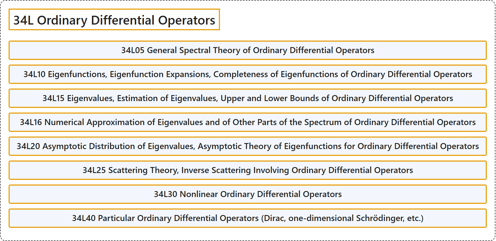

# 34L Ordinary Differential Operators

## Classification

## Glossary

| Term | Definition | 中文翻译 | Source |
|---|---|---|---|
| **34L Ordinary Differential Operators** 常微分算子 | (No definition) | （无定义） | [Associate Editors of Mathematical Reviews and zbMATH, 2020](https://msc2020.org/) |
| **34L05 General Spectral Theory of Ordinary Differential Operators** 常微分算子的一般谱理论 | (No definition) | （无定义） | [Associate Editors of Mathematical Reviews and zbMATH, 2020](https://msc2020.org/) |
| **34L10 Eigenfunctions, Eigenfunction Expansions, Completeness of Eigenfunctions of Ordinary Differential Operators** 常微分算子的本征函数、本征函数展开、本征函数的完备性 | (No definition) | （无定义） | [Associate Editors of Mathematical Reviews and zbMATH, 2020](https://msc2020.org/) |
| **34L15 Eigenvalues, Estimation of Eigenvalues, Upper and Lower Bounds of Ordinary Differential Operators** 常微分算子的本征值，本征值估计，上下界 | (No definition) | （无定义） | [Associate Editors of Mathematical Reviews and zbMATH, 2020](https://msc2020.org/) |
| **34L16 Numerical Approximation of Eigenvalues and of Other Parts of the Spectrum of Ordinary Differential Operators** 常微分算子本征值及谱的其他部分的数值逼近 | (No definition) | （无定义） | [Associate Editors of Mathematical Reviews and zbMATH, 2020](https://msc2020.org/) |
| **34L20 Asymptotic Distribution of Eigenvalues, Asymptotic Theory of Eigenfunctions for Ordinary Differential Operators** 常微分算子本征值的渐近分布，本征函数的渐近理论 | (No definition) | （无定义） | [Associate Editors of Mathematical Reviews and zbMATH, 2020](https://msc2020.org/) |
| **34L25 Scattering Theory, Inverse Scattering Involving Ordinary Differential Operators** 涉及常微分算子的散射理论，反散射 | (No definition) | （无定义） | [Associate Editors of Mathematical Reviews and zbMATH, 2020](https://msc2020.org/) |
| **34L30 Nonlinear Ordinary Differential Operators** 非线性常微分算子 | (No definition) | （无定义） | [Associate Editors of Mathematical Reviews and zbMATH, 2020](https://msc2020.org/) |
| **34L40 Particular Ordinary Differential Operators (Dirac, one-dimensional Schrödinger, etc.)** 特殊常微分算子（狄拉克、一维薛定谔等） | (No definition) | （无定义） | [Associate Editors of Mathematical Reviews and zbMATH, 2020](https://msc2020.org/) |

## References

Associate Editors of Mathematical Reviews and zbMATH. (2020). *MSC2020: Mathematics Subject Classification system*. Retrieved October 27, 2026, from <https://msc2020.org/>
