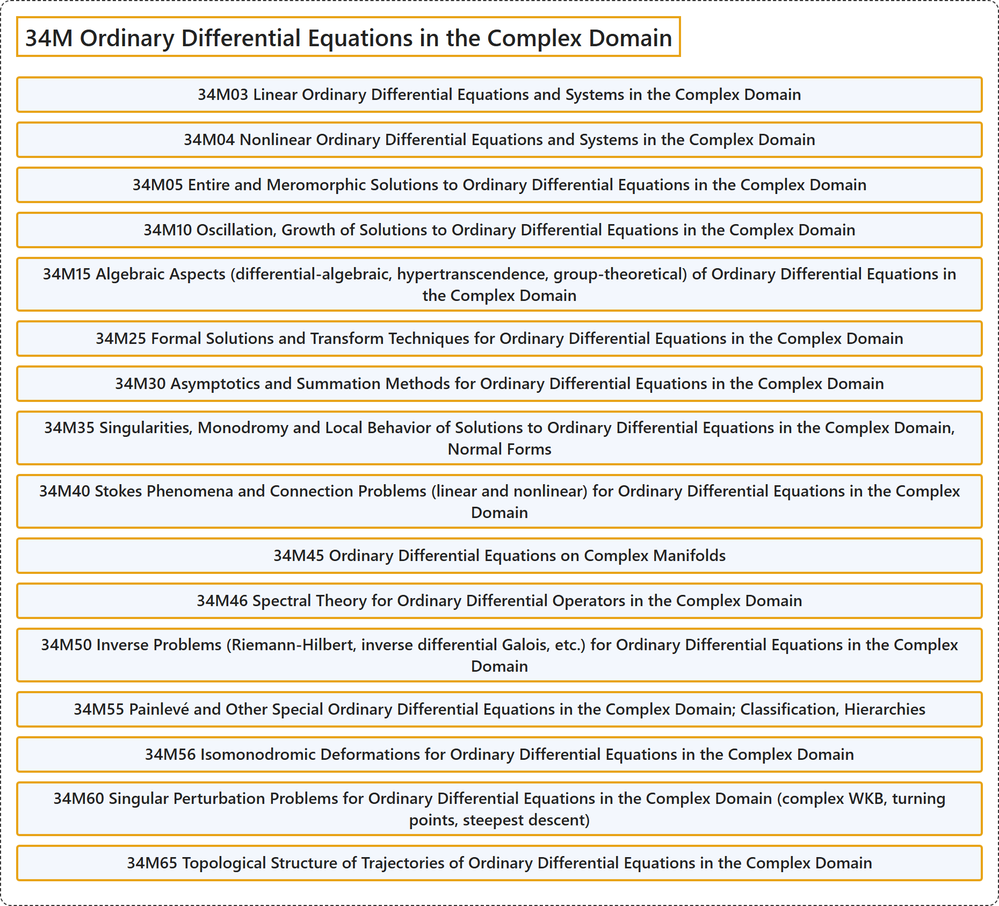

# 34M Ordinary Differential Equations in the Complex Domain

## Classification

## Glossary

| Term | Definition | 中文翻译 | Source |
|---|---|---|---|
| **34M Ordinary Differential Equations in the Complex Domain** 复域中的常微分方程 | (No definition) | （无定义） | [Associate Editors of Mathematical Reviews and zbMATH, 2020](https://msc2020.org/) |
| **34M03 Linear Ordinary Differential Equations and Systems in the Complex Domain** 复域中的线性常微分方程与方程组 | (No definition) | （无定义） | [Associate Editors of Mathematical Reviews and zbMATH, 2020](https://msc2020.org/) |
| **34M04 Nonlinear Ordinary Differential Equations and Systems in the Complex Domain** 复域中的非线性常微分方程与方程组 | (No definition) | （无定义） | [Associate Editors of Mathematical Reviews and zbMATH, 2020](https://msc2020.org/) |
| **34M05 Entire and Meromorphic Solutions to Ordinary Differential Equations in the Complex Domain** 复域中常微分方程的整解与亚纯解 | (No definition) | （无定义） | [Associate Editors of Mathematical Reviews and zbMATH, 2020](https://msc2020.org/) |
| **34M10 Oscillation, Growth of Solutions to Ordinary Differential Equations in the Complex Domain** 复域中常微分方程解的振动与增长 | (No definition) | （无定义） | [Associate Editors of Mathematical Reviews and zbMATH, 2020](https://msc2020.org/) |
| **34M15 Algebraic Aspects (differential-algebraic, hypertranscendence, group-theoretical) of Ordinary Differential Equations in the Complex Domain** 复域中常微分方程的代数方面（微分代数、超超越、群论） | (No definition) | （无定义） | [Associate Editors of Mathematical Reviews and zbMATH, 2020](https://msc2020.org/) |
| **34M25 Formal Solutions and Transform Techniques for Ordinary Differential Equations in the Complex Domain** 复域中常微分方程的形式解与变换技术 | (No definition) | （无定义） | [Associate Editors of Mathematical Reviews and zbMATH, 2020](https://msc2020.org/) |
| **34M30 Asymptotics and Summation Methods for Ordinary Differential Equations in the Complex Domain** 复域中常微分方程的渐近与求和方法 | (No definition) | （无定义） | [Associate Editors of Mathematical Reviews and zbMATH, 2020](https://msc2020.org/) |
| **34M35 Singularities, Monodromy and Local Behavior of Solutions to Ordinary Differential Equations in the Complex Domain, Normal Forms** 复域中常微分方程解的奇点、单值性与局部行为，正规形 | (No definition) | （无定义） | [Associate Editors of Mathematical Reviews and zbMATH, 2020](https://msc2020.org/) |
| **34M40 Stokes Phenomena and Connection Problems (linear and nonlinear) for Ordinary Differential Equations in the Complex Domain** 复域中常微分方程的斯托克斯现象与连接问题（线性与非线性） | (No definition) | （无定义） | [Associate Editors of Mathematical Reviews and zbMATH, 2020](https://msc2020.org/) |
| **34M45 Ordinary Differential Equations on Complex Manifolds** 复流形上的常微分方程 | (No definition) | （无定义） | [Associate Editors of Mathematical Reviews and zbMATH, 2020](https://msc2020.org/) |
| **34M46 Spectral Theory for Ordinary Differential Operators in the Complex Domain** 复域中常微分算子的谱理论 | (No definition) | （无定义） | [Associate Editors of Mathematical Reviews and zbMATH, 2020](https://msc2020.org/) |
| **34M50 Inverse Problems (Riemann-Hilbert, inverse differential Galois, etc.) for Ordinary Differential Equations in the Complex Domain** 复域中常微分方程的反问题（黎曼-希尔伯特、反微分伽罗瓦等） | (No definition) | （无定义） | [Associate Editors of Mathematical Reviews and zbMATH, 2020](https://msc2020.org/) |
| **34M55 Painlevé and Other Special Ordinary Differential Equations in the Complex Domain; Classification, Hierarchies** 复域中的潘勒韦及其他特殊常微分方程；分类，族列 | (No definition) | （无定义） | [Associate Editors of Mathematical Reviews and zbMATH, 2020](https://msc2020.org/) |
| **34M56 Isomonodromic Deformations for Ordinary Differential Equations in the Complex Domain** 复域中常微分方程的等单值形变 | (No definition) | （无定义） | [Associate Editors of Mathematical Reviews and zbMATH, 2020](https://msc2020.org/) |
| **34M60 Singular Perturbation Problems for Ordinary Differential Equations in the Complex Domain (complex WKB, turning points, steepest descent)** 复域中常微分方程的奇异摄动问题（复 WKB、转折点、最速下降） | (No definition) | （无定义） | [Associate Editors of Mathematical Reviews and zbMATH, 2020](https://msc2020.org/) |
| **34M65 Topological Structure of Trajectories of Ordinary Differential Equations in the Complex Domain** 复域中常微分方程轨线的拓扑结构 | (No definition) | （无定义） | [Associate Editors of Mathematical Reviews and zbMATH, 2020](https://msc2020.org/) |

## References

Associate Editors of Mathematical Reviews and zbMATH. (2020). *MSC2020: Mathematics Subject Classification system*. Retrieved October 27, 2026, from <https://msc2020.org/>
