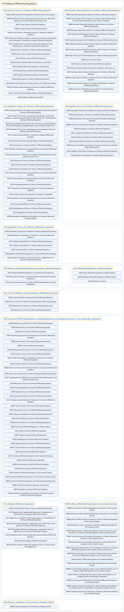

# 34 Ordinary Differential Equations

## Classification

## Glossary

| Term | Definition | 中文翻译 | Source |
|---|---|---|---|
| **34 Ordinary Differential Equations** 常微分方程 | "An ordinary differential equation (frequently called an 'ODE,' 'diff eq,' or 'diffy Q') is an **equality involving a function and its derivatives**." | 常微分方程（常称为“ODE”“diff eq”或“diffy Q”）是**含有一个函数及其导数的等式**。 | [Weisstein, n.d., "Ordinary differential equation" entry, para. 1](https://mathworld.wolfram.com/OrdinaryDifferentialEquation.html#:~:text=is%20an%20equality%20involving%20a%20function%20and%20its%20derivatives) |
| **[34A General Theory for Ordinary Differential Equations](34a-general-theory-for-ordinary-differential-equations.md)** 常微分方程一般理论 | (No definition) | （无定义） | [Associate Editors of Mathematical Reviews and zbMATH, 2020](https://msc2020.org/) |
| **[34B Boundary Value Problems for Ordinary Differential Equations](34b-boundary-value-problems-for-ordinary-differential-equations.md)** 常微分方程边值问题 | (No definition) | （无定义） | [Associate Editors of Mathematical Reviews and zbMATH, 2020](https://msc2020.org/) |
| **[34C Qualitative Theory for Ordinary Differential Equations](34c-qualitative-theory-for-ordinary-differential-equations.md)** 常微分方程定性理论 | (No definition) | （无定义） | [Associate Editors of Mathematical Reviews and zbMATH, 2020](https://msc2020.org/) |
| **[34D Stability Theory for Ordinary Differential Equations](34d-stability-theory-for-ordinary-differential-equations.md)** 常微分方程稳定性理论 | (No definition) | （无定义） | [Associate Editors of Mathematical Reviews and zbMATH, 2020](https://msc2020.org/) |
| **[34E Asymptotic Theory for Ordinary Differential Equations](34e-asymptotic-theory-for-ordinary-differential-equations.md)** 常微分方程渐近理论 | (No definition) | （无定义） | [Associate Editors of Mathematical Reviews and zbMATH, 2020](https://msc2020.org/) |
| **[34F Ordinary Differential Equations and Systems with Randomness](34f-ordinary-differential-equations-and-systems-with-randomness.md)** 带随机性的常微分方程与方程组 | (No definition) | （无定义） | [Associate Editors of Mathematical Reviews and zbMATH, 2020](https://msc2020.org/) |
| **[34G Differential Equations in Abstract Spaces](34g-differential-equations-in-abstract-spaces.md)** 抽象空间中的微分方程 | (No definition) | （无定义） | [Associate Editors of Mathematical Reviews and zbMATH, 2020](https://msc2020.org/) |
| **[34H Control Problems Involving Ordinary Differential Equations](34h-control-problems-involving-ordinary-differential-equations.md)** 涉及常微分方程的控制问题 | (No definition) | （无定义） | [Associate Editors of Mathematical Reviews and zbMATH, 2020](https://msc2020.org/) |
| **[34K Functional-Differential Equations (including equations with delayed, advanced or state-dependent argument)](34k-functional-differential-equations-including-equations-with-d.md)** 泛函微分方程（包括带滞后、超前或状态依赖变量的方程） | (No definition) | （无定义） | [Associate Editors of Mathematical Reviews and zbMATH, 2020](https://msc2020.org/) |
| **[34L Ordinary Differential Operators](34l-ordinary-differential-operators.md)** 常微分算子 | (No definition) | （无定义） | [Associate Editors of Mathematical Reviews and zbMATH, 2020](https://msc2020.org/) |
| **[34M Ordinary Differential Equations in the Complex Domain](34m-ordinary-differential-equations-in-the-complex-domain.md)** 复域中的常微分方程 | (No definition) | （无定义） | [Associate Editors of Mathematical Reviews and zbMATH, 2020](https://msc2020.org/) |
| **[34N Dynamic Equations on Time Scales or Measure Chains](34n-dynamic-equations-on-time-scales-or-measure-chains.md)** 时标或测度链上的动力方程 | (No definition) | （无定义） | [Associate Editors of Mathematical Reviews and zbMATH, 2020](https://msc2020.org/) |

## References

Associate Editors of Mathematical Reviews and zbMATH. (2020). *MSC2020: Mathematics Subject Classification system*. Retrieved October 27, 2026, from <https://msc2020.org/>

Weisstein, E. W. (n.d.). *Ordinary differential equation*. MathWorld: A Wolfram Resource. Retrieved October 27, 2026, from <https://mathworld.wolfram.com/OrdinaryDifferentialEquation.html>
