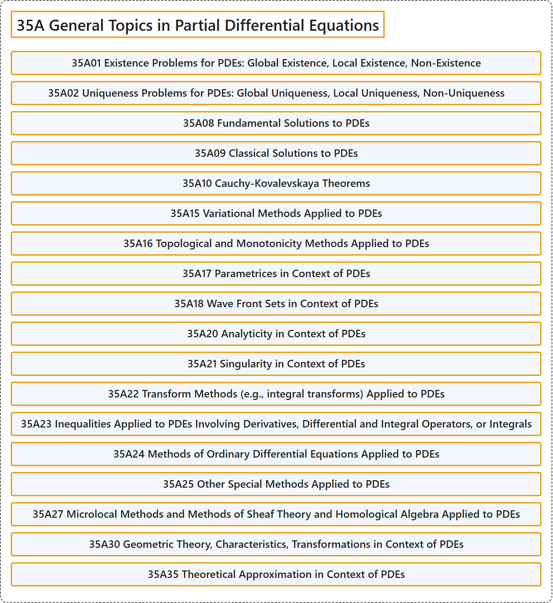

# 35A General Topics in Partial Differential Equations

## Classification

## Glossary

| Term | Definition | 中文翻译 | Source |
|---|---|---|---|
| **35A General Topics in Partial Differential Equations** 偏微分方程一般专题 | (No definition) | （无定义） | [Associate Editors of Mathematical Reviews and zbMATH, 2020](https://msc2020.org/) |
| **35A01 Existence Problems for PDEs: Global Existence, Local Existence, Non-Existence** PDE 的存在性问题：整体存在性、局部存在性、不存在性 | (No definition) | （无定义） | [Associate Editors of Mathematical Reviews and zbMATH, 2020](https://msc2020.org/) |
| **35A02 Uniqueness Problems for PDEs: Global Uniqueness, Local Uniqueness, Non-Uniqueness** PDE 的唯一性问题：整体唯一性、局部唯一性、非唯一性 | (No definition) | （无定义） | [Associate Editors of Mathematical Reviews and zbMATH, 2020](https://msc2020.org/) |
| **35A08 Fundamental Solutions to PDEs** PDE 的基本解 | (No definition) | （无定义） | [Associate Editors of Mathematical Reviews and zbMATH, 2020](https://msc2020.org/) |
| **35A09 Classical Solutions to PDEs** PDE 的经典解 | (No definition) | （无定义） | [Associate Editors of Mathematical Reviews and zbMATH, 2020](https://msc2020.org/) |
| **35A10 Cauchy-Kovalevskaya Theorems** 柯西-柯瓦列夫斯卡娅定理 | (No definition) | （无定义） | [Associate Editors of Mathematical Reviews and zbMATH, 2020](https://msc2020.org/) |
| **35A15 Variational Methods Applied to PDEs** 应用于 PDE 的变分方法 | (No definition) | （无定义） | [Associate Editors of Mathematical Reviews and zbMATH, 2020](https://msc2020.org/) |
| **35A16 Topological and Monotonicity Methods Applied to PDEs** 应用于 PDE 的拓扑方法与单调性方法 | (No definition) | （无定义） | [Associate Editors of Mathematical Reviews and zbMATH, 2020](https://msc2020.org/) |
| **35A17 Parametrices in Context of PDEs** PDE 中的拟基本解 | (No definition) | （无定义） | [Associate Editors of Mathematical Reviews and zbMATH, 2020](https://msc2020.org/) |
| **35A18 Wave Front Sets in Context of PDEs** PDE 中的波前集 | (No definition) | （无定义） | [Associate Editors of Mathematical Reviews and zbMATH, 2020](https://msc2020.org/) |
| **35A20 Analyticity in Context of PDEs** PDE 中的解析性 | (No definition) | （无定义） | [Associate Editors of Mathematical Reviews and zbMATH, 2020](https://msc2020.org/) |
| **35A21 Singularity in Context of PDEs** PDE 中的奇性 | (No definition) | （无定义） | [Associate Editors of Mathematical Reviews and zbMATH, 2020](https://msc2020.org/) |
| **35A22 Transform Methods (e.g., integral transforms) Applied to PDEs** 应用于 PDE 的变换方法（例如积分变换） | (No definition) | （无定义） | [Associate Editors of Mathematical Reviews and zbMATH, 2020](https://msc2020.org/) |
| **35A23 Inequalities Applied to PDEs Involving Derivatives, Differential and Integral Operators, or Integrals** 应用于 PDE 的涉及导数、微分算子与积分算子或积分的不等式 | (No definition) | （无定义） | [Associate Editors of Mathematical Reviews and zbMATH, 2020](https://msc2020.org/) |
| **35A24 Methods of Ordinary Differential Equations Applied to PDEs** 应用于 PDE 的常微分方程方法 | (No definition) | （无定义） | [Associate Editors of Mathematical Reviews and zbMATH, 2020](https://msc2020.org/) |
| **35A25 Other Special Methods Applied to PDEs** 应用于 PDE 的其他特殊方法 | (No definition) | （无定义） | [Associate Editors of Mathematical Reviews and zbMATH, 2020](https://msc2020.org/) |
| **35A27 Microlocal Methods and Methods of Sheaf Theory and Homological Algebra Applied to PDEs** 应用于 PDE 的微局部方法与层论及同调代数方法 | (No definition) | （无定义） | [Associate Editors of Mathematical Reviews and zbMATH, 2020](https://msc2020.org/) |
| **35A30 Geometric Theory, Characteristics, Transformations in Context of PDEs** PDE 中的几何理论，特征，变换 | (No definition) | （无定义） | [Associate Editors of Mathematical Reviews and zbMATH, 2020](https://msc2020.org/) |
| **35A35 Theoretical Approximation in Context of PDEs** PDE 中的理论逼近 | (No definition) | （无定义） | [Associate Editors of Mathematical Reviews and zbMATH, 2020](https://msc2020.org/) |

## References

Associate Editors of Mathematical Reviews and zbMATH. (2020). *MSC2020: Mathematics Subject Classification system*. Retrieved October 27, 2026, from <https://msc2020.org/>
