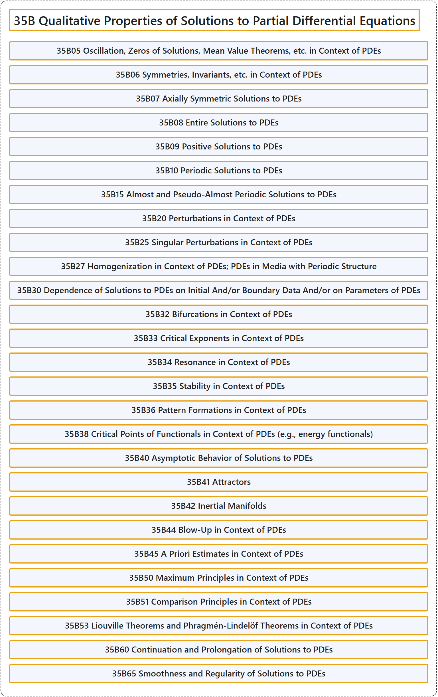

# 35B Qualitative Properties of Solutions to Partial Differential Equations

## Classification

## Glossary

| Term | Definition | 中文翻译 | Source |
|---|---|---|---|
| **35B Qualitative Properties of Solutions to Partial Differential Equations** 偏微分方程解的定性性质 | (No definition) | （无定义） | [Associate Editors of Mathematical Reviews and zbMATH, 2020](https://msc2020.org/) |
| **35B05 Oscillation, Zeros of Solutions, Mean Value Theorems, etc. in Context of PDEs** PDE 中的振动，解的零点，中值定理等 | (No definition) | （无定义） | [Associate Editors of Mathematical Reviews and zbMATH, 2020](https://msc2020.org/) |
| **35B06 Symmetries, Invariants, etc. in Context of PDEs** PDE 中的对称性，不变量等 | (No definition) | （无定义） | [Associate Editors of Mathematical Reviews and zbMATH, 2020](https://msc2020.org/) |
| **35B07 Axially Symmetric Solutions to PDEs** PDE 的轴对称解 | (No definition) | （无定义） | [Associate Editors of Mathematical Reviews and zbMATH, 2020](https://msc2020.org/) |
| **35B08 Entire Solutions to PDEs** PDE 的整解 | (No definition) | （无定义） | [Associate Editors of Mathematical Reviews and zbMATH, 2020](https://msc2020.org/) |
| **35B09 Positive Solutions to PDEs** PDE 的正解 | (No definition) | （无定义） | [Associate Editors of Mathematical Reviews and zbMATH, 2020](https://msc2020.org/) |
| **35B10 Periodic Solutions to PDEs** PDE 的周期解 | (No definition) | （无定义） | [Associate Editors of Mathematical Reviews and zbMATH, 2020](https://msc2020.org/) |
| **35B15 Almost and Pseudo-Almost Periodic Solutions to PDEs** PDE 的几乎周期解与伪几乎周期解 | (No definition) | （无定义） | [Associate Editors of Mathematical Reviews and zbMATH, 2020](https://msc2020.org/) |
| **35B20 Perturbations in Context of PDEs** PDE 中的扰动 | (No definition) | （无定义） | [Associate Editors of Mathematical Reviews and zbMATH, 2020](https://msc2020.org/) |
| **35B25 Singular Perturbations in Context of PDEs** PDE 中的奇异摄动 | (No definition) | （无定义） | [Associate Editors of Mathematical Reviews and zbMATH, 2020](https://msc2020.org/) |
| **35B27 Homogenization in Context of PDEs; PDEs in Media with Periodic Structure** PDE 中的均匀化；周期结构介质中的 PDE | (No definition) | （无定义） | [Associate Editors of Mathematical Reviews and zbMATH, 2020](https://msc2020.org/) |
| **35B30 Dependence of Solutions to PDEs on Initial And/or Boundary Data And/or on Parameters of PDEs** PDE 的解对初值、边值及 PDE 参数的依赖性 | (No definition) | （无定义） | [Associate Editors of Mathematical Reviews and zbMATH, 2020](https://msc2020.org/) |
| **35B32 Bifurcations in Context of PDEs** PDE 中的分岔 | (No definition) | （无定义） | [Associate Editors of Mathematical Reviews and zbMATH, 2020](https://msc2020.org/) |
| **35B33 Critical Exponents in Context of PDEs** PDE 中的临界指数 | (No definition) | （无定义） | [Associate Editors of Mathematical Reviews and zbMATH, 2020](https://msc2020.org/) |
| **35B34 Resonance in Context of PDEs** PDE 中的共振 | (No definition) | （无定义） | [Associate Editors of Mathematical Reviews and zbMATH, 2020](https://msc2020.org/) |
| **35B35 Stability in Context of PDEs** PDE 中的稳定性 | (No definition) | （无定义） | [Associate Editors of Mathematical Reviews and zbMATH, 2020](https://msc2020.org/) |
| **35B36 Pattern Formations in Context of PDEs** PDE 中的图案形成 | (No definition) | （无定义） | [Associate Editors of Mathematical Reviews and zbMATH, 2020](https://msc2020.org/) |
| **35B38 Critical Points of Functionals in Context of PDEs (e.g., energy functionals)** PDE 中泛函的临界点（例如能量泛函） | (No definition) | （无定义） | [Associate Editors of Mathematical Reviews and zbMATH, 2020](https://msc2020.org/) |
| **35B40 Asymptotic Behavior of Solutions to PDEs** PDE 解的渐近行为 | (No definition) | （无定义） | [Associate Editors of Mathematical Reviews and zbMATH, 2020](https://msc2020.org/) |
| **35B41 Attractors** 吸引子 | (No definition) | （无定义） | [Associate Editors of Mathematical Reviews and zbMATH, 2020](https://msc2020.org/) |
| **35B42 Inertial Manifolds** 惯性流形 | (No definition) | （无定义） | [Associate Editors of Mathematical Reviews and zbMATH, 2020](https://msc2020.org/) |
| **35B44 Blow-Up in Context of PDEs** PDE 中的爆破 | (No definition) | （无定义） | [Associate Editors of Mathematical Reviews and zbMATH, 2020](https://msc2020.org/) |
| **35B45 A Priori Estimates in Context of PDEs** PDE 中的先验估计 | (No definition) | （无定义） | [Associate Editors of Mathematical Reviews and zbMATH, 2020](https://msc2020.org/) |
| **35B50 Maximum Principles in Context of PDEs** PDE 中的极大值原理 | (No definition) | （无定义） | [Associate Editors of Mathematical Reviews and zbMATH, 2020](https://msc2020.org/) |
| **35B51 Comparison Principles in Context of PDEs** PDE 中的比较原理 | (No definition) | （无定义） | [Associate Editors of Mathematical Reviews and zbMATH, 2020](https://msc2020.org/) |
| **35B53 Liouville Theorems and Phragmén-Lindelöf Theorems in Context of PDEs** PDE 中的刘维尔定理与弗拉格门-林德勒夫定理 | (No definition) | （无定义） | [Associate Editors of Mathematical Reviews and zbMATH, 2020](https://msc2020.org/) |
| **35B60 Continuation and Prolongation of Solutions to PDEs** PDE 解的延拓与延伸 | (No definition) | （无定义） | [Associate Editors of Mathematical Reviews and zbMATH, 2020](https://msc2020.org/) |
| **35B65 Smoothness and Regularity of Solutions to PDEs** PDE 解的光滑性与正则性 | (No definition) | （无定义） | [Associate Editors of Mathematical Reviews and zbMATH, 2020](https://msc2020.org/) |

## References

Associate Editors of Mathematical Reviews and zbMATH. (2020). *MSC2020: Mathematics Subject Classification system*. Retrieved October 27, 2026, from <https://msc2020.org/>
