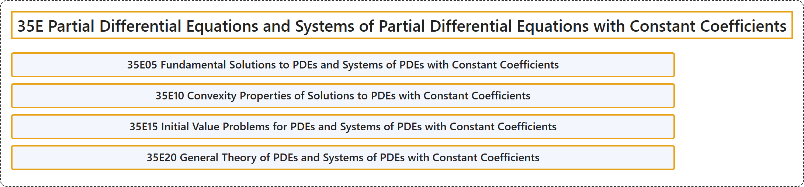

# 35E Partial Differential Equations and Systems of Partial Differential Equations with Constant Coefficients

## Classification

## Glossary

| Term | Definition | 中文翻译 | Source |
|---|---|---|---|
| **35E Partial Differential Equations and Systems of Partial Differential Equations with Constant Coefficients** 常系数偏微分方程与偏微分方程组 | (No definition) | （无定义） | [Associate Editors of Mathematical Reviews and zbMATH, 2020](https://msc2020.org/) |
| **35E05 Fundamental Solutions to PDEs and Systems of PDEs with Constant Coefficients** 常系数 PDE 与 PDE 方程组的基本解 | (No definition) | （无定义） | [Associate Editors of Mathematical Reviews and zbMATH, 2020](https://msc2020.org/) |
| **35E10 Convexity Properties of Solutions to PDEs with Constant Coefficients** 常系数 PDE 解的凸性 | (No definition) | （无定义） | [Associate Editors of Mathematical Reviews and zbMATH, 2020](https://msc2020.org/) |
| **35E15 Initial Value Problems for PDEs and Systems of PDEs with Constant Coefficients** 常系数 PDE 与 PDE 方程组的初值问题 | (No definition) | （无定义） | [Associate Editors of Mathematical Reviews and zbMATH, 2020](https://msc2020.org/) |
| **35E20 General Theory of PDEs and Systems of PDEs with Constant Coefficients** 常系数 PDE 与 PDE 方程组的一般理论 | (No definition) | （无定义） | [Associate Editors of Mathematical Reviews and zbMATH, 2020](https://msc2020.org/) |

## References

Associate Editors of Mathematical Reviews and zbMATH. (2020). *MSC2020: Mathematics Subject Classification system*. Retrieved October 27, 2026, from <https://msc2020.org/>
