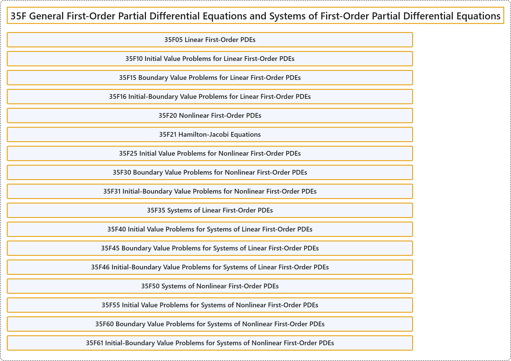

# 35F General First-Order Partial Differential Equations and Systems of First-Order Partial Differential Equations

## Classification

## Glossary

| Term | Definition | 中文翻译 | Source |
|---|---|---|---|
| **35F General First-Order Partial Differential Equations and Systems of First-Order Partial Differential Equations** 一般一阶偏微分方程与一阶偏微分方程组 | (No definition) | （无定义） | [Associate Editors of Mathematical Reviews and zbMATH, 2020](https://msc2020.org/) |
| **35F05 Linear First-Order PDEs** 线性一阶 PDE | (No definition) | （无定义） | [Associate Editors of Mathematical Reviews and zbMATH, 2020](https://msc2020.org/) |
| **35F10 Initial Value Problems for Linear First-Order PDEs** 线性一阶 PDE 的初值问题 | (No definition) | （无定义） | [Associate Editors of Mathematical Reviews and zbMATH, 2020](https://msc2020.org/) |
| **35F15 Boundary Value Problems for Linear First-Order PDEs** 线性一阶 PDE 的边值问题 | (No definition) | （无定义） | [Associate Editors of Mathematical Reviews and zbMATH, 2020](https://msc2020.org/) |
| **35F16 Initial-Boundary Value Problems for Linear First-Order PDEs** 线性一阶 PDE 的初边值问题 | (No definition) | （无定义） | [Associate Editors of Mathematical Reviews and zbMATH, 2020](https://msc2020.org/) |
| **35F20 Nonlinear First-Order PDEs** 非线性一阶 PDE | (No definition) | （无定义） | [Associate Editors of Mathematical Reviews and zbMATH, 2020](https://msc2020.org/) |
| **35F21 Hamilton-Jacobi Equations** 哈密顿-雅可比方程 | (No definition) | （无定义） | [Associate Editors of Mathematical Reviews and zbMATH, 2020](https://msc2020.org/) |
| **35F25 Initial Value Problems for Nonlinear First-Order PDEs** 非线性一阶 PDE 的初值问题 | (No definition) | （无定义） | [Associate Editors of Mathematical Reviews and zbMATH, 2020](https://msc2020.org/) |
| **35F30 Boundary Value Problems for Nonlinear First-Order PDEs** 非线性一阶 PDE 的边值问题 | (No definition) | （无定义） | [Associate Editors of Mathematical Reviews and zbMATH, 2020](https://msc2020.org/) |
| **35F31 Initial-Boundary Value Problems for Nonlinear First-Order PDEs** 非线性一阶 PDE 的初边值问题 | (No definition) | （无定义） | [Associate Editors of Mathematical Reviews and zbMATH, 2020](https://msc2020.org/) |
| **35F35 Systems of Linear First-Order PDEs** 线性一阶 PDE 方程组 | (No definition) | （无定义） | [Associate Editors of Mathematical Reviews and zbMATH, 2020](https://msc2020.org/) |
| **35F40 Initial Value Problems for Systems of Linear First-Order PDEs** 线性一阶 PDE 方程组的初值问题 | (No definition) | （无定义） | [Associate Editors of Mathematical Reviews and zbMATH, 2020](https://msc2020.org/) |
| **35F45 Boundary Value Problems for Systems of Linear First-Order PDEs** 线性一阶 PDE 方程组的边值问题 | (No definition) | （无定义） | [Associate Editors of Mathematical Reviews and zbMATH, 2020](https://msc2020.org/) |
| **35F46 Initial-Boundary Value Problems for Systems of Linear First-Order PDEs** 线性一阶 PDE 方程组的初边值问题 | (No definition) | （无定义） | [Associate Editors of Mathematical Reviews and zbMATH, 2020](https://msc2020.org/) |
| **35F50 Systems of Nonlinear First-Order PDEs** 非线性一阶 PDE 方程组 | (No definition) | （无定义） | [Associate Editors of Mathematical Reviews and zbMATH, 2020](https://msc2020.org/) |
| **35F55 Initial Value Problems for Systems of Nonlinear First-Order PDEs** 非线性一阶 PDE 方程组的初值问题 | (No definition) | （无定义） | [Associate Editors of Mathematical Reviews and zbMATH, 2020](https://msc2020.org/) |
| **35F60 Boundary Value Problems for Systems of Nonlinear First-Order PDEs** 非线性一阶 PDE 方程组的边值问题 | (No definition) | （无定义） | [Associate Editors of Mathematical Reviews and zbMATH, 2020](https://msc2020.org/) |
| **35F61 Initial-Boundary Value Problems for Systems of Nonlinear First-Order PDEs** 非线性一阶 PDE 方程组的初边值问题 | (No definition) | （无定义） | [Associate Editors of Mathematical Reviews and zbMATH, 2020](https://msc2020.org/) |

## References

Associate Editors of Mathematical Reviews and zbMATH. (2020). *MSC2020: Mathematics Subject Classification system*. Retrieved October 27, 2026, from <https://msc2020.org/>
