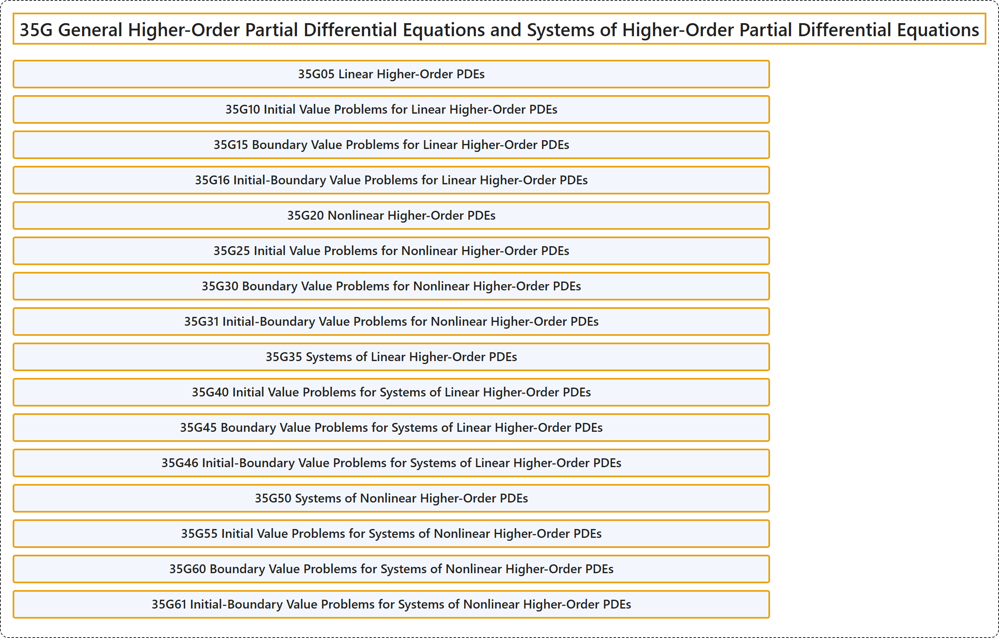

# 35G General Higher-Order Partial Differential Equations and Systems of Higher-Order Partial Differential Equations

## Classification

## Glossary

| Term | Definition | 中文翻译 | Source |
|---|---|---|---|
| **35G General Higher-Order Partial Differential Equations and Systems of Higher-Order Partial Differential Equations** 一般高阶偏微分方程与高阶偏微分方程组 | (No definition) | （无定义） | [Associate Editors of Mathematical Reviews and zbMATH, 2020](https://msc2020.org/) |
| **35G05 Linear Higher-Order PDEs** 线性高阶 PDE | (No definition) | （无定义） | [Associate Editors of Mathematical Reviews and zbMATH, 2020](https://msc2020.org/) |
| **35G10 Initial Value Problems for Linear Higher-Order PDEs** 线性高阶 PDE 的初值问题 | (No definition) | （无定义） | [Associate Editors of Mathematical Reviews and zbMATH, 2020](https://msc2020.org/) |
| **35G15 Boundary Value Problems for Linear Higher-Order PDEs** 线性高阶 PDE 的边值问题 | (No definition) | （无定义） | [Associate Editors of Mathematical Reviews and zbMATH, 2020](https://msc2020.org/) |
| **35G16 Initial-Boundary Value Problems for Linear Higher-Order PDEs** 线性高阶 PDE 的初边值问题 | (No definition) | （无定义） | [Associate Editors of Mathematical Reviews and zbMATH, 2020](https://msc2020.org/) |
| **35G20 Nonlinear Higher-Order PDEs** 非线性高阶 PDE | (No definition) | （无定义） | [Associate Editors of Mathematical Reviews and zbMATH, 2020](https://msc2020.org/) |
| **35G25 Initial Value Problems for Nonlinear Higher-Order PDEs** 非线性高阶 PDE 的初值问题 | (No definition) | （无定义） | [Associate Editors of Mathematical Reviews and zbMATH, 2020](https://msc2020.org/) |
| **35G30 Boundary Value Problems for Nonlinear Higher-Order PDEs** 非线性高阶 PDE 的边值问题 | (No definition) | （无定义） | [Associate Editors of Mathematical Reviews and zbMATH, 2020](https://msc2020.org/) |
| **35G31 Initial-Boundary Value Problems for Nonlinear Higher-Order PDEs** 非线性高阶 PDE 的初边值问题 | (No definition) | （无定义） | [Associate Editors of Mathematical Reviews and zbMATH, 2020](https://msc2020.org/) |
| **35G35 Systems of Linear Higher-Order PDEs** 线性高阶 PDE 方程组 | (No definition) | （无定义） | [Associate Editors of Mathematical Reviews and zbMATH, 2020](https://msc2020.org/) |
| **35G40 Initial Value Problems for Systems of Linear Higher-Order PDEs** 线性高阶 PDE 方程组的初值问题 | (No definition) | （无定义） | [Associate Editors of Mathematical Reviews and zbMATH, 2020](https://msc2020.org/) |
| **35G45 Boundary Value Problems for Systems of Linear Higher-Order PDEs** 线性高阶 PDE 方程组的边值问题 | (No definition) | （无定义） | [Associate Editors of Mathematical Reviews and zbMATH, 2020](https://msc2020.org/) |
| **35G46 Initial-Boundary Value Problems for Systems of Linear Higher-Order PDEs** 线性高阶 PDE 方程组的初边值问题 | (No definition) | （无定义） | [Associate Editors of Mathematical Reviews and zbMATH, 2020](https://msc2020.org/) |
| **35G50 Systems of Nonlinear Higher-Order PDEs** 非线性高阶 PDE 方程组 | (No definition) | （无定义） | [Associate Editors of Mathematical Reviews and zbMATH, 2020](https://msc2020.org/) |
| **35G55 Initial Value Problems for Systems of Nonlinear Higher-Order PDEs** 非线性高阶 PDE 方程组的初值问题 | (No definition) | （无定义） | [Associate Editors of Mathematical Reviews and zbMATH, 2020](https://msc2020.org/) |
| **35G60 Boundary Value Problems for Systems of Nonlinear Higher-Order PDEs** 非线性高阶 PDE 方程组的边值问题 | (No definition) | （无定义） | [Associate Editors of Mathematical Reviews and zbMATH, 2020](https://msc2020.org/) |
| **35G61 Initial-Boundary Value Problems for Systems of Nonlinear Higher-Order PDEs** 非线性高阶 PDE 方程组的初边值问题 | (No definition) | （无定义） | [Associate Editors of Mathematical Reviews and zbMATH, 2020](https://msc2020.org/) |

## References

Associate Editors of Mathematical Reviews and zbMATH. (2020). *MSC2020: Mathematics Subject Classification system*. Retrieved October 27, 2026, from <https://msc2020.org/>
