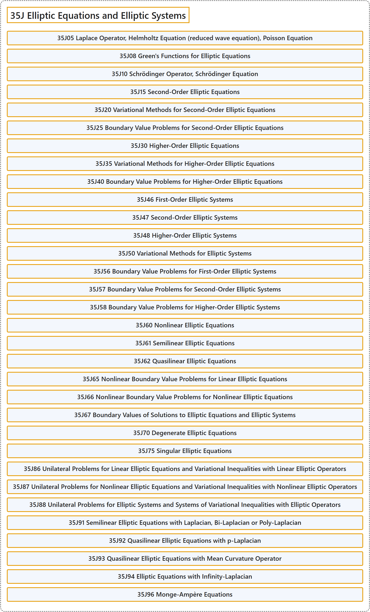

# 35J Elliptic Equations and Elliptic Systems

## Classification

## Glossary

| Term | Definition | 中文翻译 | Source |
|---|---|---|---|
| **35J Elliptic Equations and Elliptic Systems** 椭圆型方程与椭圆型方程组 | (No definition) | （无定义） | [Associate Editors of Mathematical Reviews and zbMATH, 2020](https://msc2020.org/) |
| **35J05 Laplace Operator, Helmholtz Equation (reduced wave equation), Poisson Equation** 拉普拉斯算子，亥姆霍兹方程（约化波动方程），泊松方程 | (No definition) | （无定义） | [Associate Editors of Mathematical Reviews and zbMATH, 2020](https://msc2020.org/) |
| **35J08 Green's Functions for Elliptic Equations** 椭圆方程的格林函数 | (No definition) | （无定义） | [Associate Editors of Mathematical Reviews and zbMATH, 2020](https://msc2020.org/) |
| **35J10 Schrödinger Operator, Schrödinger Equation** 薛定谔算子，薛定谔方程 | (No definition) | （无定义） | [Associate Editors of Mathematical Reviews and zbMATH, 2020](https://msc2020.org/) |
| **35J15 Second-Order Elliptic Equations** 二阶椭圆方程 | (No definition) | （无定义） | [Associate Editors of Mathematical Reviews and zbMATH, 2020](https://msc2020.org/) |
| **35J20 Variational Methods for Second-Order Elliptic Equations** 二阶椭圆方程的变分方法 | (No definition) | （无定义） | [Associate Editors of Mathematical Reviews and zbMATH, 2020](https://msc2020.org/) |
| **35J25 Boundary Value Problems for Second-Order Elliptic Equations** 二阶椭圆方程的边值问题 | (No definition) | （无定义） | [Associate Editors of Mathematical Reviews and zbMATH, 2020](https://msc2020.org/) |
| **35J30 Higher-Order Elliptic Equations** 高阶椭圆方程 | (No definition) | （无定义） | [Associate Editors of Mathematical Reviews and zbMATH, 2020](https://msc2020.org/) |
| **35J35 Variational Methods for Higher-Order Elliptic Equations** 高阶椭圆方程的变分方法 | (No definition) | （无定义） | [Associate Editors of Mathematical Reviews and zbMATH, 2020](https://msc2020.org/) |
| **35J40 Boundary Value Problems for Higher-Order Elliptic Equations** 高阶椭圆方程的边值问题 | (No definition) | （无定义） | [Associate Editors of Mathematical Reviews and zbMATH, 2020](https://msc2020.org/) |
| **35J46 First-Order Elliptic Systems** 一阶椭圆方程组 | (No definition) | （无定义） | [Associate Editors of Mathematical Reviews and zbMATH, 2020](https://msc2020.org/) |
| **35J47 Second-Order Elliptic Systems** 二阶椭圆方程组 | (No definition) | （无定义） | [Associate Editors of Mathematical Reviews and zbMATH, 2020](https://msc2020.org/) |
| **35J48 Higher-Order Elliptic Systems** 高阶椭圆方程组 | (No definition) | （无定义） | [Associate Editors of Mathematical Reviews and zbMATH, 2020](https://msc2020.org/) |
| **35J50 Variational Methods for Elliptic Systems** 椭圆方程组的变分方法 | (No definition) | （无定义） | [Associate Editors of Mathematical Reviews and zbMATH, 2020](https://msc2020.org/) |
| **35J56 Boundary Value Problems for First-Order Elliptic Systems** 一阶椭圆方程组的边值问题 | (No definition) | （无定义） | [Associate Editors of Mathematical Reviews and zbMATH, 2020](https://msc2020.org/) |
| **35J57 Boundary Value Problems for Second-Order Elliptic Systems** 二阶椭圆方程组的边值问题 | (No definition) | （无定义） | [Associate Editors of Mathematical Reviews and zbMATH, 2020](https://msc2020.org/) |
| **35J58 Boundary Value Problems for Higher-Order Elliptic Systems** 高阶椭圆方程组的边值问题 | (No definition) | （无定义） | [Associate Editors of Mathematical Reviews and zbMATH, 2020](https://msc2020.org/) |
| **35J60 Nonlinear Elliptic Equations** 非线性椭圆方程 | (No definition) | （无定义） | [Associate Editors of Mathematical Reviews and zbMATH, 2020](https://msc2020.org/) |
| **35J61 Semilinear Elliptic Equations** 半线性椭圆方程 | (No definition) | （无定义） | [Associate Editors of Mathematical Reviews and zbMATH, 2020](https://msc2020.org/) |
| **35J62 Quasilinear Elliptic Equations** 拟线性椭圆方程 | (No definition) | （无定义） | [Associate Editors of Mathematical Reviews and zbMATH, 2020](https://msc2020.org/) |
| **35J65 Nonlinear Boundary Value Problems for Linear Elliptic Equations** 线性椭圆方程的非线性边值问题 | (No definition) | （无定义） | [Associate Editors of Mathematical Reviews and zbMATH, 2020](https://msc2020.org/) |
| **35J66 Nonlinear Boundary Value Problems for Nonlinear Elliptic Equations** 非线性椭圆方程的非线性边值问题 | (No definition) | （无定义） | [Associate Editors of Mathematical Reviews and zbMATH, 2020](https://msc2020.org/) |
| **35J67 Boundary Values of Solutions to Elliptic Equations and Elliptic Systems** 椭圆方程与椭圆方程组解的边值 | (No definition) | （无定义） | [Associate Editors of Mathematical Reviews and zbMATH, 2020](https://msc2020.org/) |
| **35J70 Degenerate Elliptic Equations** 退化椭圆方程 | (No definition) | （无定义） | [Associate Editors of Mathematical Reviews and zbMATH, 2020](https://msc2020.org/) |
| **35J75 Singular Elliptic Equations** 奇异椭圆方程 | (No definition) | （无定义） | [Associate Editors of Mathematical Reviews and zbMATH, 2020](https://msc2020.org/) |
| **35J86 Unilateral Problems for Linear Elliptic Equations and Variational Inequalities with Linear Elliptic Operators** 线性椭圆方程的单边问题与带线性椭圆算子的变分不等式 | (No definition) | （无定义） | [Associate Editors of Mathematical Reviews and zbMATH, 2020](https://msc2020.org/) |
| **35J87 Unilateral Problems for Nonlinear Elliptic Equations and Variational Inequalities with Nonlinear Elliptic Operators** 非线性椭圆方程的单边问题与带非线性椭圆算子的变分不等式 | (No definition) | （无定义） | [Associate Editors of Mathematical Reviews and zbMATH, 2020](https://msc2020.org/) |
| **35J88 Unilateral Problems for Elliptic Systems and Systems of Variational Inequalities with Elliptic Operators** 椭圆方程组的单边问题与带椭圆算子的变分不等式组 | (No definition) | （无定义） | [Associate Editors of Mathematical Reviews and zbMATH, 2020](https://msc2020.org/) |
| **35J91 Semilinear Elliptic Equations with Laplacian, Bi-Laplacian or Poly-Laplacian** 带拉普拉斯算子、双拉普拉斯算子或多重拉普拉斯算子的半线性椭圆方程 | (No definition) | （无定义） | [Associate Editors of Mathematical Reviews and zbMATH, 2020](https://msc2020.org/) |
| **35J92 Quasilinear Elliptic Equations with p-Laplacian** 带 p-拉普拉斯算子的拟线性椭圆方程 | (No definition) | （无定义） | [Associate Editors of Mathematical Reviews and zbMATH, 2020](https://msc2020.org/) |
| **35J93 Quasilinear Elliptic Equations with Mean Curvature Operator** 带平均曲率算子的拟线性椭圆方程 | (No definition) | （无定义） | [Associate Editors of Mathematical Reviews and zbMATH, 2020](https://msc2020.org/) |
| **35J94 Elliptic Equations with Infinity-Laplacian** 带无穷拉普拉斯算子的椭圆方程 | (No definition) | （无定义） | [Associate Editors of Mathematical Reviews and zbMATH, 2020](https://msc2020.org/) |
| **35J96 Monge-Ampère Equations** 蒙日-安培方程 | (No definition) | （无定义） | [Associate Editors of Mathematical Reviews and zbMATH, 2020](https://msc2020.org/) |

## References

Associate Editors of Mathematical Reviews and zbMATH. (2020). *MSC2020: Mathematics Subject Classification system*. Retrieved October 27, 2026, from <https://msc2020.org/>
