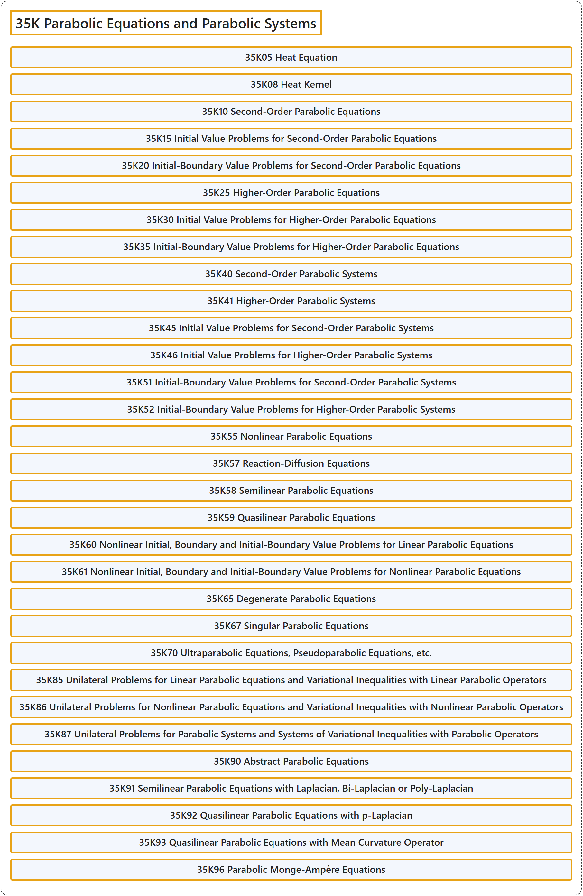

# 35K Parabolic Equations and Parabolic Systems

## Classification

## Glossary

| Term | Definition | 中文翻译 | Source |
|---|---|---|---|
| **35K Parabolic Equations and Parabolic Systems** 抛物型方程与抛物型方程组 | (No definition) | （无定义） | [Associate Editors of Mathematical Reviews and zbMATH, 2020](https://msc2020.org/) |
| **35K05 Heat Equation** 热方程 | (No definition) | （无定义） | [Associate Editors of Mathematical Reviews and zbMATH, 2020](https://msc2020.org/) |
| **35K08 Heat Kernel** 热核 | (No definition) | （无定义） | [Associate Editors of Mathematical Reviews and zbMATH, 2020](https://msc2020.org/) |
| **35K10 Second-Order Parabolic Equations** 二阶抛物方程 | (No definition) | （无定义） | [Associate Editors of Mathematical Reviews and zbMATH, 2020](https://msc2020.org/) |
| **35K15 Initial Value Problems for Second-Order Parabolic Equations** 二阶抛物方程的初值问题 | (No definition) | （无定义） | [Associate Editors of Mathematical Reviews and zbMATH, 2020](https://msc2020.org/) |
| **35K20 Initial-Boundary Value Problems for Second-Order Parabolic Equations** 二阶抛物方程的初边值问题 | (No definition) | （无定义） | [Associate Editors of Mathematical Reviews and zbMATH, 2020](https://msc2020.org/) |
| **35K25 Higher-Order Parabolic Equations** 高阶抛物方程 | (No definition) | （无定义） | [Associate Editors of Mathematical Reviews and zbMATH, 2020](https://msc2020.org/) |
| **35K30 Initial Value Problems for Higher-Order Parabolic Equations** 高阶抛物方程的初值问题 | (No definition) | （无定义） | [Associate Editors of Mathematical Reviews and zbMATH, 2020](https://msc2020.org/) |
| **35K35 Initial-Boundary Value Problems for Higher-Order Parabolic Equations** 高阶抛物方程的初边值问题 | (No definition) | （无定义） | [Associate Editors of Mathematical Reviews and zbMATH, 2020](https://msc2020.org/) |
| **35K40 Second-Order Parabolic Systems** 二阶抛物方程组 | (No definition) | （无定义） | [Associate Editors of Mathematical Reviews and zbMATH, 2020](https://msc2020.org/) |
| **35K41 Higher-Order Parabolic Systems** 高阶抛物方程组 | (No definition) | （无定义） | [Associate Editors of Mathematical Reviews and zbMATH, 2020](https://msc2020.org/) |
| **35K45 Initial Value Problems for Second-Order Parabolic Systems** 二阶抛物方程组的初值问题 | (No definition) | （无定义） | [Associate Editors of Mathematical Reviews and zbMATH, 2020](https://msc2020.org/) |
| **35K46 Initial Value Problems for Higher-Order Parabolic Systems** 高阶抛物方程组的初值问题 | (No definition) | （无定义） | [Associate Editors of Mathematical Reviews and zbMATH, 2020](https://msc2020.org/) |
| **35K51 Initial-Boundary Value Problems for Second-Order Parabolic Systems** 二阶抛物方程组的初边值问题 | (No definition) | （无定义） | [Associate Editors of Mathematical Reviews and zbMATH, 2020](https://msc2020.org/) |
| **35K52 Initial-Boundary Value Problems for Higher-Order Parabolic Systems** 高阶抛物方程组的初边值问题 | (No definition) | （无定义） | [Associate Editors of Mathematical Reviews and zbMATH, 2020](https://msc2020.org/) |
| **35K55 Nonlinear Parabolic Equations** 非线性抛物方程 | (No definition) | （无定义） | [Associate Editors of Mathematical Reviews and zbMATH, 2020](https://msc2020.org/) |
| **35K57 Reaction-Diffusion Equations** 反应扩散方程 | (No definition) | （无定义） | [Associate Editors of Mathematical Reviews and zbMATH, 2020](https://msc2020.org/) |
| **35K58 Semilinear Parabolic Equations** 半线性抛物方程 | (No definition) | （无定义） | [Associate Editors of Mathematical Reviews and zbMATH, 2020](https://msc2020.org/) |
| **35K59 Quasilinear Parabolic Equations** 拟线性抛物方程 | (No definition) | （无定义） | [Associate Editors of Mathematical Reviews and zbMATH, 2020](https://msc2020.org/) |
| **35K60 Nonlinear Initial, Boundary and Initial-Boundary Value Problems for Linear Parabolic Equations** 线性抛物方程的非线性初值问题、边值问题与初边值问题 | (No definition) | （无定义） | [Associate Editors of Mathematical Reviews and zbMATH, 2020](https://msc2020.org/) |
| **35K61 Nonlinear Initial, Boundary and Initial-Boundary Value Problems for Nonlinear Parabolic Equations** 非线性抛物方程的非线性初值问题、边值问题与初边值问题 | (No definition) | （无定义） | [Associate Editors of Mathematical Reviews and zbMATH, 2020](https://msc2020.org/) |
| **35K65 Degenerate Parabolic Equations** 退化抛物方程 | (No definition) | （无定义） | [Associate Editors of Mathematical Reviews and zbMATH, 2020](https://msc2020.org/) |
| **35K67 Singular Parabolic Equations** 奇异抛物方程 | (No definition) | （无定义） | [Associate Editors of Mathematical Reviews and zbMATH, 2020](https://msc2020.org/) |
| **35K70 Ultraparabolic Equations, Pseudoparabolic Equations, etc.** 超抛物方程，伪抛物方程等 | (No definition) | （无定义） | [Associate Editors of Mathematical Reviews and zbMATH, 2020](https://msc2020.org/) |
| **35K85 Unilateral Problems for Linear Parabolic Equations and Variational Inequalities with Linear Parabolic Operators** 线性抛物方程的单边问题与带线性抛物算子的变分不等式 | (No definition) | （无定义） | [Associate Editors of Mathematical Reviews and zbMATH, 2020](https://msc2020.org/) |
| **35K86 Unilateral Problems for Nonlinear Parabolic Equations and Variational Inequalities with Nonlinear Parabolic Operators** 非线性抛物方程的单边问题与带非线性抛物算子的变分不等式 | (No definition) | （无定义） | [Associate Editors of Mathematical Reviews and zbMATH, 2020](https://msc2020.org/) |
| **35K87 Unilateral Problems for Parabolic Systems and Systems of Variational Inequalities with Parabolic Operators** 抛物方程组的单边问题与带抛物算子的变分不等式组 | (No definition) | （无定义） | [Associate Editors of Mathematical Reviews and zbMATH, 2020](https://msc2020.org/) |
| **35K90 Abstract Parabolic Equations** 抽象抛物方程 | (No definition) | （无定义） | [Associate Editors of Mathematical Reviews and zbMATH, 2020](https://msc2020.org/) |
| **35K91 Semilinear Parabolic Equations with Laplacian, Bi-Laplacian or Poly-Laplacian** 带拉普拉斯算子、双拉普拉斯算子或多重拉普拉斯算子的半线性抛物方程 | (No definition) | （无定义） | [Associate Editors of Mathematical Reviews and zbMATH, 2020](https://msc2020.org/) |
| **35K92 Quasilinear Parabolic Equations with p-Laplacian** 带 p-拉普拉斯算子的拟线性抛物方程 | (No definition) | （无定义） | [Associate Editors of Mathematical Reviews and zbMATH, 2020](https://msc2020.org/) |
| **35K93 Quasilinear Parabolic Equations with Mean Curvature Operator** 带平均曲率算子的拟线性抛物方程 | (No definition) | （无定义） | [Associate Editors of Mathematical Reviews and zbMATH, 2020](https://msc2020.org/) |
| **35K96 Parabolic Monge-Ampère Equations** 抛物蒙日-安培方程 | (No definition) | （无定义） | [Associate Editors of Mathematical Reviews and zbMATH, 2020](https://msc2020.org/) |

## References

Associate Editors of Mathematical Reviews and zbMATH. (2020). *MSC2020: Mathematics Subject Classification system*. Retrieved October 27, 2026, from <https://msc2020.org/>
