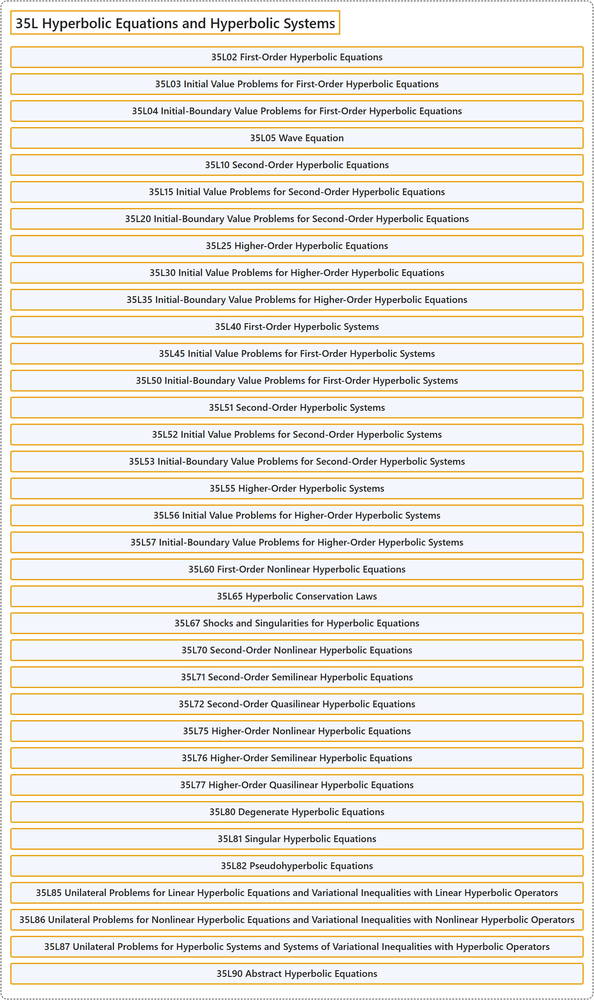

# 35L Hyperbolic Equations and Hyperbolic Systems

## Classification

## Glossary

| Term | Definition | 中文翻译 | Source |
|---|---|---|---|
| **35L Hyperbolic Equations and Hyperbolic Systems** 双曲型方程与双曲型方程组 | (No definition) | （无定义） | [Associate Editors of Mathematical Reviews and zbMATH, 2020](https://msc2020.org/) |
| **35L02 First-Order Hyperbolic Equations** 一阶双曲方程 | (No definition) | （无定义） | [Associate Editors of Mathematical Reviews and zbMATH, 2020](https://msc2020.org/) |
| **35L03 Initial Value Problems for First-Order Hyperbolic Equations** 一阶双曲方程的初值问题 | (No definition) | （无定义） | [Associate Editors of Mathematical Reviews and zbMATH, 2020](https://msc2020.org/) |
| **35L04 Initial-Boundary Value Problems for First-Order Hyperbolic Equations** 一阶双曲方程的初边值问题 | (No definition) | （无定义） | [Associate Editors of Mathematical Reviews and zbMATH, 2020](https://msc2020.org/) |
| **35L05 Wave Equation** 波动方程 | (No definition) | （无定义） | [Associate Editors of Mathematical Reviews and zbMATH, 2020](https://msc2020.org/) |
| **35L10 Second-Order Hyperbolic Equations** 二阶双曲方程 | (No definition) | （无定义） | [Associate Editors of Mathematical Reviews and zbMATH, 2020](https://msc2020.org/) |
| **35L15 Initial Value Problems for Second-Order Hyperbolic Equations** 二阶双曲方程的初值问题 | (No definition) | （无定义） | [Associate Editors of Mathematical Reviews and zbMATH, 2020](https://msc2020.org/) |
| **35L20 Initial-Boundary Value Problems for Second-Order Hyperbolic Equations** 二阶双曲方程的初边值问题 | (No definition) | （无定义） | [Associate Editors of Mathematical Reviews and zbMATH, 2020](https://msc2020.org/) |
| **35L25 Higher-Order Hyperbolic Equations** 高阶双曲方程 | (No definition) | （无定义） | [Associate Editors of Mathematical Reviews and zbMATH, 2020](https://msc2020.org/) |
| **35L30 Initial Value Problems for Higher-Order Hyperbolic Equations** 高阶双曲方程的初值问题 | (No definition) | （无定义） | [Associate Editors of Mathematical Reviews and zbMATH, 2020](https://msc2020.org/) |
| **35L35 Initial-Boundary Value Problems for Higher-Order Hyperbolic Equations** 高阶双曲方程的初边值问题 | (No definition) | （无定义） | [Associate Editors of Mathematical Reviews and zbMATH, 2020](https://msc2020.org/) |
| **35L40 First-Order Hyperbolic Systems** 一阶双曲方程组 | (No definition) | （无定义） | [Associate Editors of Mathematical Reviews and zbMATH, 2020](https://msc2020.org/) |
| **35L45 Initial Value Problems for First-Order Hyperbolic Systems** 一阶双曲方程组的初值问题 | (No definition) | （无定义） | [Associate Editors of Mathematical Reviews and zbMATH, 2020](https://msc2020.org/) |
| **35L50 Initial-Boundary Value Problems for First-Order Hyperbolic Systems** 一阶双曲方程组的初边值问题 | (No definition) | （无定义） | [Associate Editors of Mathematical Reviews and zbMATH, 2020](https://msc2020.org/) |
| **35L51 Second-Order Hyperbolic Systems** 二阶双曲方程组 | (No definition) | （无定义） | [Associate Editors of Mathematical Reviews and zbMATH, 2020](https://msc2020.org/) |
| **35L52 Initial Value Problems for Second-Order Hyperbolic Systems** 二阶双曲方程组的初值问题 | (No definition) | （无定义） | [Associate Editors of Mathematical Reviews and zbMATH, 2020](https://msc2020.org/) |
| **35L53 Initial-Boundary Value Problems for Second-Order Hyperbolic Systems** 二阶双曲方程组的初边值问题 | (No definition) | （无定义） | [Associate Editors of Mathematical Reviews and zbMATH, 2020](https://msc2020.org/) |
| **35L55 Higher-Order Hyperbolic Systems** 高阶双曲方程组 | (No definition) | （无定义） | [Associate Editors of Mathematical Reviews and zbMATH, 2020](https://msc2020.org/) |
| **35L56 Initial Value Problems for Higher-Order Hyperbolic Systems** 高阶双曲方程组的初值问题 | (No definition) | （无定义） | [Associate Editors of Mathematical Reviews and zbMATH, 2020](https://msc2020.org/) |
| **35L57 Initial-Boundary Value Problems for Higher-Order Hyperbolic Systems** 高阶双曲方程组的初边值问题 | (No definition) | （无定义） | [Associate Editors of Mathematical Reviews and zbMATH, 2020](https://msc2020.org/) |
| **35L60 First-Order Nonlinear Hyperbolic Equations** 一阶非线性双曲方程 | (No definition) | （无定义） | [Associate Editors of Mathematical Reviews and zbMATH, 2020](https://msc2020.org/) |
| **35L65 Hyperbolic Conservation Laws** 双曲守恒律 | (No definition) | （无定义） | [Associate Editors of Mathematical Reviews and zbMATH, 2020](https://msc2020.org/) |
| **35L67 Shocks and Singularities for Hyperbolic Equations** 双曲方程的激波与奇性 | (No definition) | （无定义） | [Associate Editors of Mathematical Reviews and zbMATH, 2020](https://msc2020.org/) |
| **35L70 Second-Order Nonlinear Hyperbolic Equations** 二阶非线性双曲方程 | (No definition) | （无定义） | [Associate Editors of Mathematical Reviews and zbMATH, 2020](https://msc2020.org/) |
| **35L71 Second-Order Semilinear Hyperbolic Equations** 二阶半线性双曲方程 | (No definition) | （无定义） | [Associate Editors of Mathematical Reviews and zbMATH, 2020](https://msc2020.org/) |
| **35L72 Second-Order Quasilinear Hyperbolic Equations** 二阶拟线性双曲方程 | (No definition) | （无定义） | [Associate Editors of Mathematical Reviews and zbMATH, 2020](https://msc2020.org/) |
| **35L75 Higher-Order Nonlinear Hyperbolic Equations** 高阶非线性双曲方程 | (No definition) | （无定义） | [Associate Editors of Mathematical Reviews and zbMATH, 2020](https://msc2020.org/) |
| **35L76 Higher-Order Semilinear Hyperbolic Equations** 高阶半线性双曲方程 | (No definition) | （无定义） | [Associate Editors of Mathematical Reviews and zbMATH, 2020](https://msc2020.org/) |
| **35L77 Higher-Order Quasilinear Hyperbolic Equations** 高阶拟线性双曲方程 | (No definition) | （无定义） | [Associate Editors of Mathematical Reviews and zbMATH, 2020](https://msc2020.org/) |
| **35L80 Degenerate Hyperbolic Equations** 退化双曲方程 | (No definition) | （无定义） | [Associate Editors of Mathematical Reviews and zbMATH, 2020](https://msc2020.org/) |
| **35L81 Singular Hyperbolic Equations** 奇异双曲方程 | (No definition) | （无定义） | [Associate Editors of Mathematical Reviews and zbMATH, 2020](https://msc2020.org/) |
| **35L82 Pseudohyperbolic Equations** 伪双曲方程 | (No definition) | （无定义） | [Associate Editors of Mathematical Reviews and zbMATH, 2020](https://msc2020.org/) |
| **35L85 Unilateral Problems for Linear Hyperbolic Equations and Variational Inequalities with Linear Hyperbolic Operators** 线性双曲方程的单边问题与带线性双曲算子的变分不等式 | (No definition) | （无定义） | [Associate Editors of Mathematical Reviews and zbMATH, 2020](https://msc2020.org/) |
| **35L86 Unilateral Problems for Nonlinear Hyperbolic Equations and Variational Inequalities with Nonlinear Hyperbolic Operators** 非线性双曲方程的单边问题与带非线性双曲算子的变分不等式 | (No definition) | （无定义） | [Associate Editors of Mathematical Reviews and zbMATH, 2020](https://msc2020.org/) |
| **35L87 Unilateral Problems for Hyperbolic Systems and Systems of Variational Inequalities with Hyperbolic Operators** 双曲方程组的单边问题与带双曲算子的变分不等式组 | (No definition) | （无定义） | [Associate Editors of Mathematical Reviews and zbMATH, 2020](https://msc2020.org/) |
| **35L90 Abstract Hyperbolic Equations** 抽象双曲方程 | (No definition) | （无定义） | [Associate Editors of Mathematical Reviews and zbMATH, 2020](https://msc2020.org/) |

## References

Associate Editors of Mathematical Reviews and zbMATH. (2020). *MSC2020: Mathematics Subject Classification system*. Retrieved October 27, 2026, from <https://msc2020.org/>
