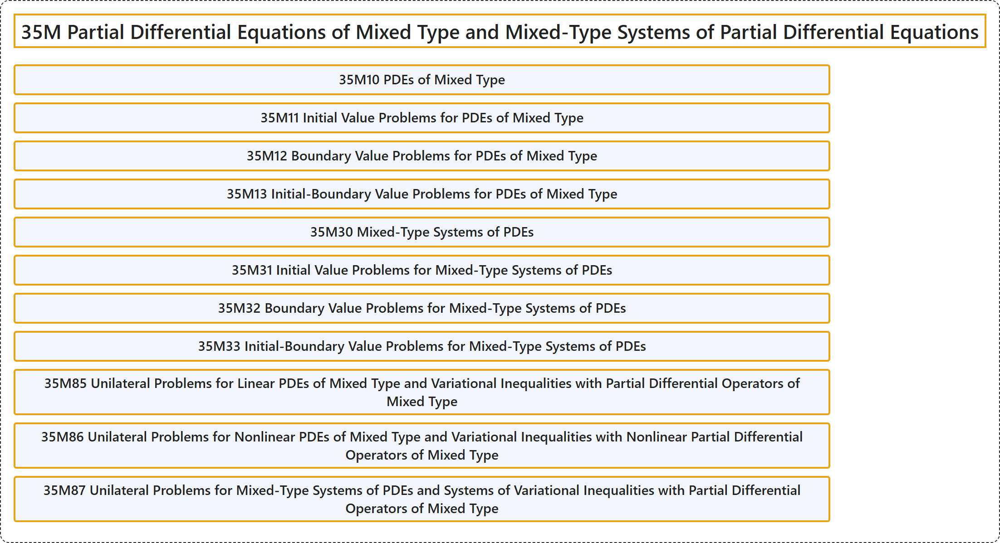

# 35M Partial Differential Equations of Mixed Type and Mixed-Type Systems of Partial Differential Equations

## Classification

## Glossary

| Term | Definition | 中文翻译 | Source |
|---|---|---|---|
| **35M Partial Differential Equations of Mixed Type and Mixed-Type Systems of Partial Differential Equations** 混合型偏微分方程与混合型偏微分方程组 | (No definition) | （无定义） | [Associate Editors of Mathematical Reviews and zbMATH, 2020](https://msc2020.org/) |
| **35M10 PDEs of Mixed Type** 混合型 PDE | (No definition) | （无定义） | [Associate Editors of Mathematical Reviews and zbMATH, 2020](https://msc2020.org/) |
| **35M11 Initial Value Problems for PDEs of Mixed Type** 混合型 PDE 的初值问题 | (No definition) | （无定义） | [Associate Editors of Mathematical Reviews and zbMATH, 2020](https://msc2020.org/) |
| **35M12 Boundary Value Problems for PDEs of Mixed Type** 混合型 PDE 的边值问题 | (No definition) | （无定义） | [Associate Editors of Mathematical Reviews and zbMATH, 2020](https://msc2020.org/) |
| **35M13 Initial-Boundary Value Problems for PDEs of Mixed Type** 混合型 PDE 的初边值问题 | (No definition) | （无定义） | [Associate Editors of Mathematical Reviews and zbMATH, 2020](https://msc2020.org/) |
| **35M30 Mixed-Type Systems of PDEs** 混合型 PDE 方程组 | (No definition) | （无定义） | [Associate Editors of Mathematical Reviews and zbMATH, 2020](https://msc2020.org/) |
| **35M31 Initial Value Problems for Mixed-Type Systems of PDEs** 混合型 PDE 方程组的初值问题 | (No definition) | （无定义） | [Associate Editors of Mathematical Reviews and zbMATH, 2020](https://msc2020.org/) |
| **35M32 Boundary Value Problems for Mixed-Type Systems of PDEs** 混合型 PDE 方程组的边值问题 | (No definition) | （无定义） | [Associate Editors of Mathematical Reviews and zbMATH, 2020](https://msc2020.org/) |
| **35M33 Initial-Boundary Value Problems for Mixed-Type Systems of PDEs** 混合型 PDE 方程组的初边值问题 | (No definition) | （无定义） | [Associate Editors of Mathematical Reviews and zbMATH, 2020](https://msc2020.org/) |
| **35M85 Unilateral Problems for Linear PDEs of Mixed Type and Variational Inequalities with Partial Differential Operators of Mixed Type** 线性混合型 PDE 的单边问题与带混合型偏微分算子的变分不等式 | (No definition) | （无定义） | [Associate Editors of Mathematical Reviews and zbMATH, 2020](https://msc2020.org/) |
| **35M86 Unilateral Problems for Nonlinear PDEs of Mixed Type and Variational Inequalities with Nonlinear Partial Differential Operators of Mixed Type** 非线性混合型 PDE 的单边问题与带非线性混合型偏微分算子的变分不等式 | (No definition) | （无定义） | [Associate Editors of Mathematical Reviews and zbMATH, 2020](https://msc2020.org/) |
| **35M87 Unilateral Problems for Mixed-Type Systems of PDEs and Systems of Variational Inequalities with Partial Differential Operators of Mixed Type** 混合型 PDE 方程组的单边问题与带混合型偏微分算子的变分不等式组 | (No definition) | （无定义） | [Associate Editors of Mathematical Reviews and zbMATH, 2020](https://msc2020.org/) |

## References

Associate Editors of Mathematical Reviews and zbMATH. (2020). *MSC2020: Mathematics Subject Classification system*. Retrieved October 27, 2026, from <https://msc2020.org/>
