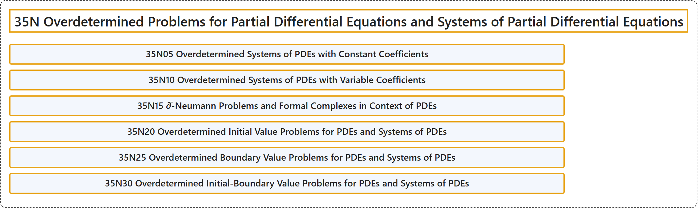

# 35N Overdetermined Problems for Partial Differential Equations and Systems of Partial Differential Equations

## Classification

## Glossary

| Term | Definition | 中文翻译 | Source |
|---|---|---|---|
| **35N Overdetermined Problems for Partial Differential Equations and Systems of Partial Differential Equations** 偏微分方程与偏微分方程组的超定问题 | (No definition) | （无定义） | [Associate Editors of Mathematical Reviews and zbMATH, 2020](https://msc2020.org/) |
| **35N05 Overdetermined Systems of PDEs with Constant Coefficients** 常系数超定 PDE 方程组 | (No definition) | （无定义） | [Associate Editors of Mathematical Reviews and zbMATH, 2020](https://msc2020.org/) |
| **35N10 Overdetermined Systems of PDEs with Variable Coefficients** 变系数超定 PDE 方程组 | (No definition) | （无定义） | [Associate Editors of Mathematical Reviews and zbMATH, 2020](https://msc2020.org/) |
| **35N15 ∂̅-Neumann Problems and Formal Complexes in Context of PDEs** PDE 中的 ∂̅-诺伊曼问题与形式复形 | (No definition) | （无定义） | [Associate Editors of Mathematical Reviews and zbMATH, 2020](https://msc2020.org/) |
| **35N20 Overdetermined Initial Value Problems for PDEs and Systems of PDEs** PDE 与 PDE 方程组的超定初值问题 | (No definition) | （无定义） | [Associate Editors of Mathematical Reviews and zbMATH, 2020](https://msc2020.org/) |
| **35N25 Overdetermined Boundary Value Problems for PDEs and Systems of PDEs** PDE 与 PDE 方程组的超定边值问题 | (No definition) | （无定义） | [Associate Editors of Mathematical Reviews and zbMATH, 2020](https://msc2020.org/) |
| **35N30 Overdetermined Initial-Boundary Value Problems for PDEs and Systems of PDEs** PDE 与 PDE 方程组的超定初边值问题 | (No definition) | （无定义） | [Associate Editors of Mathematical Reviews and zbMATH, 2020](https://msc2020.org/) |

## References

Associate Editors of Mathematical Reviews and zbMATH. (2020). *MSC2020: Mathematics Subject Classification system*. Retrieved October 27, 2026, from <https://msc2020.org/>
