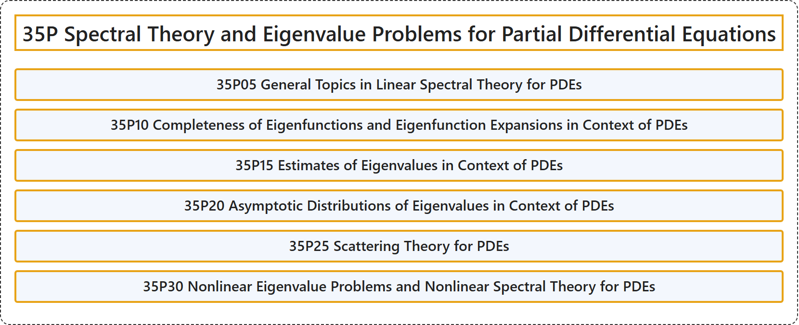

# 35P Spectral Theory and Eigenvalue Problems for Partial Differential Equations

## Classification

## Glossary

| Term | Definition | 中文翻译 | Source |
|---|---|---|---|
| **35P Spectral Theory and Eigenvalue Problems for Partial Differential Equations** 偏微分方程的谱理论与特征值问题 | (No definition) | （无定义） | [Associate Editors of Mathematical Reviews and zbMATH, 2020](https://msc2020.org/) |
| **35P05 General Topics in Linear Spectral Theory for PDEs** PDE 的线性谱理论一般主题 | (No definition) | （无定义） | [Associate Editors of Mathematical Reviews and zbMATH, 2020](https://msc2020.org/) |
| **35P10 Completeness of Eigenfunctions and Eigenfunction Expansions in Context of PDEs** PDE 中本征函数的完备性与本征函数展开 | (No definition) | （无定义） | [Associate Editors of Mathematical Reviews and zbMATH, 2020](https://msc2020.org/) |
| **35P15 Estimates of Eigenvalues in Context of PDEs** PDE 中的本征值估计 | (No definition) | （无定义） | [Associate Editors of Mathematical Reviews and zbMATH, 2020](https://msc2020.org/) |
| **35P20 Asymptotic Distributions of Eigenvalues in Context of PDEs** PDE 中本征值的渐近分布 | (No definition) | （无定义） | [Associate Editors of Mathematical Reviews and zbMATH, 2020](https://msc2020.org/) |
| **35P25 Scattering Theory for PDEs** PDE 的散射理论 | (No definition) | （无定义） | [Associate Editors of Mathematical Reviews and zbMATH, 2020](https://msc2020.org/) |
| **35P30 Nonlinear Eigenvalue Problems and Nonlinear Spectral Theory for PDEs** PDE 的非线性本征值问题与非线性谱理论 | (No definition) | （无定义） | [Associate Editors of Mathematical Reviews and zbMATH, 2020](https://msc2020.org/) |

## References

Associate Editors of Mathematical Reviews and zbMATH. (2020). *MSC2020: Mathematics Subject Classification system*. Retrieved October 27, 2026, from <https://msc2020.org/>
