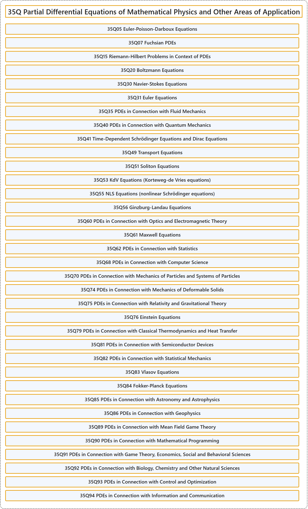

# 35Q Partial Differential Equations of Mathematical Physics and Other Areas of Application

## Classification

## Glossary

| Term | Definition | 中文翻译 | Source |
|---|---|---|---|
| **35Q Partial Differential Equations of Mathematical Physics and Other Areas of Application** 数学物理及其他应用领域的偏微分方程 | (No definition) | （无定义） | [Associate Editors of Mathematical Reviews and zbMATH, 2020](https://msc2020.org/) |
| **35Q05 Euler-Poisson-Darboux Equations** 欧拉-泊松-达布方程 | (No definition) | （无定义） | [Associate Editors of Mathematical Reviews and zbMATH, 2020](https://msc2020.org/) |
| **35Q07 Fuchsian PDEs** 富克斯型 PDE | (No definition) | （无定义） | [Associate Editors of Mathematical Reviews and zbMATH, 2020](https://msc2020.org/) |
| **35Q15 Riemann-Hilbert Problems in Context of PDEs** PDE 中的黎曼-希尔伯特问题 | (No definition) | （无定义） | [Associate Editors of Mathematical Reviews and zbMATH, 2020](https://msc2020.org/) |
| **35Q20 Boltzmann Equations** 玻尔兹曼方程 | (No definition) | （无定义） | [Associate Editors of Mathematical Reviews and zbMATH, 2020](https://msc2020.org/) |
| **35Q30 Navier-Stokes Equations** 纳维-斯托克斯方程 | (No definition) | （无定义） | [Associate Editors of Mathematical Reviews and zbMATH, 2020](https://msc2020.org/) |
| **35Q31 Euler Equations** 欧拉方程 | (No definition) | （无定义） | [Associate Editors of Mathematical Reviews and zbMATH, 2020](https://msc2020.org/) |
| **35Q35 PDEs in Connection with Fluid Mechanics** 与流体力学有关的 PDE | (No definition) | （无定义） | [Associate Editors of Mathematical Reviews and zbMATH, 2020](https://msc2020.org/) |
| **35Q40 PDEs in Connection with Quantum Mechanics** 与量子力学有关的 PDE | (No definition) | （无定义） | [Associate Editors of Mathematical Reviews and zbMATH, 2020](https://msc2020.org/) |
| **35Q41 Time-Dependent Schrödinger Equations and Dirac Equations** 含时薛定谔方程与狄拉克方程 | (No definition) | （无定义） | [Associate Editors of Mathematical Reviews and zbMATH, 2020](https://msc2020.org/) |
| **35Q49 Transport Equations** 输运方程 | (No definition) | （无定义） | [Associate Editors of Mathematical Reviews and zbMATH, 2020](https://msc2020.org/) |
| **35Q51 Soliton Equations** 孤子方程 | (No definition) | （无定义） | [Associate Editors of Mathematical Reviews and zbMATH, 2020](https://msc2020.org/) |
| **35Q53 KdV Equations (Korteweg-de Vries equations)** KdV 方程（科特韦格-德弗里斯方程） | (No definition) | （无定义） | [Associate Editors of Mathematical Reviews and zbMATH, 2020](https://msc2020.org/) |
| **35Q55 NLS Equations (nonlinear Schrödinger equations)** NLS 方程（非线性薛定谔方程） | (No definition) | （无定义） | [Associate Editors of Mathematical Reviews and zbMATH, 2020](https://msc2020.org/) |
| **35Q56 Ginzburg-Landau Equations** 金兹堡-朗道方程 | (No definition) | （无定义） | [Associate Editors of Mathematical Reviews and zbMATH, 2020](https://msc2020.org/) |
| **35Q60 PDEs in Connection with Optics and Electromagnetic Theory** 与光学和电磁理论有关的 PDE | (No definition) | （无定义） | [Associate Editors of Mathematical Reviews and zbMATH, 2020](https://msc2020.org/) |
| **35Q61 Maxwell Equations** 麦克斯韦方程 | (No definition) | （无定义） | [Associate Editors of Mathematical Reviews and zbMATH, 2020](https://msc2020.org/) |
| **35Q62 PDEs in Connection with Statistics** 与统计学有关的 PDE | (No definition) | （无定义） | [Associate Editors of Mathematical Reviews and zbMATH, 2020](https://msc2020.org/) |
| **35Q68 PDEs in Connection with Computer Science** 与计算机科学有关的 PDE | (No definition) | （无定义） | [Associate Editors of Mathematical Reviews and zbMATH, 2020](https://msc2020.org/) |
| **35Q70 PDEs in Connection with Mechanics of Particles and Systems of Particles** 与粒子力学及粒子系统力学有关的 PDE | (No definition) | （无定义） | [Associate Editors of Mathematical Reviews and zbMATH, 2020](https://msc2020.org/) |
| **35Q74 PDEs in Connection with Mechanics of Deformable Solids** 与可变形固体力学有关的 PDE | (No definition) | （无定义） | [Associate Editors of Mathematical Reviews and zbMATH, 2020](https://msc2020.org/) |
| **35Q75 PDEs in Connection with Relativity and Gravitational Theory** 与相对论和引力理论有关的 PDE | (No definition) | （无定义） | [Associate Editors of Mathematical Reviews and zbMATH, 2020](https://msc2020.org/) |
| **35Q76 Einstein Equations** 爱因斯坦方程 | (No definition) | （无定义） | [Associate Editors of Mathematical Reviews and zbMATH, 2020](https://msc2020.org/) |
| **35Q79 PDEs in Connection with Classical Thermodynamics and Heat Transfer** 与经典热力学和传热有关的 PDE | (No definition) | （无定义） | [Associate Editors of Mathematical Reviews and zbMATH, 2020](https://msc2020.org/) |
| **35Q81 PDEs in Connection with Semiconductor Devices** 与半导体器件有关的 PDE | (No definition) | （无定义） | [Associate Editors of Mathematical Reviews and zbMATH, 2020](https://msc2020.org/) |
| **35Q82 PDEs in Connection with Statistical Mechanics** 与统计力学有关的 PDE | (No definition) | （无定义） | [Associate Editors of Mathematical Reviews and zbMATH, 2020](https://msc2020.org/) |
| **35Q83 Vlasov Equations** 弗拉索夫方程 | (No definition) | （无定义） | [Associate Editors of Mathematical Reviews and zbMATH, 2020](https://msc2020.org/) |
| **35Q84 Fokker-Planck Equations** 福克-普朗克方程 | (No definition) | （无定义） | [Associate Editors of Mathematical Reviews and zbMATH, 2020](https://msc2020.org/) |
| **35Q85 PDEs in Connection with Astronomy and Astrophysics** 与天文学和天体物理学有关的 PDE | (No definition) | （无定义） | [Associate Editors of Mathematical Reviews and zbMATH, 2020](https://msc2020.org/) |
| **35Q86 PDEs in Connection with Geophysics** 与地球物理学有关的 PDE | (No definition) | （无定义） | [Associate Editors of Mathematical Reviews and zbMATH, 2020](https://msc2020.org/) |
| **35Q89 PDEs in Connection with Mean Field Game Theory** 与平均场博弈论有关的 PDE | (No definition) | （无定义） | [Associate Editors of Mathematical Reviews and zbMATH, 2020](https://msc2020.org/) |
| **35Q90 PDEs in Connection with Mathematical Programming** 与数学规划有关的 PDE | (No definition) | （无定义） | [Associate Editors of Mathematical Reviews and zbMATH, 2020](https://msc2020.org/) |
| **35Q91 PDEs in Connection with Game Theory, Economics, Social and Behavioral Sciences** 与博弈论、经济学、社会科学和行为科学有关的 PDE | (No definition) | （无定义） | [Associate Editors of Mathematical Reviews and zbMATH, 2020](https://msc2020.org/) |
| **35Q92 PDEs in Connection with Biology, Chemistry and Other Natural Sciences** 与生物学、化学及其他自然科学有关的 PDE | (No definition) | （无定义） | [Associate Editors of Mathematical Reviews and zbMATH, 2020](https://msc2020.org/) |
| **35Q93 PDEs in Connection with Control and Optimization** 与控制和最优化有关的 PDE | (No definition) | （无定义） | [Associate Editors of Mathematical Reviews and zbMATH, 2020](https://msc2020.org/) |
| **35Q94 PDEs in Connection with Information and Communication** 与信息和通信有关的 PDE | (No definition) | （无定义） | [Associate Editors of Mathematical Reviews and zbMATH, 2020](https://msc2020.org/) |

## References

Associate Editors of Mathematical Reviews and zbMATH. (2020). *MSC2020: Mathematics Subject Classification system*. Retrieved October 27, 2026, from <https://msc2020.org/>
