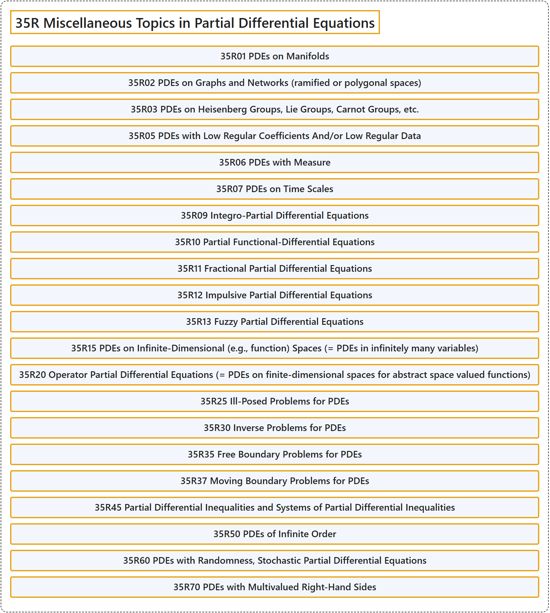

# 35R Miscellaneous Topics in Partial Differential Equations

## Classification

## Glossary

| Term | Definition | 中文翻译 | Source |
|---|---|---|---|
| **35R Miscellaneous Topics in Partial Differential Equations** 偏微分方程的杂项专题 | (No definition) | （无定义） | [Associate Editors of Mathematical Reviews and zbMATH, 2020](https://msc2020.org/) |
| **35R01 PDEs on Manifolds** 流形上的 PDE | (No definition) | （无定义） | [Associate Editors of Mathematical Reviews and zbMATH, 2020](https://msc2020.org/) |
| **35R02 PDEs on Graphs and Networks (ramified or polygonal spaces)** 图与网络（分支空间或多边形空间）上的 PDE | (No definition) | （无定义） | [Associate Editors of Mathematical Reviews and zbMATH, 2020](https://msc2020.org/) |
| **35R03 PDEs on Heisenberg Groups, Lie Groups, Carnot Groups, etc.** 海森堡群、李群、卡诺群等上的 PDE | (No definition) | （无定义） | [Associate Editors of Mathematical Reviews and zbMATH, 2020](https://msc2020.org/) |
| **35R05 PDEs with Low Regular Coefficients And/or Low Regular Data** 低正则系数和（或）低正则数据的 PDE | (No definition) | （无定义） | [Associate Editors of Mathematical Reviews and zbMATH, 2020](https://msc2020.org/) |
| **35R06 PDEs with Measure** 带测度的 PDE | (No definition) | （无定义） | [Associate Editors of Mathematical Reviews and zbMATH, 2020](https://msc2020.org/) |
| **35R07 PDEs on Time Scales** 时标上的 PDE | (No definition) | （无定义） | [Associate Editors of Mathematical Reviews and zbMATH, 2020](https://msc2020.org/) |
| **35R09 Integro-Partial Differential Equations** 积分偏微分方程 | (No definition) | （无定义） | [Associate Editors of Mathematical Reviews and zbMATH, 2020](https://msc2020.org/) |
| **35R10 Partial Functional-Differential Equations** 偏泛函微分方程 | (No definition) | （无定义） | [Associate Editors of Mathematical Reviews and zbMATH, 2020](https://msc2020.org/) |
| **35R11 Fractional Partial Differential Equations** 分数阶偏微分方程 | (No definition) | （无定义） | [Associate Editors of Mathematical Reviews and zbMATH, 2020](https://msc2020.org/) |
| **35R12 Impulsive Partial Differential Equations** 脉冲偏微分方程 | (No definition) | （无定义） | [Associate Editors of Mathematical Reviews and zbMATH, 2020](https://msc2020.org/) |
| **35R13 Fuzzy Partial Differential Equations** 模糊偏微分方程 | (No definition) | （无定义） | [Associate Editors of Mathematical Reviews and zbMATH, 2020](https://msc2020.org/) |
| **35R15 PDEs on Infinite-Dimensional (e.g., function) Spaces (= PDEs in infinitely many variables)** 无穷维空间（例如函数空间）上的 PDE（= 无穷多变量的 PDE） | (No definition) | （无定义） | [Associate Editors of Mathematical Reviews and zbMATH, 2020](https://msc2020.org/) |
| **35R20 Operator Partial Differential Equations (= PDEs on finite-dimensional spaces for abstract space valued functions)** 算子偏微分方程（= 取值于抽象空间的函数在有限维空间上的 PDE） | (No definition) | （无定义） | [Associate Editors of Mathematical Reviews and zbMATH, 2020](https://msc2020.org/) |
| **35R25 Ill-Posed Problems for PDEs** PDE 的不适定问题 | (No definition) | （无定义） | [Associate Editors of Mathematical Reviews and zbMATH, 2020](https://msc2020.org/) |
| **35R30 Inverse Problems for PDEs** PDE 的反问题 | (No definition) | （无定义） | [Associate Editors of Mathematical Reviews and zbMATH, 2020](https://msc2020.org/) |
| **35R35 Free Boundary Problems for PDEs** PDE 的自由边界问题 | (No definition) | （无定义） | [Associate Editors of Mathematical Reviews and zbMATH, 2020](https://msc2020.org/) |
| **35R37 Moving Boundary Problems for PDEs** PDE 的动边界问题 | (No definition) | （无定义） | [Associate Editors of Mathematical Reviews and zbMATH, 2020](https://msc2020.org/) |
| **35R45 Partial Differential Inequalities and Systems of Partial Differential Inequalities** 偏微分不等式与偏微分不等式组 | (No definition) | （无定义） | [Associate Editors of Mathematical Reviews and zbMATH, 2020](https://msc2020.org/) |
| **35R50 PDEs of Infinite Order** 无穷阶 PDE | (No definition) | （无定义） | [Associate Editors of Mathematical Reviews and zbMATH, 2020](https://msc2020.org/) |
| **35R60 PDEs with Randomness, Stochastic Partial Differential Equations** 带随机性的 PDE，随机偏微分方程 | (No definition) | （无定义） | [Associate Editors of Mathematical Reviews and zbMATH, 2020](https://msc2020.org/) |
| **35R70 PDEs with Multivalued Right-Hand Sides** 右端为多值的 PDE | (No definition) | （无定义） | [Associate Editors of Mathematical Reviews and zbMATH, 2020](https://msc2020.org/) |

## References

Associate Editors of Mathematical Reviews and zbMATH. (2020). *MSC2020: Mathematics Subject Classification system*. Retrieved October 27, 2026, from <https://msc2020.org/>
