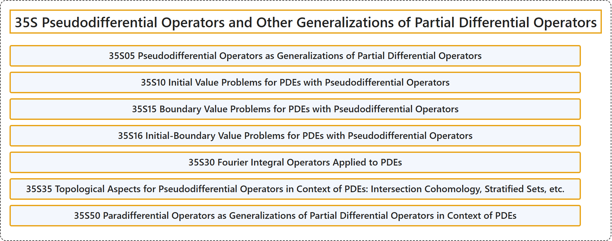

# 35S Pseudodifferential Operators and Other Generalizations of Partial Differential Operators

## Classification

## Glossary

| Term | Definition | 中文翻译 | Source |
|---|---|---|---|
| **35S Pseudodifferential Operators and Other Generalizations of Partial Differential Operators** 伪微分算子及偏微分算子的其他推广 | (No definition) | （无定义） | [Associate Editors of Mathematical Reviews and zbMATH, 2020](https://msc2020.org/) |
| **35S05 Pseudodifferential Operators as Generalizations of Partial Differential Operators** 作为偏微分算子推广的伪微分算子 | (No definition) | （无定义） | [Associate Editors of Mathematical Reviews and zbMATH, 2020](https://msc2020.org/) |
| **35S10 Initial Value Problems for PDEs with Pseudodifferential Operators** 带伪微分算子的 PDE 的初值问题 | (No definition) | （无定义） | [Associate Editors of Mathematical Reviews and zbMATH, 2020](https://msc2020.org/) |
| **35S15 Boundary Value Problems for PDEs with Pseudodifferential Operators** 带伪微分算子的 PDE 的边值问题 | (No definition) | （无定义） | [Associate Editors of Mathematical Reviews and zbMATH, 2020](https://msc2020.org/) |
| **35S16 Initial-Boundary Value Problems for PDEs with Pseudodifferential Operators** 带伪微分算子的 PDE 的初边值问题 | (No definition) | （无定义） | [Associate Editors of Mathematical Reviews and zbMATH, 2020](https://msc2020.org/) |
| **35S30 Fourier Integral Operators Applied to PDEs** 应用于 PDE 的傅里叶积分算子 | (No definition) | （无定义） | [Associate Editors of Mathematical Reviews and zbMATH, 2020](https://msc2020.org/) |
| **35S35 Topological Aspects for Pseudodifferential Operators in Context of PDEs: Intersection Cohomology, Stratified Sets, etc.** PDE 中伪微分算子的拓扑方面：相交上同调，分层集等 | (No definition) | （无定义） | [Associate Editors of Mathematical Reviews and zbMATH, 2020](https://msc2020.org/) |
| **35S50 Paradifferential Operators as Generalizations of Partial Differential Operators in Context of PDEs** PDE 中作为偏微分算子推广的仿微分算子 | (No definition) | （无定义） | [Associate Editors of Mathematical Reviews and zbMATH, 2020](https://msc2020.org/) |

## References

Associate Editors of Mathematical Reviews and zbMATH. (2020). *MSC2020: Mathematics Subject Classification system*. Retrieved October 27, 2026, from <https://msc2020.org/>
