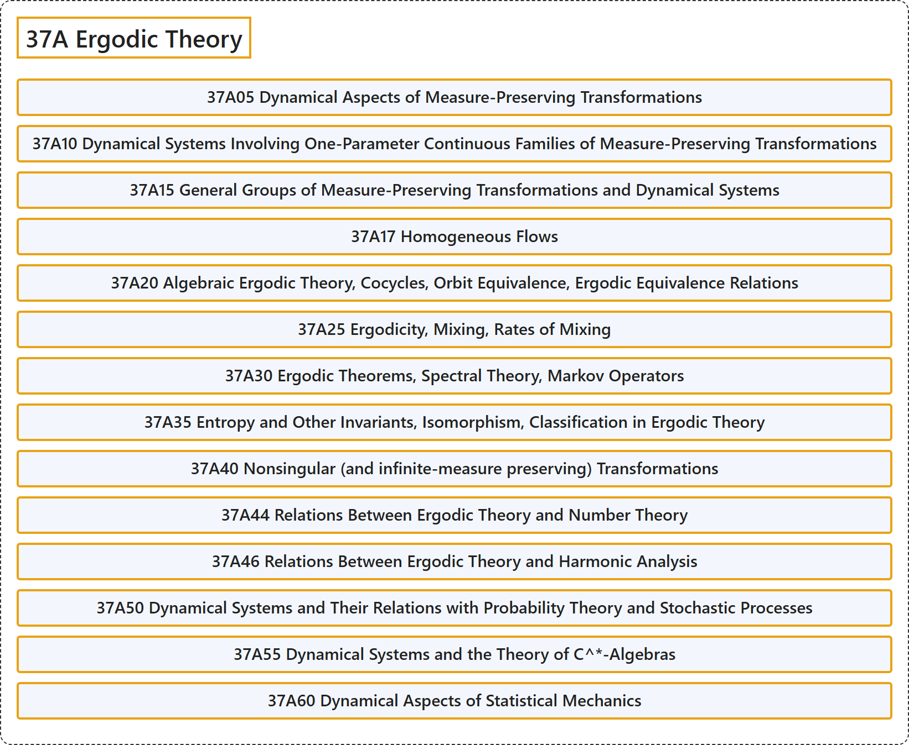

# 37A Ergodic Theory

## Classification

## Glossary

| Term | Definition | 中文翻译 | Source |
|---|---|---|---|
| **37A Ergodic Theory** 遍历理论 | (No definition) | （无定义） | [Associate Editors of Mathematical Reviews and zbMATH, 2020](https://msc2020.org/) |
| **37A05 Dynamical Aspects of Measure-Preserving Transformations** 保测变换的动力学方面 | (No definition) | （无定义） | [Associate Editors of Mathematical Reviews and zbMATH, 2020](https://msc2020.org/) |
| **37A10 Dynamical Systems Involving One-Parameter Continuous Families of Measure-Preserving Transformations** 涉及保测变换单参数连续族的动力系统 | (No definition) | （无定义） | [Associate Editors of Mathematical Reviews and zbMATH, 2020](https://msc2020.org/) |
| **37A15 General Groups of Measure-Preserving Transformations and Dynamical Systems** 保测变换的一般群与动力系统 | (No definition) | （无定义） | [Associate Editors of Mathematical Reviews and zbMATH, 2020](https://msc2020.org/) |
| **37A17 Homogeneous Flows** 齐性流 | (No definition) | （无定义） | [Associate Editors of Mathematical Reviews and zbMATH, 2020](https://msc2020.org/) |
| **37A20 Algebraic Ergodic Theory, Cocycles, Orbit Equivalence, Ergodic Equivalence Relations** 代数遍历理论，上圈，轨道等价，遍历等价关系 | (No definition) | （无定义） | [Associate Editors of Mathematical Reviews and zbMATH, 2020](https://msc2020.org/) |
| **37A25 Ergodicity, Mixing, Rates of Mixing** 遍历性，混合，混合速率 | (No definition) | （无定义） | [Associate Editors of Mathematical Reviews and zbMATH, 2020](https://msc2020.org/) |
| **37A30 Ergodic Theorems, Spectral Theory, Markov Operators** 遍历定理，谱理论，马尔可夫算子 | (No definition) | （无定义） | [Associate Editors of Mathematical Reviews and zbMATH, 2020](https://msc2020.org/) |
| **37A35 Entropy and Other Invariants, Isomorphism, Classification in Ergodic Theory** 遍历理论中的熵及其他不变量，同构，分类 | (No definition) | （无定义） | [Associate Editors of Mathematical Reviews and zbMATH, 2020](https://msc2020.org/) |
| **37A40 Nonsingular (and infinite-measure preserving) Transformations** 非奇异（及无穷测度保持）变换 | (No definition) | （无定义） | [Associate Editors of Mathematical Reviews and zbMATH, 2020](https://msc2020.org/) |
| **37A44 Relations Between Ergodic Theory and Number Theory** 遍历理论与数论的关系 | (No definition) | （无定义） | [Associate Editors of Mathematical Reviews and zbMATH, 2020](https://msc2020.org/) |
| **37A46 Relations Between Ergodic Theory and Harmonic Analysis** 遍历理论与调和分析的关系 | (No definition) | （无定义） | [Associate Editors of Mathematical Reviews and zbMATH, 2020](https://msc2020.org/) |
| **37A50 Dynamical Systems and Their Relations with Probability Theory and Stochastic Processes** 动力系统及其与概率论和随机过程的关系 | (No definition) | （无定义） | [Associate Editors of Mathematical Reviews and zbMATH, 2020](https://msc2020.org/) |
| **37A55 Dynamical Systems and the Theory of C^\*-Algebras** 动力系统与 C^*-代数理论 | (No definition) | （无定义） | [Associate Editors of Mathematical Reviews and zbMATH, 2020](https://msc2020.org/) |
| **37A60 Dynamical Aspects of Statistical Mechanics** 统计力学的动力学方面 | (No definition) | （无定义） | [Associate Editors of Mathematical Reviews and zbMATH, 2020](https://msc2020.org/) |

## References

Associate Editors of Mathematical Reviews and zbMATH. (2020). *MSC2020: Mathematics Subject Classification system*. Retrieved October 27, 2026, from <https://msc2020.org/>
