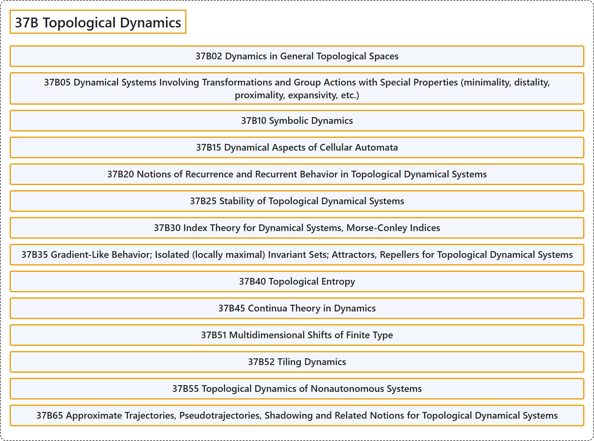

# 37B Topological Dynamics

## Classification

## Glossary

| Term | Definition | 中文翻译 | Source |
|---|---|---|---|
| **37B Topological Dynamics** 拓扑动力学 | (No definition) | （无定义） | [Associate Editors of Mathematical Reviews and zbMATH, 2020](https://msc2020.org/) |
| **37B02 Dynamics in General Topological Spaces** 一般拓扑空间中的动力学 | (No definition) | （无定义） | [Associate Editors of Mathematical Reviews and zbMATH, 2020](https://msc2020.org/) |
| **37B05 Dynamical Systems Involving Transformations and Group Actions with Special Properties (minimality, distality, proximality, expansivity, etc.)** 涉及具有特殊性质（极小性、远端性、邻近性、扩张性等）的变换与群作用的动力系统 | (No definition) | （无定义） | [Associate Editors of Mathematical Reviews and zbMATH, 2020](https://msc2020.org/) |
| **37B10 Symbolic Dynamics** 符号动力学 | (No definition) | （无定义） | [Associate Editors of Mathematical Reviews and zbMATH, 2020](https://msc2020.org/) |
| **37B15 Dynamical Aspects of Cellular Automata** 元胞自动机的动力学方面 | (No definition) | （无定义） | [Associate Editors of Mathematical Reviews and zbMATH, 2020](https://msc2020.org/) |
| **37B20 Notions of Recurrence and Recurrent Behavior in Topological Dynamical Systems** 拓扑动力系统中的回复概念与回复行为 | (No definition) | （无定义） | [Associate Editors of Mathematical Reviews and zbMATH, 2020](https://msc2020.org/) |
| **37B25 Stability of Topological Dynamical Systems** 拓扑动力系统的稳定性 | (No definition) | （无定义） | [Associate Editors of Mathematical Reviews and zbMATH, 2020](https://msc2020.org/) |
| **37B30 Index Theory for Dynamical Systems, Morse-Conley Indices** 动力系统的指标理论，莫尔斯-康利指数 | (No definition) | （无定义） | [Associate Editors of Mathematical Reviews and zbMATH, 2020](https://msc2020.org/) |
| **37B35 Gradient-Like Behavior; Isolated (locally maximal) Invariant Sets; Attractors, Repellers for Topological Dynamical Systems** 类梯度行为；孤立（局部极大）不变集；拓扑动力系统的吸引子与排斥子 | (No definition) | （无定义） | [Associate Editors of Mathematical Reviews and zbMATH, 2020](https://msc2020.org/) |
| **37B40 Topological Entropy** 拓扑熵 | (No definition) | （无定义） | [Associate Editors of Mathematical Reviews and zbMATH, 2020](https://msc2020.org/) |
| **37B45 Continua Theory in Dynamics** 动力学中的连续统理论 | (No definition) | （无定义） | [Associate Editors of Mathematical Reviews and zbMATH, 2020](https://msc2020.org/) |
| **37B51 Multidimensional Shifts of Finite Type** 多维有限型移位 | (No definition) | （无定义） | [Associate Editors of Mathematical Reviews and zbMATH, 2020](https://msc2020.org/) |
| **37B52 Tiling Dynamics** 铺砌动力学 | (No definition) | （无定义） | [Associate Editors of Mathematical Reviews and zbMATH, 2020](https://msc2020.org/) |
| **37B55 Topological Dynamics of Nonautonomous Systems** 非自治系统的拓扑动力学 | (No definition) | （无定义） | [Associate Editors of Mathematical Reviews and zbMATH, 2020](https://msc2020.org/) |
| **37B65 Approximate Trajectories, Pseudotrajectories, Shadowing and Related Notions for Topological Dynamical Systems** 拓扑动力系统的近似轨道、伪轨道、跟踪及相关概念 | (No definition) | （无定义） | [Associate Editors of Mathematical Reviews and zbMATH, 2020](https://msc2020.org/) |

## References

Associate Editors of Mathematical Reviews and zbMATH. (2020). *MSC2020: Mathematics Subject Classification system*. Retrieved October 27, 2026, from <https://msc2020.org/>
