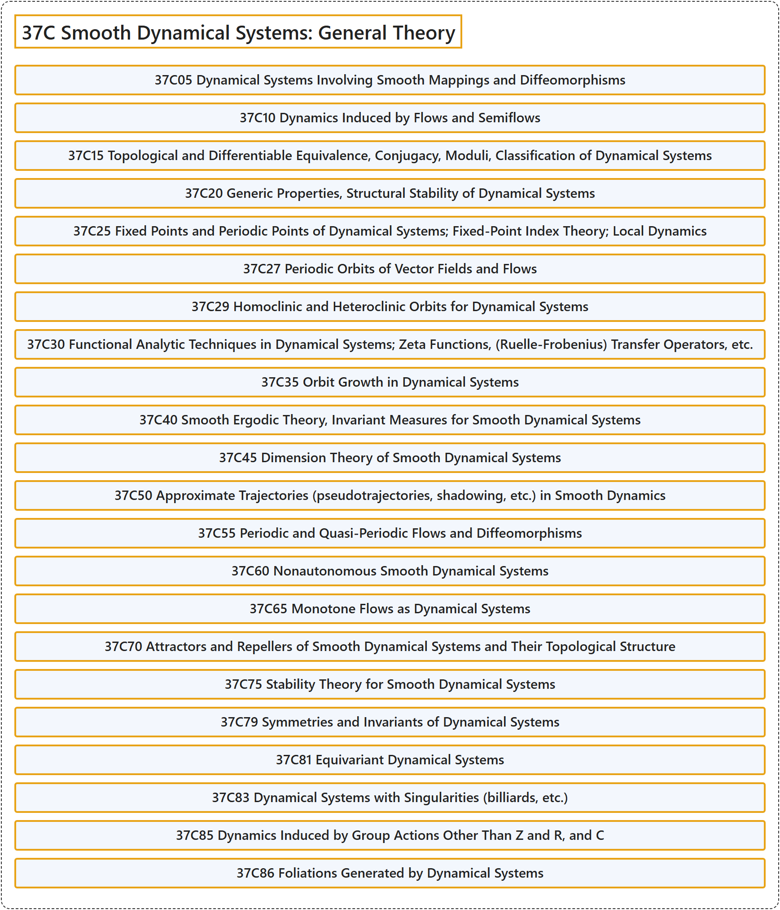

# 37C Smooth Dynamical Systems: General Theory

## Classification

## Glossary

| Term | Definition | 中文翻译 | Source |
|---|---|---|---|
| **37C Smooth Dynamical Systems: General Theory** 光滑动力系统：一般理论 | (No definition) | （无定义） | [Associate Editors of Mathematical Reviews and zbMATH, 2020](https://msc2020.org/) |
| **37C05 Dynamical Systems Involving Smooth Mappings and Diffeomorphisms** 涉及光滑映射与微分同胚的动力系统 | (No definition) | （无定义） | [Associate Editors of Mathematical Reviews and zbMATH, 2020](https://msc2020.org/) |
| **37C10 Dynamics Induced by Flows and Semiflows** 由流与半流诱导的动力学 | (No definition) | （无定义） | [Associate Editors of Mathematical Reviews and zbMATH, 2020](https://msc2020.org/) |
| **37C15 Topological and Differentiable Equivalence, Conjugacy, Moduli, Classification of Dynamical Systems** 动力系统的拓扑等价与可微等价，共轭，模，分类 | (No definition) | （无定义） | [Associate Editors of Mathematical Reviews and zbMATH, 2020](https://msc2020.org/) |
| **37C20 Generic Properties, Structural Stability of Dynamical Systems** 动力系统的一般性质，结构稳定性 | (No definition) | （无定义） | [Associate Editors of Mathematical Reviews and zbMATH, 2020](https://msc2020.org/) |
| **37C25 Fixed Points and Periodic Points of Dynamical Systems; Fixed-Point Index Theory; Local Dynamics** 动力系统的不动点与周期点；不动点指数理论；局部动力学 | (No definition) | （无定义） | [Associate Editors of Mathematical Reviews and zbMATH, 2020](https://msc2020.org/) |
| **37C27 Periodic Orbits of Vector Fields and Flows** 向量场与流的周期轨道 | (No definition) | （无定义） | [Associate Editors of Mathematical Reviews and zbMATH, 2020](https://msc2020.org/) |
| **37C29 Homoclinic and Heteroclinic Orbits for Dynamical Systems** 动力系统的同宿轨道与异宿轨道 | (No definition) | （无定义） | [Associate Editors of Mathematical Reviews and zbMATH, 2020](https://msc2020.org/) |
| **37C30 Functional Analytic Techniques in Dynamical Systems; Zeta Functions, (Ruelle-Frobenius) Transfer Operators, etc.** 动力系统中的泛函分析技术；zeta 函数，（吕埃勒-弗罗贝尼乌斯）转移算子等 | (No definition) | （无定义） | [Associate Editors of Mathematical Reviews and zbMATH, 2020](https://msc2020.org/) |
| **37C35 Orbit Growth in Dynamical Systems** 动力系统中的轨道增长 | (No definition) | （无定义） | [Associate Editors of Mathematical Reviews and zbMATH, 2020](https://msc2020.org/) |
| **37C40 Smooth Ergodic Theory, Invariant Measures for Smooth Dynamical Systems** 光滑遍历理论，光滑动力系统的不变测度 | (No definition) | （无定义） | [Associate Editors of Mathematical Reviews and zbMATH, 2020](https://msc2020.org/) |
| **37C45 Dimension Theory of Smooth Dynamical Systems** 光滑动力系统的维数理论 | (No definition) | （无定义） | [Associate Editors of Mathematical Reviews and zbMATH, 2020](https://msc2020.org/) |
| **37C50 Approximate Trajectories (pseudotrajectories, shadowing, etc.) in Smooth Dynamics** 光滑动力学中的近似轨道（伪轨道、跟踪等） | (No definition) | （无定义） | [Associate Editors of Mathematical Reviews and zbMATH, 2020](https://msc2020.org/) |
| **37C55 Periodic and Quasi-Periodic Flows and Diffeomorphisms** 周期与拟周期流及微分同胚 | (No definition) | （无定义） | [Associate Editors of Mathematical Reviews and zbMATH, 2020](https://msc2020.org/) |
| **37C60 Nonautonomous Smooth Dynamical Systems** 非自治光滑动力系统 | (No definition) | （无定义） | [Associate Editors of Mathematical Reviews and zbMATH, 2020](https://msc2020.org/) |
| **37C65 Monotone Flows as Dynamical Systems** 作为动力系统的单调流 | (No definition) | （无定义） | [Associate Editors of Mathematical Reviews and zbMATH, 2020](https://msc2020.org/) |
| **37C70 Attractors and Repellers of Smooth Dynamical Systems and Their Topological Structure** 光滑动力系统的吸引子与排斥子及其拓扑结构 | (No definition) | （无定义） | [Associate Editors of Mathematical Reviews and zbMATH, 2020](https://msc2020.org/) |
| **37C75 Stability Theory for Smooth Dynamical Systems** 光滑动力系统的稳定性理论 | (No definition) | （无定义） | [Associate Editors of Mathematical Reviews and zbMATH, 2020](https://msc2020.org/) |
| **37C79 Symmetries and Invariants of Dynamical Systems** 动力系统的对称性与不变量 | (No definition) | （无定义） | [Associate Editors of Mathematical Reviews and zbMATH, 2020](https://msc2020.org/) |
| **37C81 Equivariant Dynamical Systems** 等变动力系统 | (No definition) | （无定义） | [Associate Editors of Mathematical Reviews and zbMATH, 2020](https://msc2020.org/) |
| **37C83 Dynamical Systems with Singularities (billiards, etc.)** 带奇点的动力系统（台球等） | (No definition) | （无定义） | [Associate Editors of Mathematical Reviews and zbMATH, 2020](https://msc2020.org/) |
| **37C85 Dynamics Induced by Group Actions Other Than Z and R, and C** 由 Z、R 及 C 以外的群作用诱导的动力学 | (No definition) | （无定义） | [Associate Editors of Mathematical Reviews and zbMATH, 2020](https://msc2020.org/) |
| **37C86 Foliations Generated by Dynamical Systems** 由动力系统生成的叶状结构 | (No definition) | （无定义） | [Associate Editors of Mathematical Reviews and zbMATH, 2020](https://msc2020.org/) |

## References

Associate Editors of Mathematical Reviews and zbMATH. (2020). *MSC2020: Mathematics Subject Classification system*. Retrieved October 27, 2026, from <https://msc2020.org/>
