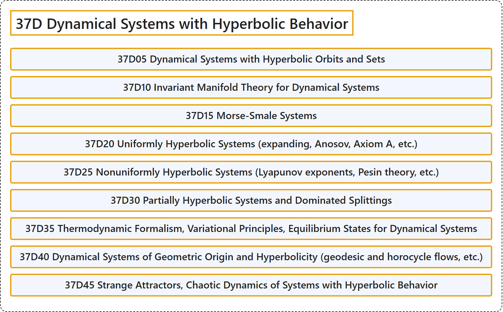

# 37D Dynamical Systems with Hyperbolic Behavior

## Classification

## Glossary

| Term | Definition | 中文翻译 | Source |
|---|---|---|---|
| **37D Dynamical Systems with Hyperbolic Behavior** 具双曲行为的动力系统 | (No definition) | （无定义） | [Associate Editors of Mathematical Reviews and zbMATH, 2020](https://msc2020.org/) |
| **37D05 Dynamical Systems with Hyperbolic Orbits and Sets** 具有双曲轨道与双曲集的动力系统 | (No definition) | （无定义） | [Associate Editors of Mathematical Reviews and zbMATH, 2020](https://msc2020.org/) |
| **37D10 Invariant Manifold Theory for Dynamical Systems** 动力系统的不变流形理论 | (No definition) | （无定义） | [Associate Editors of Mathematical Reviews and zbMATH, 2020](https://msc2020.org/) |
| **37D15 Morse-Smale Systems** 莫尔斯-斯梅尔系统 | (No definition) | （无定义） | [Associate Editors of Mathematical Reviews and zbMATH, 2020](https://msc2020.org/) |
| **37D20 Uniformly Hyperbolic Systems (expanding, Anosov, Axiom A, etc.)** 一致双曲系统（扩张、阿诺索夫、公理 A 等） | (No definition) | （无定义） | [Associate Editors of Mathematical Reviews and zbMATH, 2020](https://msc2020.org/) |
| **37D25 Nonuniformly Hyperbolic Systems (Lyapunov exponents, Pesin theory, etc.)** 非一致双曲系统（李雅普诺夫指数，佩辛理论等） | (No definition) | （无定义） | [Associate Editors of Mathematical Reviews and zbMATH, 2020](https://msc2020.org/) |
| **37D30 Partially Hyperbolic Systems and Dominated Splittings** 部分双曲系统与占优分裂 | (No definition) | （无定义） | [Associate Editors of Mathematical Reviews and zbMATH, 2020](https://msc2020.org/) |
| **37D35 Thermodynamic Formalism, Variational Principles, Equilibrium States for Dynamical Systems** 热力学形式体系，变分原理，动力系统的平衡态 | (No definition) | （无定义） | [Associate Editors of Mathematical Reviews and zbMATH, 2020](https://msc2020.org/) |
| **37D40 Dynamical Systems of Geometric Origin and Hyperbolicity (geodesic and horocycle flows, etc.)** 几何起源的动力系统与双曲性（测地流与极限圆流等） | (No definition) | （无定义） | [Associate Editors of Mathematical Reviews and zbMATH, 2020](https://msc2020.org/) |
| **37D45 Strange Attractors, Chaotic Dynamics of Systems with Hyperbolic Behavior** 奇异吸引子，具有双曲行为系统的混沌动力学 | (No definition) | （无定义） | [Associate Editors of Mathematical Reviews and zbMATH, 2020](https://msc2020.org/) |

## References

Associate Editors of Mathematical Reviews and zbMATH. (2020). *MSC2020: Mathematics Subject Classification system*. Retrieved October 27, 2026, from <https://msc2020.org/>
