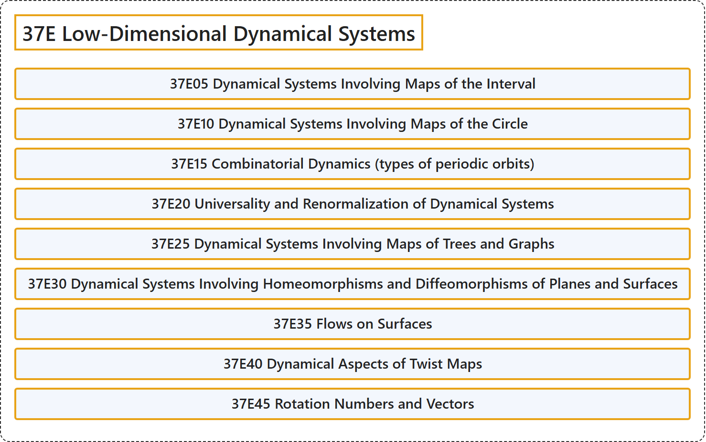

# 37E Low-Dimensional Dynamical Systems

## Classification

## Glossary

| Term | Definition | 中文翻译 | Source |
|---|---|---|---|
| **37E Low-Dimensional Dynamical Systems** 低维动力系统 | (No definition) | （无定义） | [Associate Editors of Mathematical Reviews and zbMATH, 2020](https://msc2020.org/) |
| **37E05 Dynamical Systems Involving Maps of the Interval** 涉及区间映射的动力系统 | (No definition) | （无定义） | [Associate Editors of Mathematical Reviews and zbMATH, 2020](https://msc2020.org/) |
| **37E10 Dynamical Systems Involving Maps of the Circle** 涉及圆周映射的动力系统 | (No definition) | （无定义） | [Associate Editors of Mathematical Reviews and zbMATH, 2020](https://msc2020.org/) |
| **37E15 Combinatorial Dynamics (types of periodic orbits)** 组合动力学（周期轨道的类型） | (No definition) | （无定义） | [Associate Editors of Mathematical Reviews and zbMATH, 2020](https://msc2020.org/) |
| **37E20 Universality and Renormalization of Dynamical Systems** 动力系统的普适性与重整化 | (No definition) | （无定义） | [Associate Editors of Mathematical Reviews and zbMATH, 2020](https://msc2020.org/) |
| **37E25 Dynamical Systems Involving Maps of Trees and Graphs** 涉及树与图的映射的动力系统 | (No definition) | （无定义） | [Associate Editors of Mathematical Reviews and zbMATH, 2020](https://msc2020.org/) |
| **37E30 Dynamical Systems Involving Homeomorphisms and Diffeomorphisms of Planes and Surfaces** 涉及平面与曲面的同胚与微分同胚的动力系统 | (No definition) | （无定义） | [Associate Editors of Mathematical Reviews and zbMATH, 2020](https://msc2020.org/) |
| **37E35 Flows on Surfaces** 曲面上的流 | (No definition) | （无定义） | [Associate Editors of Mathematical Reviews and zbMATH, 2020](https://msc2020.org/) |
| **37E40 Dynamical Aspects of Twist Maps** 扭转映射的动力学方面 | (No definition) | （无定义） | [Associate Editors of Mathematical Reviews and zbMATH, 2020](https://msc2020.org/) |
| **37E45 Rotation Numbers and Vectors** 旋转数与旋转向量 | (No definition) | （无定义） | [Associate Editors of Mathematical Reviews and zbMATH, 2020](https://msc2020.org/) |

## References

Associate Editors of Mathematical Reviews and zbMATH. (2020). *MSC2020: Mathematics Subject Classification system*. Retrieved October 27, 2026, from <https://msc2020.org/>
