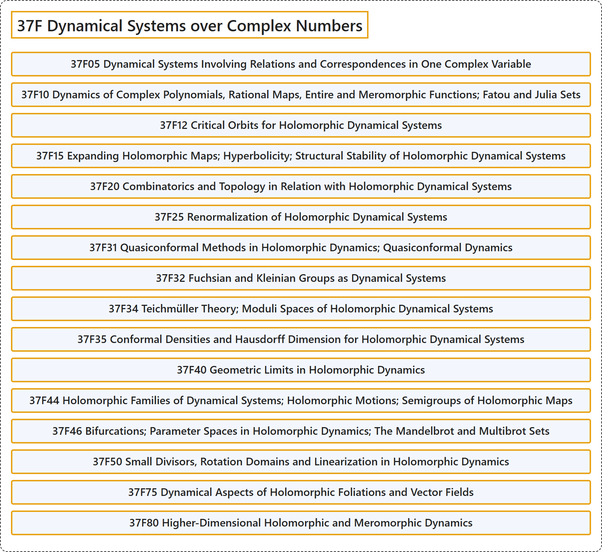

# 37F Dynamical Systems over Complex Numbers

## Classification

## Glossary

| Term | Definition | 中文翻译 | Source |
|---|---|---|---|
| **37F Dynamical Systems over Complex Numbers** 复数上的动力系统 | (No definition) | （无定义） | [Associate Editors of Mathematical Reviews and zbMATH, 2020](https://msc2020.org/) |
| **37F05 Dynamical Systems Involving Relations and Correspondences in One Complex Variable** 涉及一复变量中关系与对应的动力系统 | (No definition) | （无定义） | [Associate Editors of Mathematical Reviews and zbMATH, 2020](https://msc2020.org/) |
| **37F10 Dynamics of Complex Polynomials, Rational Maps, Entire and Meromorphic Functions; Fatou and Julia Sets** 复多项式、有理映射、整函数与亚纯函数的动力学；法图集与朱利亚集 | (No definition) | （无定义） | [Associate Editors of Mathematical Reviews and zbMATH, 2020](https://msc2020.org/) |
| **37F12 Critical Orbits for Holomorphic Dynamical Systems** 全纯动力系统的临界轨道 | (No definition) | （无定义） | [Associate Editors of Mathematical Reviews and zbMATH, 2020](https://msc2020.org/) |
| **37F15 Expanding Holomorphic Maps; Hyperbolicity; Structural Stability of Holomorphic Dynamical Systems** 扩张全纯映射；双曲性；全纯动力系统的结构稳定性 | (No definition) | （无定义） | [Associate Editors of Mathematical Reviews and zbMATH, 2020](https://msc2020.org/) |
| **37F20 Combinatorics and Topology in Relation with Holomorphic Dynamical Systems** 与全纯动力系统有关的组合学与拓扑 | (No definition) | （无定义） | [Associate Editors of Mathematical Reviews and zbMATH, 2020](https://msc2020.org/) |
| **37F25 Renormalization of Holomorphic Dynamical Systems** 全纯动力系统的重整化 | (No definition) | （无定义） | [Associate Editors of Mathematical Reviews and zbMATH, 2020](https://msc2020.org/) |
| **37F31 Quasiconformal Methods in Holomorphic Dynamics; Quasiconformal Dynamics** 全纯动力学中的拟共形方法；拟共形动力学 | (No definition) | （无定义） | [Associate Editors of Mathematical Reviews and zbMATH, 2020](https://msc2020.org/) |
| **37F32 Fuchsian and Kleinian Groups as Dynamical Systems** 作为动力系统的富克斯群与克莱因群 | (No definition) | （无定义） | [Associate Editors of Mathematical Reviews and zbMATH, 2020](https://msc2020.org/) |
| **37F34 Teichmüller Theory; Moduli Spaces of Holomorphic Dynamical Systems** 泰希米勒理论；全纯动力系统的模空间 | (No definition) | （无定义） | [Associate Editors of Mathematical Reviews and zbMATH, 2020](https://msc2020.org/) |
| **37F35 Conformal Densities and Hausdorff Dimension for Holomorphic Dynamical Systems** 全纯动力系统的共形密度与豪斯多夫维数 | (No definition) | （无定义） | [Associate Editors of Mathematical Reviews and zbMATH, 2020](https://msc2020.org/) |
| **37F40 Geometric Limits in Holomorphic Dynamics** 全纯动力学中的几何极限 | (No definition) | （无定义） | [Associate Editors of Mathematical Reviews and zbMATH, 2020](https://msc2020.org/) |
| **37F44 Holomorphic Families of Dynamical Systems; Holomorphic Motions; Semigroups of Holomorphic Maps** 全纯动力系统族；全纯运动；全纯映射的半群 | (No definition) | （无定义） | [Associate Editors of Mathematical Reviews and zbMATH, 2020](https://msc2020.org/) |
| **37F46 Bifurcations; Parameter Spaces in Holomorphic Dynamics; The Mandelbrot and Multibrot Sets** 全纯动力学中的分岔；参数空间；曼德布罗特集与多重曼德布罗特集 | (No definition) | （无定义） | [Associate Editors of Mathematical Reviews and zbMATH, 2020](https://msc2020.org/) |
| **37F50 Small Divisors, Rotation Domains and Linearization in Holomorphic Dynamics** 全纯动力学中的小分母，旋转域与线性化 | (No definition) | （无定义） | [Associate Editors of Mathematical Reviews and zbMATH, 2020](https://msc2020.org/) |
| **37F75 Dynamical Aspects of Holomorphic Foliations and Vector Fields** 全纯叶状结构与向量场的动力学方面 | (No definition) | （无定义） | [Associate Editors of Mathematical Reviews and zbMATH, 2020](https://msc2020.org/) |
| **37F80 Higher-Dimensional Holomorphic and Meromorphic Dynamics** 高维全纯与亚纯动力学 | (No definition) | （无定义） | [Associate Editors of Mathematical Reviews and zbMATH, 2020](https://msc2020.org/) |

## References

Associate Editors of Mathematical Reviews and zbMATH. (2020). *MSC2020: Mathematics Subject Classification system*. Retrieved October 27, 2026, from <https://msc2020.org/>
