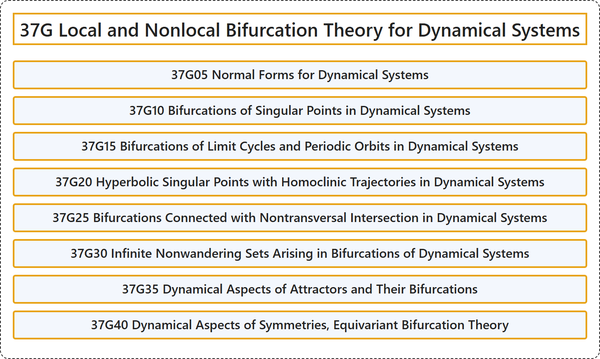

# 37G Local and Nonlocal Bifurcation Theory for Dynamical Systems

## Classification

## Glossary

| Term | Definition | 中文翻译 | Source |
|---|---|---|---|
| **37G Local and Nonlocal Bifurcation Theory for Dynamical Systems** 动力系统的局部与非局部分岔理论 | (No definition) | （无定义） | [Associate Editors of Mathematical Reviews and zbMATH, 2020](https://msc2020.org/) |
| **37G05 Normal Forms for Dynamical Systems** 动力系统的正规形 | (No definition) | （无定义） | [Associate Editors of Mathematical Reviews and zbMATH, 2020](https://msc2020.org/) |
| **37G10 Bifurcations of Singular Points in Dynamical Systems** 动力系统中奇点的分岔 | (No definition) | （无定义） | [Associate Editors of Mathematical Reviews and zbMATH, 2020](https://msc2020.org/) |
| **37G15 Bifurcations of Limit Cycles and Periodic Orbits in Dynamical Systems** 动力系统中极限环与周期轨道的分岔 | (No definition) | （无定义） | [Associate Editors of Mathematical Reviews and zbMATH, 2020](https://msc2020.org/) |
| **37G20 Hyperbolic Singular Points with Homoclinic Trajectories in Dynamical Systems** 动力系统中带同宿轨线的双曲奇点 | (No definition) | （无定义） | [Associate Editors of Mathematical Reviews and zbMATH, 2020](https://msc2020.org/) |
| **37G25 Bifurcations Connected with Nontransversal Intersection in Dynamical Systems** 动力系统中与非横截相交有关的分岔 | (No definition) | （无定义） | [Associate Editors of Mathematical Reviews and zbMATH, 2020](https://msc2020.org/) |
| **37G30 Infinite Nonwandering Sets Arising in Bifurcations of Dynamical Systems** 动力系统分岔中出现的无穷非游荡集 | (No definition) | （无定义） | [Associate Editors of Mathematical Reviews and zbMATH, 2020](https://msc2020.org/) |
| **37G35 Dynamical Aspects of Attractors and Their Bifurcations** 吸引子及其分岔的动力学方面 | (No definition) | （无定义） | [Associate Editors of Mathematical Reviews and zbMATH, 2020](https://msc2020.org/) |
| **37G40 Dynamical Aspects of Symmetries, Equivariant Bifurcation Theory** 对称性的动力学方面，等变分岔理论 | (No definition) | （无定义） | [Associate Editors of Mathematical Reviews and zbMATH, 2020](https://msc2020.org/) |

## References

Associate Editors of Mathematical Reviews and zbMATH. (2020). *MSC2020: Mathematics Subject Classification system*. Retrieved October 27, 2026, from <https://msc2020.org/>
