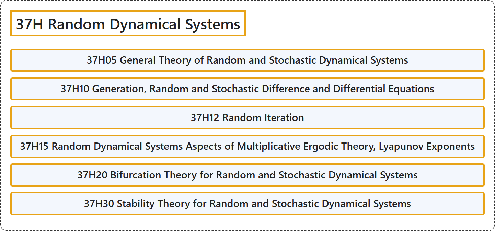

# 37H Random Dynamical Systems

## Classification

## Glossary

| Term | Definition | 中文翻译 | Source |
|---|---|---|---|
| **37H Random Dynamical Systems** 随机动力系统 | (No definition) | （无定义） | [Associate Editors of Mathematical Reviews and zbMATH, 2020](https://msc2020.org/) |
| **37H05 General Theory of Random and Stochastic Dynamical Systems** 随机动力系统与随机性动力系统的一般理论 | (No definition) | （无定义） | [Associate Editors of Mathematical Reviews and zbMATH, 2020](https://msc2020.org/) |
| **37H10 Generation, Random and Stochastic Difference and Differential Equations** 生成，随机与随机性差分方程和微分方程 | (No definition) | （无定义） | [Associate Editors of Mathematical Reviews and zbMATH, 2020](https://msc2020.org/) |
| **37H12 Random Iteration** 随机迭代 | (No definition) | （无定义） | [Associate Editors of Mathematical Reviews and zbMATH, 2020](https://msc2020.org/) |
| **37H15 Random Dynamical Systems Aspects of Multiplicative Ergodic Theory, Lyapunov Exponents** 乘性遍历理论、李雅普诺夫指数的随机动力系统方面 | (No definition) | （无定义） | [Associate Editors of Mathematical Reviews and zbMATH, 2020](https://msc2020.org/) |
| **37H20 Bifurcation Theory for Random and Stochastic Dynamical Systems** 随机动力系统与随机性动力系统的分岔理论 | (No definition) | （无定义） | [Associate Editors of Mathematical Reviews and zbMATH, 2020](https://msc2020.org/) |
| **37H30 Stability Theory for Random and Stochastic Dynamical Systems** 随机动力系统与随机性动力系统的稳定性理论 | (No definition) | （无定义） | [Associate Editors of Mathematical Reviews and zbMATH, 2020](https://msc2020.org/) |

## References

Associate Editors of Mathematical Reviews and zbMATH. (2020). *MSC2020: Mathematics Subject Classification system*. Retrieved October 27, 2026, from <https://msc2020.org/>
