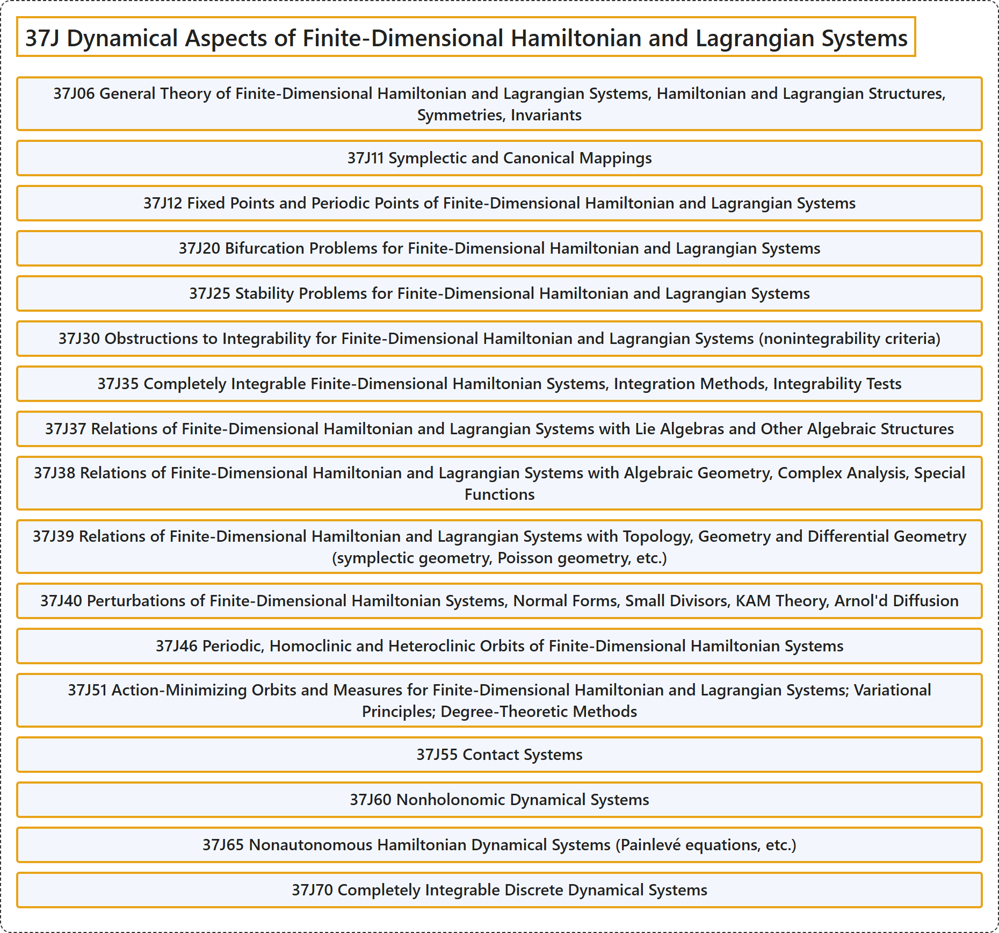

# 37J Dynamical Aspects of Finite-Dimensional Hamiltonian and Lagrangian Systems

## Classification

## Glossary

| Term | Definition | 中文翻译 | Source |
|---|---|---|---|
| **37J Dynamical Aspects of Finite-Dimensional Hamiltonian and Lagrangian Systems** 有限维哈密顿系统与拉格朗日系统的动力学方面 | (No definition) | （无定义） | [Associate Editors of Mathematical Reviews and zbMATH, 2020](https://msc2020.org/) |
| **37J06 General Theory of Finite-Dimensional Hamiltonian and Lagrangian Systems, Hamiltonian and Lagrangian Structures, Symmetries, Invariants** 有限维哈密顿系统与拉格朗日系统的一般理论，哈密顿结构与拉格朗日结构，对称性，不变量 | (No definition) | （无定义） | [Associate Editors of Mathematical Reviews and zbMATH, 2020](https://msc2020.org/) |
| **37J11 Symplectic and Canonical Mappings** 辛映射与正则映射 | (No definition) | （无定义） | [Associate Editors of Mathematical Reviews and zbMATH, 2020](https://msc2020.org/) |
| **37J12 Fixed Points and Periodic Points of Finite-Dimensional Hamiltonian and Lagrangian Systems** 有限维哈密顿系统与拉格朗日系统的不动点与周期点 | (No definition) | （无定义） | [Associate Editors of Mathematical Reviews and zbMATH, 2020](https://msc2020.org/) |
| **37J20 Bifurcation Problems for Finite-Dimensional Hamiltonian and Lagrangian Systems** 有限维哈密顿系统与拉格朗日系统的分岔问题 | (No definition) | （无定义） | [Associate Editors of Mathematical Reviews and zbMATH, 2020](https://msc2020.org/) |
| **37J25 Stability Problems for Finite-Dimensional Hamiltonian and Lagrangian Systems** 有限维哈密顿系统与拉格朗日系统的稳定性问题 | (No definition) | （无定义） | [Associate Editors of Mathematical Reviews and zbMATH, 2020](https://msc2020.org/) |
| **37J30 Obstructions to Integrability for Finite-Dimensional Hamiltonian and Lagrangian Systems (nonintegrability criteria)** 有限维哈密顿系统与拉格朗日系统可积性的障碍（不可积性判据） | (No definition) | （无定义） | [Associate Editors of Mathematical Reviews and zbMATH, 2020](https://msc2020.org/) |
| **37J35 Completely Integrable Finite-Dimensional Hamiltonian Systems, Integration Methods, Integrability Tests** 完全可积有限维哈密顿系统，积分方法，可积性检验 | (No definition) | （无定义） | [Associate Editors of Mathematical Reviews and zbMATH, 2020](https://msc2020.org/) |
| **37J37 Relations of Finite-Dimensional Hamiltonian and Lagrangian Systems with Lie Algebras and Other Algebraic Structures** 有限维哈密顿系统与拉格朗日系统与李代数及其他代数结构的关系 | (No definition) | （无定义） | [Associate Editors of Mathematical Reviews and zbMATH, 2020](https://msc2020.org/) |
| **37J38 Relations of Finite-Dimensional Hamiltonian and Lagrangian Systems with Algebraic Geometry, Complex Analysis, Special Functions** 有限维哈密顿系统与拉格朗日系统与代数几何、复分析、特殊函数的关系 | (No definition) | （无定义） | [Associate Editors of Mathematical Reviews and zbMATH, 2020](https://msc2020.org/) |
| **37J39 Relations of Finite-Dimensional Hamiltonian and Lagrangian Systems with Topology, Geometry and Differential Geometry (symplectic geometry, Poisson geometry, etc.)** 有限维哈密顿系统与拉格朗日系统与拓扑、几何和微分几何（辛几何、泊松几何等）的关系 | (No definition) | （无定义） | [Associate Editors of Mathematical Reviews and zbMATH, 2020](https://msc2020.org/) |
| **37J40 Perturbations of Finite-Dimensional Hamiltonian Systems, Normal Forms, Small Divisors, KAM Theory, Arnol'd Diffusion** 有限维哈密顿系统的扰动，正规形，小分母，KAM 理论，阿诺尔德扩散 | (No definition) | （无定义） | [Associate Editors of Mathematical Reviews and zbMATH, 2020](https://msc2020.org/) |
| **37J46 Periodic, Homoclinic and Heteroclinic Orbits of Finite-Dimensional Hamiltonian Systems** 有限维哈密顿系统的周期轨道、同宿轨道与异宿轨道 | (No definition) | （无定义） | [Associate Editors of Mathematical Reviews and zbMATH, 2020](https://msc2020.org/) |
| **37J51 Action-Minimizing Orbits and Measures for Finite-Dimensional Hamiltonian and Lagrangian Systems; Variational Principles; Degree-Theoretic Methods** 有限维哈密顿系统与拉格朗日系统的作用极小轨道与测度；变分原理；度理论方法 | (No definition) | （无定义） | [Associate Editors of Mathematical Reviews and zbMATH, 2020](https://msc2020.org/) |
| **37J55 Contact Systems** 接触系统 | (No definition) | （无定义） | [Associate Editors of Mathematical Reviews and zbMATH, 2020](https://msc2020.org/) |
| **37J60 Nonholonomic Dynamical Systems** 非完整动力系统 | (No definition) | （无定义） | [Associate Editors of Mathematical Reviews and zbMATH, 2020](https://msc2020.org/) |
| **37J65 Nonautonomous Hamiltonian Dynamical Systems (Painlevé equations, etc.)** 非自治哈密顿动力系统（潘勒韦方程等） | (No definition) | （无定义） | [Associate Editors of Mathematical Reviews and zbMATH, 2020](https://msc2020.org/) |
| **37J70 Completely Integrable Discrete Dynamical Systems** 完全可积离散动力系统 | (No definition) | （无定义） | [Associate Editors of Mathematical Reviews and zbMATH, 2020](https://msc2020.org/) |

## References

Associate Editors of Mathematical Reviews and zbMATH. (2020). *MSC2020: Mathematics Subject Classification system*. Retrieved October 27, 2026, from <https://msc2020.org/>
