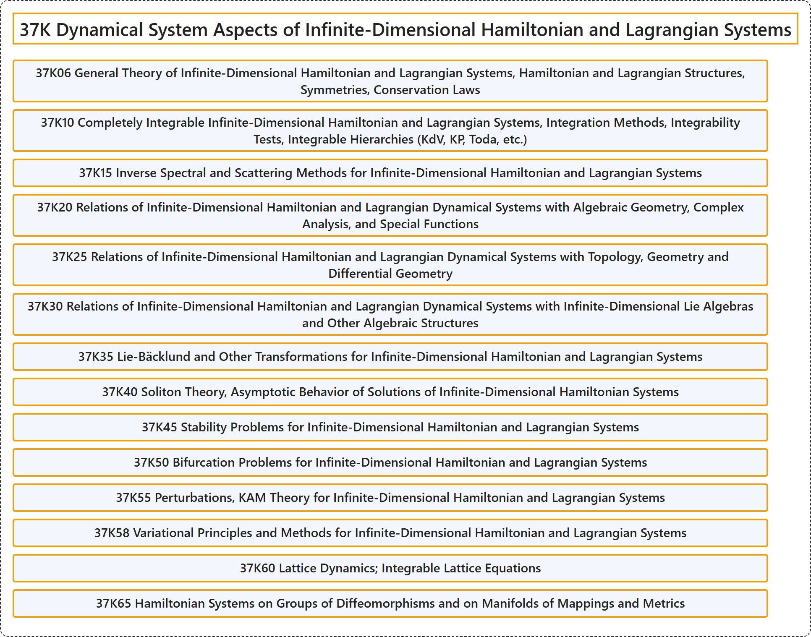

# 37K Dynamical System Aspects of Infinite-Dimensional Hamiltonian and Lagrangian Systems

## Classification

## Glossary

| Term | Definition | 中文翻译 | Source |
|---|---|---|---|
| **37K Dynamical System Aspects of Infinite-Dimensional Hamiltonian and Lagrangian Systems** 无穷维哈密顿系统与拉格朗日系统的动力系统方面 | (No definition) | （无定义） | [Associate Editors of Mathematical Reviews and zbMATH, 2020](https://msc2020.org/) |
| **37K06 General Theory of Infinite-Dimensional Hamiltonian and Lagrangian Systems, Hamiltonian and Lagrangian Structures, Symmetries, Conservation Laws** 无穷维哈密顿系统与拉格朗日系统的一般理论，哈密顿结构与拉格朗日结构，对称性，守恒律 | (No definition) | （无定义） | [Associate Editors of Mathematical Reviews and zbMATH, 2020](https://msc2020.org/) |
| **37K10 Completely Integrable Infinite-Dimensional Hamiltonian and Lagrangian Systems, Integration Methods, Integrability Tests, Integrable Hierarchies (KdV, KP, Toda, etc.)** 完全可积无穷维哈密顿系统与拉格朗日系统，积分方法，可积性检验，可积族列（KdV、KP、户田等） | (No definition) | （无定义） | [Associate Editors of Mathematical Reviews and zbMATH, 2020](https://msc2020.org/) |
| **37K15 Inverse Spectral and Scattering Methods for Infinite-Dimensional Hamiltonian and Lagrangian Systems** 无穷维哈密顿系统与拉格朗日系统的反谱方法与散射方法 | (No definition) | （无定义） | [Associate Editors of Mathematical Reviews and zbMATH, 2020](https://msc2020.org/) |
| **37K20 Relations of Infinite-Dimensional Hamiltonian and Lagrangian Dynamical Systems with Algebraic Geometry, Complex Analysis, and Special Functions** 无穷维哈密顿动力系统与拉格朗日动力系统与代数几何、复分析和特殊函数的关系 | (No definition) | （无定义） | [Associate Editors of Mathematical Reviews and zbMATH, 2020](https://msc2020.org/) |
| **37K25 Relations of Infinite-Dimensional Hamiltonian and Lagrangian Dynamical Systems with Topology, Geometry and Differential Geometry** 无穷维哈密顿动力系统与拉格朗日动力系统与拓扑、几何和微分几何的关系 | (No definition) | （无定义） | [Associate Editors of Mathematical Reviews and zbMATH, 2020](https://msc2020.org/) |
| **37K30 Relations of Infinite-Dimensional Hamiltonian and Lagrangian Dynamical Systems with Infinite-Dimensional Lie Algebras and Other Algebraic Structures** 无穷维哈密顿动力系统与拉格朗日动力系统与无穷维李代数及其他代数结构的关系 | (No definition) | （无定义） | [Associate Editors of Mathematical Reviews and zbMATH, 2020](https://msc2020.org/) |
| **37K35 Lie-Bäcklund and Other Transformations for Infinite-Dimensional Hamiltonian and Lagrangian Systems** 无穷维哈密顿系统与拉格朗日系统的李-贝克隆变换及其他变换 | (No definition) | （无定义） | [Associate Editors of Mathematical Reviews and zbMATH, 2020](https://msc2020.org/) |
| **37K40 Soliton Theory, Asymptotic Behavior of Solutions of Infinite-Dimensional Hamiltonian Systems** 孤子理论，无穷维哈密顿系统解的渐近行为 | (No definition) | （无定义） | [Associate Editors of Mathematical Reviews and zbMATH, 2020](https://msc2020.org/) |
| **37K45 Stability Problems for Infinite-Dimensional Hamiltonian and Lagrangian Systems** 无穷维哈密顿系统与拉格朗日系统的稳定性问题 | (No definition) | （无定义） | [Associate Editors of Mathematical Reviews and zbMATH, 2020](https://msc2020.org/) |
| **37K50 Bifurcation Problems for Infinite-Dimensional Hamiltonian and Lagrangian Systems** 无穷维哈密顿系统与拉格朗日系统的分岔问题 | (No definition) | （无定义） | [Associate Editors of Mathematical Reviews and zbMATH, 2020](https://msc2020.org/) |
| **37K55 Perturbations, KAM Theory for Infinite-Dimensional Hamiltonian and Lagrangian Systems** 无穷维哈密顿系统与拉格朗日系统的扰动，KAM 理论 | (No definition) | （无定义） | [Associate Editors of Mathematical Reviews and zbMATH, 2020](https://msc2020.org/) |
| **37K58 Variational Principles and Methods for Infinite-Dimensional Hamiltonian and Lagrangian Systems** 无穷维哈密顿系统与拉格朗日系统的变分原理与方法 | (No definition) | （无定义） | [Associate Editors of Mathematical Reviews and zbMATH, 2020](https://msc2020.org/) |
| **37K60 Lattice Dynamics; Integrable Lattice Equations** 格点动力学；可积格点方程 | (No definition) | （无定义） | [Associate Editors of Mathematical Reviews and zbMATH, 2020](https://msc2020.org/) |
| **37K65 Hamiltonian Systems on Groups of Diffeomorphisms and on Manifolds of Mappings and Metrics** 微分同胚群及映射流形与度量流形上的哈密顿系统 | (No definition) | （无定义） | [Associate Editors of Mathematical Reviews and zbMATH, 2020](https://msc2020.org/) |

## References

Associate Editors of Mathematical Reviews and zbMATH. (2020). *MSC2020: Mathematics Subject Classification system*. Retrieved October 27, 2026, from <https://msc2020.org/>
