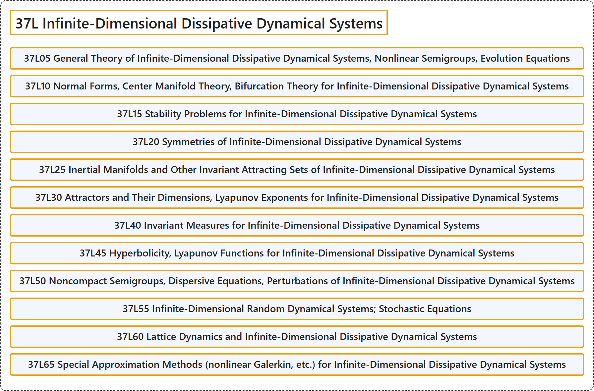

# 37L Infinite-Dimensional Dissipative Dynamical Systems

## Classification

## Glossary

| Term | Definition | 中文翻译 | Source |
|---|---|---|---|
| **37L Infinite-Dimensional Dissipative Dynamical Systems** 无穷维耗散动力系统 | (No definition) | （无定义） | [Associate Editors of Mathematical Reviews and zbMATH, 2020](https://msc2020.org/) |
| **37L05 General Theory of Infinite-Dimensional Dissipative Dynamical Systems, Nonlinear Semigroups, Evolution Equations** 无穷维耗散动力系统的一般理论，非线性半群，发展方程 | (No definition) | （无定义） | [Associate Editors of Mathematical Reviews and zbMATH, 2020](https://msc2020.org/) |
| **37L10 Normal Forms, Center Manifold Theory, Bifurcation Theory for Infinite-Dimensional Dissipative Dynamical Systems** 无穷维耗散动力系统的正规形，中心流形理论，分岔理论 | (No definition) | （无定义） | [Associate Editors of Mathematical Reviews and zbMATH, 2020](https://msc2020.org/) |
| **37L15 Stability Problems for Infinite-Dimensional Dissipative Dynamical Systems** 无穷维耗散动力系统的稳定性问题 | (No definition) | （无定义） | [Associate Editors of Mathematical Reviews and zbMATH, 2020](https://msc2020.org/) |
| **37L20 Symmetries of Infinite-Dimensional Dissipative Dynamical Systems** 无穷维耗散动力系统的对称性 | (No definition) | （无定义） | [Associate Editors of Mathematical Reviews and zbMATH, 2020](https://msc2020.org/) |
| **37L25 Inertial Manifolds and Other Invariant Attracting Sets of Infinite-Dimensional Dissipative Dynamical Systems** 无穷维耗散动力系统的惯性流形及其他不变吸引集 | (No definition) | （无定义） | [Associate Editors of Mathematical Reviews and zbMATH, 2020](https://msc2020.org/) |
| **37L30 Attractors and Their Dimensions, Lyapunov Exponents for Infinite-Dimensional Dissipative Dynamical Systems** 无穷维耗散动力系统的吸引子及其维数，李雅普诺夫指数 | (No definition) | （无定义） | [Associate Editors of Mathematical Reviews and zbMATH, 2020](https://msc2020.org/) |
| **37L40 Invariant Measures for Infinite-Dimensional Dissipative Dynamical Systems** 无穷维耗散动力系统的不变测度 | (No definition) | （无定义） | [Associate Editors of Mathematical Reviews and zbMATH, 2020](https://msc2020.org/) |
| **37L45 Hyperbolicity, Lyapunov Functions for Infinite-Dimensional Dissipative Dynamical Systems** 无穷维耗散动力系统的双曲性，李雅普诺夫函数 | (No definition) | （无定义） | [Associate Editors of Mathematical Reviews and zbMATH, 2020](https://msc2020.org/) |
| **37L50 Noncompact Semigroups, Dispersive Equations, Perturbations of Infinite-Dimensional Dissipative Dynamical Systems** 无穷维耗散动力系统的非紧半群，色散方程，扰动 | (No definition) | （无定义） | [Associate Editors of Mathematical Reviews and zbMATH, 2020](https://msc2020.org/) |
| **37L55 Infinite-Dimensional Random Dynamical Systems; Stochastic Equations** 无穷维随机动力系统；随机方程 | (No definition) | （无定义） | [Associate Editors of Mathematical Reviews and zbMATH, 2020](https://msc2020.org/) |
| **37L60 Lattice Dynamics and Infinite-Dimensional Dissipative Dynamical Systems** 格点动力学与无穷维耗散动力系统 | (No definition) | （无定义） | [Associate Editors of Mathematical Reviews and zbMATH, 2020](https://msc2020.org/) |
| **37L65 Special Approximation Methods (nonlinear Galerkin, etc.) for Infinite-Dimensional Dissipative Dynamical Systems** 无穷维耗散动力系统的特殊逼近方法（非线性伽辽金等） | (No definition) | （无定义） | [Associate Editors of Mathematical Reviews and zbMATH, 2020](https://msc2020.org/) |

## References

Associate Editors of Mathematical Reviews and zbMATH. (2020). *MSC2020: Mathematics Subject Classification system*. Retrieved October 27, 2026, from <https://msc2020.org/>
