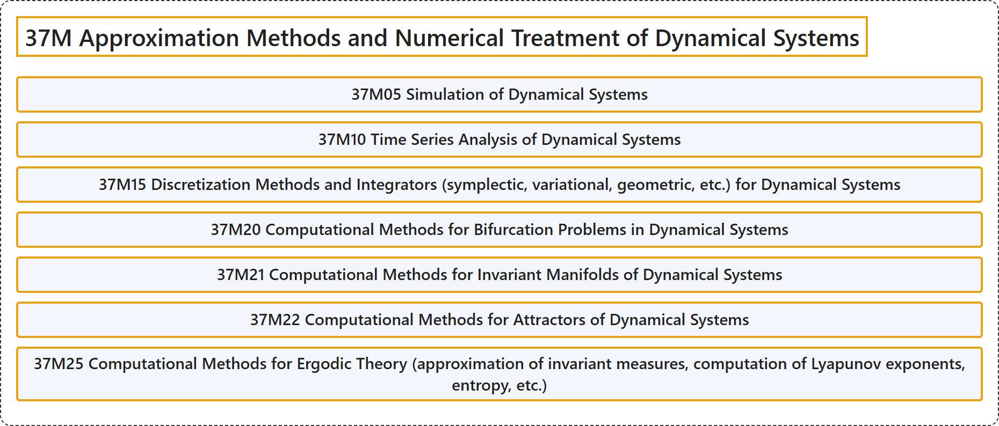

# 37M Approximation Methods and Numerical Treatment of Dynamical Systems

## Classification

## Glossary

| Term | Definition | 中文翻译 | Source |
|---|---|---|---|
| **37M Approximation Methods and Numerical Treatment of Dynamical Systems** 动力系统的逼近方法与数值处理 | (No definition) | （无定义） | [Associate Editors of Mathematical Reviews and zbMATH, 2020](https://msc2020.org/) |
| **37M05 Simulation of Dynamical Systems** 动力系统的模拟 | (No definition) | （无定义） | [Associate Editors of Mathematical Reviews and zbMATH, 2020](https://msc2020.org/) |
| **37M10 Time Series Analysis of Dynamical Systems** 动力系统的时间序列分析 | (No definition) | （无定义） | [Associate Editors of Mathematical Reviews and zbMATH, 2020](https://msc2020.org/) |
| **37M15 Discretization Methods and Integrators (symplectic, variational, geometric, etc.) for Dynamical Systems** 动力系统的离散化方法与积分器（辛、变分、几何等） | (No definition) | （无定义） | [Associate Editors of Mathematical Reviews and zbMATH, 2020](https://msc2020.org/) |
| **37M20 Computational Methods for Bifurcation Problems in Dynamical Systems** 动力系统中分岔问题的计算方法 | (No definition) | （无定义） | [Associate Editors of Mathematical Reviews and zbMATH, 2020](https://msc2020.org/) |
| **37M21 Computational Methods for Invariant Manifolds of Dynamical Systems** 动力系统不变流形的计算方法 | (No definition) | （无定义） | [Associate Editors of Mathematical Reviews and zbMATH, 2020](https://msc2020.org/) |
| **37M22 Computational Methods for Attractors of Dynamical Systems** 动力系统吸引子的计算方法 | (No definition) | （无定义） | [Associate Editors of Mathematical Reviews and zbMATH, 2020](https://msc2020.org/) |
| **37M25 Computational Methods for Ergodic Theory (approximation of invariant measures, computation of Lyapunov exponents, entropy, etc.)** 遍历理论的计算方法（不变测度的逼近，李雅普诺夫指数的计算，熵等） | (No definition) | （无定义） | [Associate Editors of Mathematical Reviews and zbMATH, 2020](https://msc2020.org/) |

## References

Associate Editors of Mathematical Reviews and zbMATH. (2020). *MSC2020: Mathematics Subject Classification system*. Retrieved October 27, 2026, from <https://msc2020.org/>
