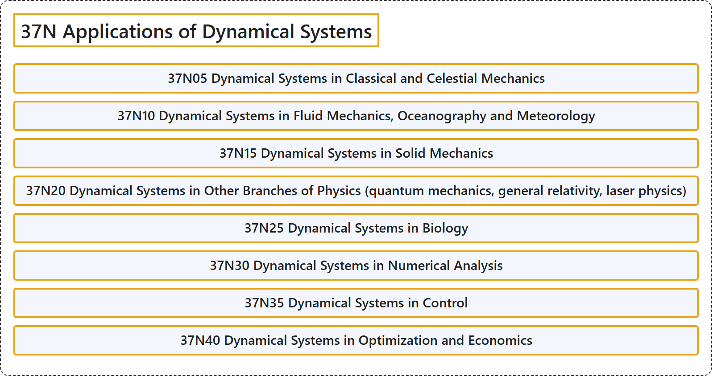

# 37N Applications of Dynamical Systems

## Classification

## Glossary

| Term | Definition | 中文翻译 | Source |
|---|---|---|---|
| **37N Applications of Dynamical Systems** 动力系统的应用 | (No definition) | （无定义） | [Associate Editors of Mathematical Reviews and zbMATH, 2020](https://msc2020.org/) |
| **37N05 Dynamical Systems in Classical and Celestial Mechanics** 经典力学与天体力学中的动力系统 | (No definition) | （无定义） | [Associate Editors of Mathematical Reviews and zbMATH, 2020](https://msc2020.org/) |
| **37N10 Dynamical Systems in Fluid Mechanics, Oceanography and Meteorology** 流体力学、海洋学与气象学中的动力系统 | (No definition) | （无定义） | [Associate Editors of Mathematical Reviews and zbMATH, 2020](https://msc2020.org/) |
| **37N15 Dynamical Systems in Solid Mechanics** 固体力学中的动力系统 | (No definition) | （无定义） | [Associate Editors of Mathematical Reviews and zbMATH, 2020](https://msc2020.org/) |
| **37N20 Dynamical Systems in Other Branches of Physics (quantum mechanics, general relativity, laser physics)** 物理学其他分支（量子力学、广义相对论、激光物理）中的动力系统 | (No definition) | （无定义） | [Associate Editors of Mathematical Reviews and zbMATH, 2020](https://msc2020.org/) |
| **37N25 Dynamical Systems in Biology** 生物学中的动力系统 | (No definition) | （无定义） | [Associate Editors of Mathematical Reviews and zbMATH, 2020](https://msc2020.org/) |
| **37N30 Dynamical Systems in Numerical Analysis** 数值分析中的动力系统 | (No definition) | （无定义） | [Associate Editors of Mathematical Reviews and zbMATH, 2020](https://msc2020.org/) |
| **37N35 Dynamical Systems in Control** 控制中的动力系统 | (No definition) | （无定义） | [Associate Editors of Mathematical Reviews and zbMATH, 2020](https://msc2020.org/) |
| **37N40 Dynamical Systems in Optimization and Economics** 最优化与经济学中的动力系统 | (No definition) | （无定义） | [Associate Editors of Mathematical Reviews and zbMATH, 2020](https://msc2020.org/) |

## References

Associate Editors of Mathematical Reviews and zbMATH. (2020). *MSC2020: Mathematics Subject Classification system*. Retrieved October 27, 2026, from <https://msc2020.org/>
