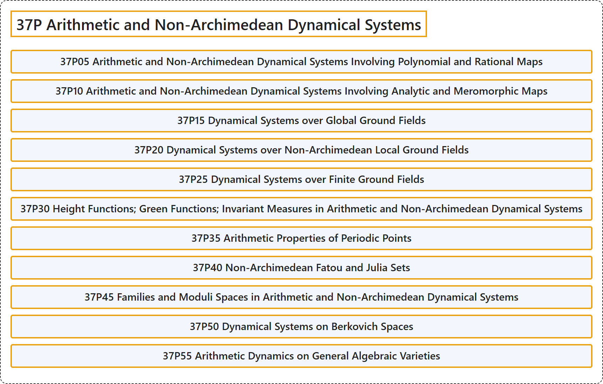

# 37P Arithmetic and Non-Archimedean Dynamical Systems

## Classification

## Glossary

| Term | Definition | 中文翻译 | Source |
|---|---|---|---|
| **37P Arithmetic and Non-Archimedean Dynamical Systems** 算术与非阿基米德动力系统 | (No definition) | （无定义） | [Associate Editors of Mathematical Reviews and zbMATH, 2020](https://msc2020.org/) |
| **37P05 Arithmetic and Non-Archimedean Dynamical Systems Involving Polynomial and Rational Maps** 涉及多项式映射与有理映射的算术与非阿基米德动力系统 | (No definition) | （无定义） | [Associate Editors of Mathematical Reviews and zbMATH, 2020](https://msc2020.org/) |
| **37P10 Arithmetic and Non-Archimedean Dynamical Systems Involving Analytic and Meromorphic Maps** 涉及解析映射与亚纯映射的算术与非阿基米德动力系统 | (No definition) | （无定义） | [Associate Editors of Mathematical Reviews and zbMATH, 2020](https://msc2020.org/) |
| **37P15 Dynamical Systems over Global Ground Fields** 整体基域上的动力系统 | (No definition) | （无定义） | [Associate Editors of Mathematical Reviews and zbMATH, 2020](https://msc2020.org/) |
| **37P20 Dynamical Systems over Non-Archimedean Local Ground Fields** 非阿基米德局部基域上的动力系统 | (No definition) | （无定义） | [Associate Editors of Mathematical Reviews and zbMATH, 2020](https://msc2020.org/) |
| **37P25 Dynamical Systems over Finite Ground Fields** 有限基域上的动力系统 | (No definition) | （无定义） | [Associate Editors of Mathematical Reviews and zbMATH, 2020](https://msc2020.org/) |
| **37P30 Height Functions; Green Functions; Invariant Measures in Arithmetic and Non-Archimedean Dynamical Systems** 算术与非阿基米德动力系统中的高度函数；格林函数；不变测度 | (No definition) | （无定义） | [Associate Editors of Mathematical Reviews and zbMATH, 2020](https://msc2020.org/) |
| **37P35 Arithmetic Properties of Periodic Points** 周期点的算术性质 | (No definition) | （无定义） | [Associate Editors of Mathematical Reviews and zbMATH, 2020](https://msc2020.org/) |
| **37P40 Non-Archimedean Fatou and Julia Sets** 非阿基米德法图集与朱利亚集 | (No definition) | （无定义） | [Associate Editors of Mathematical Reviews and zbMATH, 2020](https://msc2020.org/) |
| **37P45 Families and Moduli Spaces in Arithmetic and Non-Archimedean Dynamical Systems** 算术与非阿基米德动力系统中的族与模空间 | (No definition) | （无定义） | [Associate Editors of Mathematical Reviews and zbMATH, 2020](https://msc2020.org/) |
| **37P50 Dynamical Systems on Berkovich Spaces** 伯克维奇空间上的动力系统 | (No definition) | （无定义） | [Associate Editors of Mathematical Reviews and zbMATH, 2020](https://msc2020.org/) |
| **37P55 Arithmetic Dynamics on General Algebraic Varieties** 一般代数簇上的算术动力学 | (No definition) | （无定义） | [Associate Editors of Mathematical Reviews and zbMATH, 2020](https://msc2020.org/) |

## References

Associate Editors of Mathematical Reviews and zbMATH. (2020). *MSC2020: Mathematics Subject Classification system*. Retrieved October 27, 2026, from <https://msc2020.org/>
