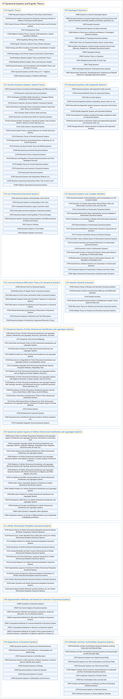

# 37 Dynamical Systems and Ergodic Theory

## Classification

## Glossary

| Term | Definition | 中文翻译 | Source |
|---|---|---|---|
| **37 Dynamical Systems and Ergodic Theory** 动力系统与遍历理论 | "A dynamical system describes **how a state evolves with time**." | 动力系统描述**状态如何随时间演化**。 | [Weisstein, n.d., "Dynamical system" entry, para. 1](https://mathworld.wolfram.com/DynamicalSystem.html#:~:text=A%20dynamical%20system%20describes%20how%20a%20state%20evolves%20with%20time) |
| **[37A Ergodic Theory](37a-ergodic-theory.md)** 遍历理论 | (No definition) | （无定义） | [Associate Editors of Mathematical Reviews and zbMATH, 2020](https://msc2020.org/) |
| **[37B Topological Dynamics](37b-topological-dynamics.md)** 拓扑动力学 | (No definition) | （无定义） | [Associate Editors of Mathematical Reviews and zbMATH, 2020](https://msc2020.org/) |
| **[37C Smooth Dynamical Systems: General Theory](37c-smooth-dynamical-systems-general-theory.md)** 光滑动力系统：一般理论 | (No definition) | （无定义） | [Associate Editors of Mathematical Reviews and zbMATH, 2020](https://msc2020.org/) |
| **[37D Dynamical Systems with Hyperbolic Behavior](37d-dynamical-systems-with-hyperbolic-behavior.md)** 具双曲行为的动力系统 | (No definition) | （无定义） | [Associate Editors of Mathematical Reviews and zbMATH, 2020](https://msc2020.org/) |
| **[37E Low-Dimensional Dynamical Systems](37e-low-dimensional-dynamical-systems.md)** 低维动力系统 | (No definition) | （无定义） | [Associate Editors of Mathematical Reviews and zbMATH, 2020](https://msc2020.org/) |
| **[37F Dynamical Systems over Complex Numbers](37f-dynamical-systems-over-complex-numbers.md)** 复数上的动力系统 | (No definition) | （无定义） | [Associate Editors of Mathematical Reviews and zbMATH, 2020](https://msc2020.org/) |
| **[37G Local and Nonlocal Bifurcation Theory for Dynamical Systems](37g-local-and-nonlocal-bifurcation-theory-for-dynamical-systems.md)** 动力系统的局部与非局部分岔理论 | (No definition) | （无定义） | [Associate Editors of Mathematical Reviews and zbMATH, 2020](https://msc2020.org/) |
| **[37H Random Dynamical Systems](37h-random-dynamical-systems.md)** 随机动力系统 | (No definition) | （无定义） | [Associate Editors of Mathematical Reviews and zbMATH, 2020](https://msc2020.org/) |
| **[37J Dynamical Aspects of Finite-Dimensional Hamiltonian and Lagrangian Systems](37j-dynamical-aspects-of-finite-dimensional-hamiltonian-and-lagr.md)** 有限维哈密顿系统与拉格朗日系统的动力学方面 | (No definition) | （无定义） | [Associate Editors of Mathematical Reviews and zbMATH, 2020](https://msc2020.org/) |
| **[37K Dynamical System Aspects of Infinite-Dimensional Hamiltonian and Lagrangian Systems](37k-dynamical-system-aspects-of-infinite-dimensional-hamiltonian.md)** 无穷维哈密顿系统与拉格朗日系统的动力系统方面 | (No definition) | （无定义） | [Associate Editors of Mathematical Reviews and zbMATH, 2020](https://msc2020.org/) |
| **[37L Infinite-Dimensional Dissipative Dynamical Systems](37l-infinite-dimensional-dissipative-dynamical-systems.md)** 无穷维耗散动力系统 | (No definition) | （无定义） | [Associate Editors of Mathematical Reviews and zbMATH, 2020](https://msc2020.org/) |
| **[37M Approximation Methods and Numerical Treatment of Dynamical Systems](37m-approximation-methods-and-numerical-treatment-of-dynamical-s.md)** 动力系统的逼近方法与数值处理 | (No definition) | （无定义） | [Associate Editors of Mathematical Reviews and zbMATH, 2020](https://msc2020.org/) |
| **[37N Applications of Dynamical Systems](37n-applications-of-dynamical-systems.md)** 动力系统的应用 | (No definition) | （无定义） | [Associate Editors of Mathematical Reviews and zbMATH, 2020](https://msc2020.org/) |
| **[37P Arithmetic and Non-Archimedean Dynamical Systems](37p-arithmetic-and-non-archimedean-dynamical-systems.md)** 算术与非阿基米德动力系统 | (No definition) | （无定义） | [Associate Editors of Mathematical Reviews and zbMATH, 2020](https://msc2020.org/) |

## References

Associate Editors of Mathematical Reviews and zbMATH. (2020). *MSC2020: Mathematics Subject Classification system*. Retrieved October 27, 2026, from <https://msc2020.org/>

Weisstein, E. W. (n.d.). *Dynamical system*. MathWorld: A Wolfram Resource. Retrieved October 27, 2026, from <https://mathworld.wolfram.com/DynamicalSystem.html>
