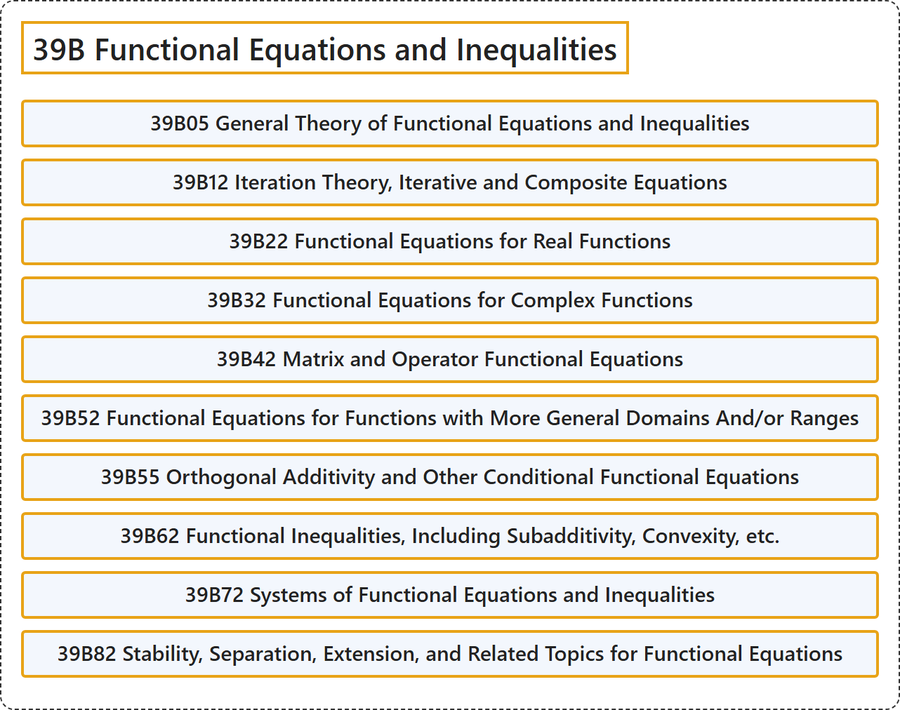

# 39B Functional Equations and Inequalities

## Classification

## Glossary

| Term | Definition | 中文翻译 | Source |
|---|---|---|---|
| **39B Functional Equations and Inequalities** 函数方程与不等式 | (No definition) | （无定义） | [Associate Editors of Mathematical Reviews and zbMATH, 2020](https://msc2020.org/) |
| **39B05 General Theory of Functional Equations and Inequalities** 函数方程与不等式的一般理论 | (No definition) | （无定义） | [Associate Editors of Mathematical Reviews and zbMATH, 2020](https://msc2020.org/) |
| **39B12 Iteration Theory, Iterative and Composite Equations** 迭代理论，迭代方程与复合方程 | (No definition) | （无定义） | [Associate Editors of Mathematical Reviews and zbMATH, 2020](https://msc2020.org/) |
| **39B22 Functional Equations for Real Functions** 实函数的函数方程 | (No definition) | （无定义） | [Associate Editors of Mathematical Reviews and zbMATH, 2020](https://msc2020.org/) |
| **39B32 Functional Equations for Complex Functions** 复函数的函数方程 | (No definition) | （无定义） | [Associate Editors of Mathematical Reviews and zbMATH, 2020](https://msc2020.org/) |
| **39B42 Matrix and Operator Functional Equations** 矩阵与算子函数方程 | (No definition) | （无定义） | [Associate Editors of Mathematical Reviews and zbMATH, 2020](https://msc2020.org/) |
| **39B52 Functional Equations for Functions with More General Domains And/or Ranges** 具有更一般定义域和（或）值域的函数的函数方程 | (No definition) | （无定义） | [Associate Editors of Mathematical Reviews and zbMATH, 2020](https://msc2020.org/) |
| **39B55 Orthogonal Additivity and Other Conditional Functional Equations** 正交可加性及其他条件函数方程 | (No definition) | （无定义） | [Associate Editors of Mathematical Reviews and zbMATH, 2020](https://msc2020.org/) |
| **39B62 Functional Inequalities, Including Subadditivity, Convexity, etc.** 函数不等式，包括次可加性、凸性等 | (No definition) | （无定义） | [Associate Editors of Mathematical Reviews and zbMATH, 2020](https://msc2020.org/) |
| **39B72 Systems of Functional Equations and Inequalities** 函数方程与不等式组 | (No definition) | （无定义） | [Associate Editors of Mathematical Reviews and zbMATH, 2020](https://msc2020.org/) |
| **39B82 Stability, Separation, Extension, and Related Topics for Functional Equations** 函数方程的稳定性、分离、延拓及相关主题 | (No definition) | （无定义） | [Associate Editors of Mathematical Reviews and zbMATH, 2020](https://msc2020.org/) |

## References

Associate Editors of Mathematical Reviews and zbMATH. (2020). *MSC2020: Mathematics Subject Classification system*. Retrieved October 27, 2026, from <https://msc2020.org/>
