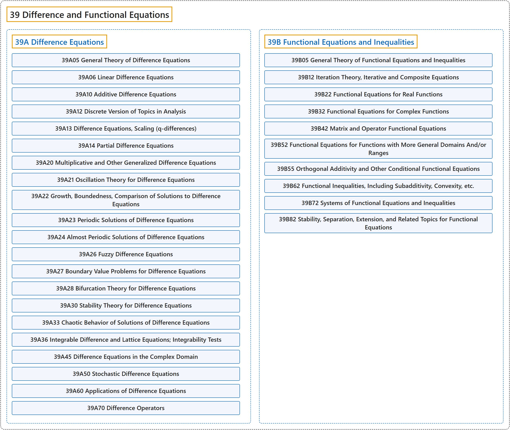

# 39 Difference and Functional Equations

## Classification

## Glossary

| Term | Definition | 中文翻译 | Source |
|---|---|---|---|
| **39 Difference and Functional Equations** 差分方程与函数方程 | "A difference equation, also called a finite difference equations, is an equation that **involves finite differences of a function**." | 差分方程（也称有限差分方程）是**含有函数的有限差分**的方程。 | [Weisstein, n.d., "Difference equation" entry, para. 1](https://mathworld.wolfram.com/DifferenceEquation.html#:~:text=is%20an%20equation%20that%20involves%20finite%20differences%20of%20a%20function) |
| **[39A Difference Equations](39a-difference-equations.md)** 差分方程 | (No definition) | （无定义） | [Associate Editors of Mathematical Reviews and zbMATH, 2020](https://msc2020.org/) |
| **[39B Functional Equations and Inequalities](39b-functional-equations-and-inequalities.md)** 函数方程与不等式 | (No definition) | （无定义） | [Associate Editors of Mathematical Reviews and zbMATH, 2020](https://msc2020.org/) |

## References

Associate Editors of Mathematical Reviews and zbMATH. (2020). *MSC2020: Mathematics Subject Classification system*. Retrieved October 27, 2026, from <https://msc2020.org/>

Weisstein, E. W. (n.d.). *Difference equation*. MathWorld: A Wolfram Resource. Retrieved October 27, 2026, from <https://mathworld.wolfram.com/DifferenceEquation.html>
