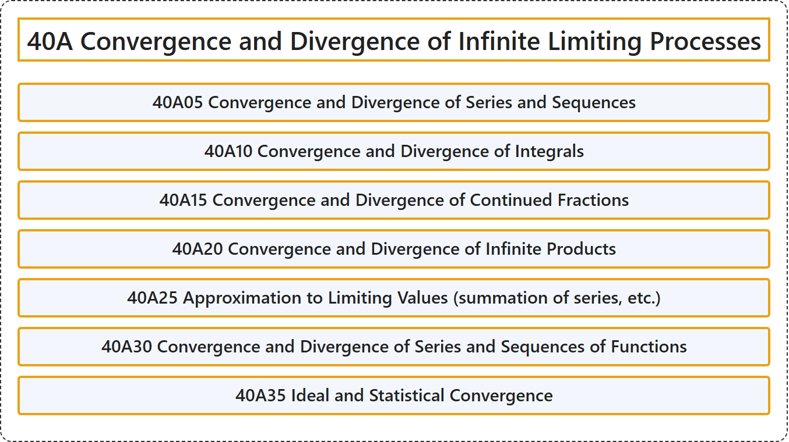

# 40A Convergence and Divergence of Infinite Limiting Processes

## Classification

## Glossary

| Term | Definition | 中文翻译 | Source |
|---|---|---|---|
| **40A Convergence and Divergence of Infinite Limiting Processes** 无穷极限过程的收敛与发散 | (No definition) | （无定义） | [Associate Editors of Mathematical Reviews and zbMATH, 2020](https://msc2020.org/) |
| **40A05 Convergence and Divergence of Series and Sequences** 级数与序列的收敛与发散 | (No definition) | （无定义） | [Associate Editors of Mathematical Reviews and zbMATH, 2020](https://msc2020.org/) |
| **40A10 Convergence and Divergence of Integrals** 积分的收敛与发散 | (No definition) | （无定义） | [Associate Editors of Mathematical Reviews and zbMATH, 2020](https://msc2020.org/) |
| **40A15 Convergence and Divergence of Continued Fractions** 连分数的收敛与发散 | (No definition) | （无定义） | [Associate Editors of Mathematical Reviews and zbMATH, 2020](https://msc2020.org/) |
| **40A20 Convergence and Divergence of Infinite Products** 无穷乘积的收敛与发散 | (No definition) | （无定义） | [Associate Editors of Mathematical Reviews and zbMATH, 2020](https://msc2020.org/) |
| **40A25 Approximation to Limiting Values (summation of series, etc.)** 对极限值的逼近（级数求和等） | (No definition) | （无定义） | [Associate Editors of Mathematical Reviews and zbMATH, 2020](https://msc2020.org/) |
| **40A30 Convergence and Divergence of Series and Sequences of Functions** 函数项级数与函数列的收敛与发散 | (No definition) | （无定义） | [Associate Editors of Mathematical Reviews and zbMATH, 2020](https://msc2020.org/) |
| **40A35 Ideal and Statistical Convergence** 理想收敛与统计收敛 | (No definition) | （无定义） | [Associate Editors of Mathematical Reviews and zbMATH, 2020](https://msc2020.org/) |

## References

Associate Editors of Mathematical Reviews and zbMATH. (2020). *MSC2020: Mathematics Subject Classification system*. Retrieved October 27, 2026, from <https://msc2020.org/>
