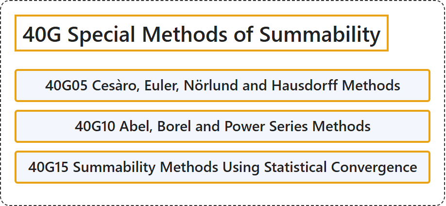

# 40G Special Methods of Summability

## Classification

## Glossary

| Term | Definition | 中文翻译 | Source |
|---|---|---|---|
| **40G Special Methods of Summability** 特殊可和方法 | (No definition) | （无定义） | [Associate Editors of Mathematical Reviews and zbMATH, 2020](https://msc2020.org/) |
| **40G05 Cesàro, Euler, Nörlund and Hausdorff Methods** 切萨罗、欧拉、诺尔隆德与豪斯多夫方法 | (No definition) | （无定义） | [Associate Editors of Mathematical Reviews and zbMATH, 2020](https://msc2020.org/) |
| **40G10 Abel, Borel and Power Series Methods** 阿贝尔、博雷尔与幂级数方法 | (No definition) | （无定义） | [Associate Editors of Mathematical Reviews and zbMATH, 2020](https://msc2020.org/) |
| **40G15 Summability Methods Using Statistical Convergence** 使用统计收敛的可和方法 | (No definition) | （无定义） | [Associate Editors of Mathematical Reviews and zbMATH, 2020](https://msc2020.org/) |

## References

Associate Editors of Mathematical Reviews and zbMATH. (2020). *MSC2020: Mathematics Subject Classification system*. Retrieved October 27, 2026, from <https://msc2020.org/>
