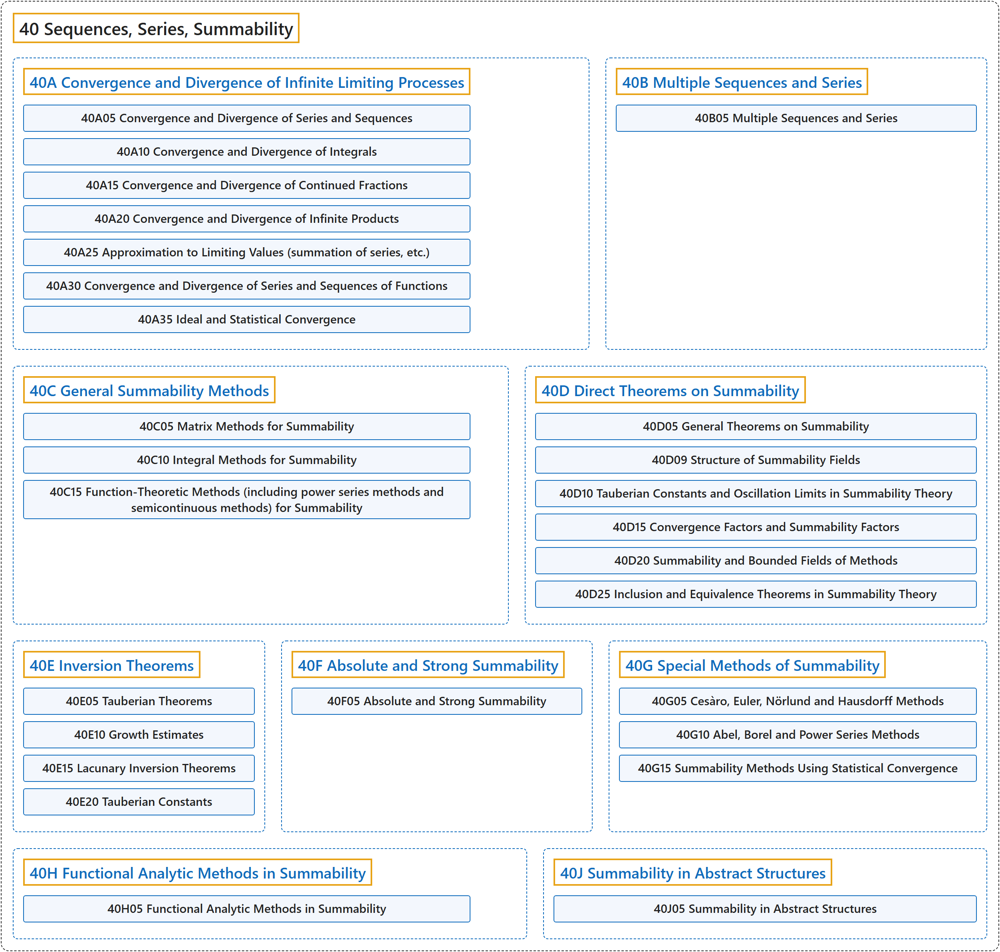

# 40 Sequences, Series, Summability

## Classification

## Glossary

| Term | Definition | 中文翻译 | Source |
|---|---|---|---|
| **40 Sequences, Series, Summability** 序列、级数、可和性 | "A sequence is an **ordered set of mathematical objects**." | 序列是**数学对象的有序集合**。 | [Weisstein, n.d., "Sequence" entry, para. 1](https://mathworld.wolfram.com/Sequence.html#:~:text=A%20sequence%20is%20an%20ordered%20set%20of%20mathematical%20objects) |
| **[40A Convergence and Divergence of Infinite Limiting Processes](40a-convergence-and-divergence-of-infinite-limiting-processes.md)** 无穷极限过程的收敛与发散 | (No definition) | （无定义） | [Associate Editors of Mathematical Reviews and zbMATH, 2020](https://msc2020.org/) |
| **[40B Multiple Sequences and Series](40b-multiple-sequences-and-series.md)** 多重序列与级数 | (No definition) | （无定义） | [Associate Editors of Mathematical Reviews and zbMATH, 2020](https://msc2020.org/) |
| **[40C General Summability Methods](40c-general-summability-methods.md)** 一般可和方法 | (No definition) | （无定义） | [Associate Editors of Mathematical Reviews and zbMATH, 2020](https://msc2020.org/) |
| **[40D Direct Theorems on Summability](40d-direct-theorems-on-summability.md)** 可和性的直接定理 | (No definition) | （无定义） | [Associate Editors of Mathematical Reviews and zbMATH, 2020](https://msc2020.org/) |
| **[40E Inversion Theorems](40e-inversion-theorems.md)** 反演定理 | (No definition) | （无定义） | [Associate Editors of Mathematical Reviews and zbMATH, 2020](https://msc2020.org/) |
| **[40F Absolute and Strong Summability](40f-absolute-and-strong-summability.md)** 绝对可和与强可和 | (No definition) | （无定义） | [Associate Editors of Mathematical Reviews and zbMATH, 2020](https://msc2020.org/) |
| **[40G Special Methods of Summability](40g-special-methods-of-summability.md)** 特殊可和方法 | (No definition) | （无定义） | [Associate Editors of Mathematical Reviews and zbMATH, 2020](https://msc2020.org/) |
| **[40H Functional Analytic Methods in Summability](40h-functional-analytic-methods-in-summability.md)** 可和性中的泛函分析方法 | (No definition) | （无定义） | [Associate Editors of Mathematical Reviews and zbMATH, 2020](https://msc2020.org/) |
| **[40J Summability in Abstract Structures](40j-summability-in-abstract-structures.md)** 抽象结构中的可和性 | (No definition) | （无定义） | [Associate Editors of Mathematical Reviews and zbMATH, 2020](https://msc2020.org/) |

## References

Associate Editors of Mathematical Reviews and zbMATH. (2020). *MSC2020: Mathematics Subject Classification system*. Retrieved October 27, 2026, from <https://msc2020.org/>

Weisstein, E. W. (n.d.). *Sequence*. MathWorld: A Wolfram Resource. Retrieved October 27, 2026, from <https://mathworld.wolfram.com/Sequence.html>
