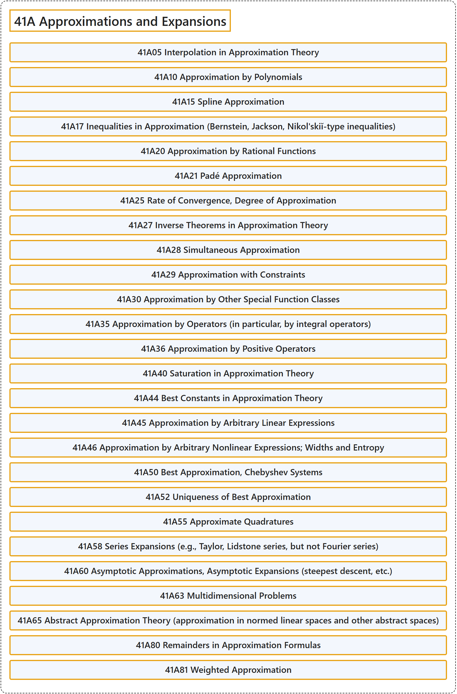

# 41A Approximations and Expansions

## Classification

## Glossary

| Term | Definition | 中文翻译 | Source |
|---|---|---|---|
| **41A Approximations and Expansions** 逼近与展开 | (No definition) | （无定义） | [Associate Editors of Mathematical Reviews and zbMATH, 2020](https://msc2020.org/) |
| **41A05 Interpolation in Approximation Theory** 逼近论中的插值 | (No definition) | （无定义） | [Associate Editors of Mathematical Reviews and zbMATH, 2020](https://msc2020.org/) |
| **41A10 Approximation by Polynomials** 多项式逼近 | (No definition) | （无定义） | [Associate Editors of Mathematical Reviews and zbMATH, 2020](https://msc2020.org/) |
| **41A15 Spline Approximation** 样条逼近 | (No definition) | （无定义） | [Associate Editors of Mathematical Reviews and zbMATH, 2020](https://msc2020.org/) |
| **41A17 Inequalities in Approximation (Bernstein, Jackson, Nikol'skiĭ-type inequalities)** 逼近中的不等式（伯恩斯坦、杰克逊、尼科尔斯基型不等式） | (No definition) | （无定义） | [Associate Editors of Mathematical Reviews and zbMATH, 2020](https://msc2020.org/) |
| **41A20 Approximation by Rational Functions** 有理函数逼近 | (No definition) | （无定义） | [Associate Editors of Mathematical Reviews and zbMATH, 2020](https://msc2020.org/) |
| **41A21 Padé Approximation** 帕德逼近 | (No definition) | （无定义） | [Associate Editors of Mathematical Reviews and zbMATH, 2020](https://msc2020.org/) |
| **41A25 Rate of Convergence, Degree of Approximation** 收敛速度，逼近阶 | (No definition) | （无定义） | [Associate Editors of Mathematical Reviews and zbMATH, 2020](https://msc2020.org/) |
| **41A27 Inverse Theorems in Approximation Theory** 逼近论中的逆定理 | (No definition) | （无定义） | [Associate Editors of Mathematical Reviews and zbMATH, 2020](https://msc2020.org/) |
| **41A28 Simultaneous Approximation** 同时逼近 | (No definition) | （无定义） | [Associate Editors of Mathematical Reviews and zbMATH, 2020](https://msc2020.org/) |
| **41A29 Approximation with Constraints** 带约束的逼近 | (No definition) | （无定义） | [Associate Editors of Mathematical Reviews and zbMATH, 2020](https://msc2020.org/) |
| **41A30 Approximation by Other Special Function Classes** 用其他特殊函数类逼近 | (No definition) | （无定义） | [Associate Editors of Mathematical Reviews and zbMATH, 2020](https://msc2020.org/) |
| **41A35 Approximation by Operators (in particular, by integral operators)** 用算子逼近（特别是用积分算子） | (No definition) | （无定义） | [Associate Editors of Mathematical Reviews and zbMATH, 2020](https://msc2020.org/) |
| **41A36 Approximation by Positive Operators** 用正算子逼近 | (No definition) | （无定义） | [Associate Editors of Mathematical Reviews and zbMATH, 2020](https://msc2020.org/) |
| **41A40 Saturation in Approximation Theory** 逼近论中的饱和 | (No definition) | （无定义） | [Associate Editors of Mathematical Reviews and zbMATH, 2020](https://msc2020.org/) |
| **41A44 Best Constants in Approximation Theory** 逼近论中的最佳常数 | (No definition) | （无定义） | [Associate Editors of Mathematical Reviews and zbMATH, 2020](https://msc2020.org/) |
| **41A45 Approximation by Arbitrary Linear Expressions** 用任意线性表达式逼近 | (No definition) | （无定义） | [Associate Editors of Mathematical Reviews and zbMATH, 2020](https://msc2020.org/) |
| **41A46 Approximation by Arbitrary Nonlinear Expressions; Widths and Entropy** 用任意非线性表达式逼近；宽度与熵 | (No definition) | （无定义） | [Associate Editors of Mathematical Reviews and zbMATH, 2020](https://msc2020.org/) |
| **41A50 Best Approximation, Chebyshev Systems** 最佳逼近，切比雪夫系 | (No definition) | （无定义） | [Associate Editors of Mathematical Reviews and zbMATH, 2020](https://msc2020.org/) |
| **41A52 Uniqueness of Best Approximation** 最佳逼近的唯一性 | (No definition) | （无定义） | [Associate Editors of Mathematical Reviews and zbMATH, 2020](https://msc2020.org/) |
| **41A55 Approximate Quadratures** 近似求积 | (No definition) | （无定义） | [Associate Editors of Mathematical Reviews and zbMATH, 2020](https://msc2020.org/) |
| **41A58 Series Expansions (e.g., Taylor, Lidstone series, but not Fourier series)** 级数展开（例如泰勒级数、利德斯通级数，但不含傅里叶级数） | (No definition) | （无定义） | [Associate Editors of Mathematical Reviews and zbMATH, 2020](https://msc2020.org/) |
| **41A60 Asymptotic Approximations, Asymptotic Expansions (steepest descent, etc.)** 渐近逼近，渐近展开（最速下降等） | (No definition) | （无定义） | [Associate Editors of Mathematical Reviews and zbMATH, 2020](https://msc2020.org/) |
| **41A63 Multidimensional Problems** 多维问题 | (No definition) | （无定义） | [Associate Editors of Mathematical Reviews and zbMATH, 2020](https://msc2020.org/) |
| **41A65 Abstract Approximation Theory (approximation in normed linear spaces and other abstract spaces)** 抽象逼近论（赋范线性空间及其他抽象空间中的逼近） | (No definition) | （无定义） | [Associate Editors of Mathematical Reviews and zbMATH, 2020](https://msc2020.org/) |
| **41A80 Remainders in Approximation Formulas** 逼近公式中的余项 | (No definition) | （无定义） | [Associate Editors of Mathematical Reviews and zbMATH, 2020](https://msc2020.org/) |
| **41A81 Weighted Approximation** 加权逼近 | (No definition) | （无定义） | [Associate Editors of Mathematical Reviews and zbMATH, 2020](https://msc2020.org/) |

## References

Associate Editors of Mathematical Reviews and zbMATH. (2020). *MSC2020: Mathematics Subject Classification system*. Retrieved October 27, 2026, from <https://msc2020.org/>
