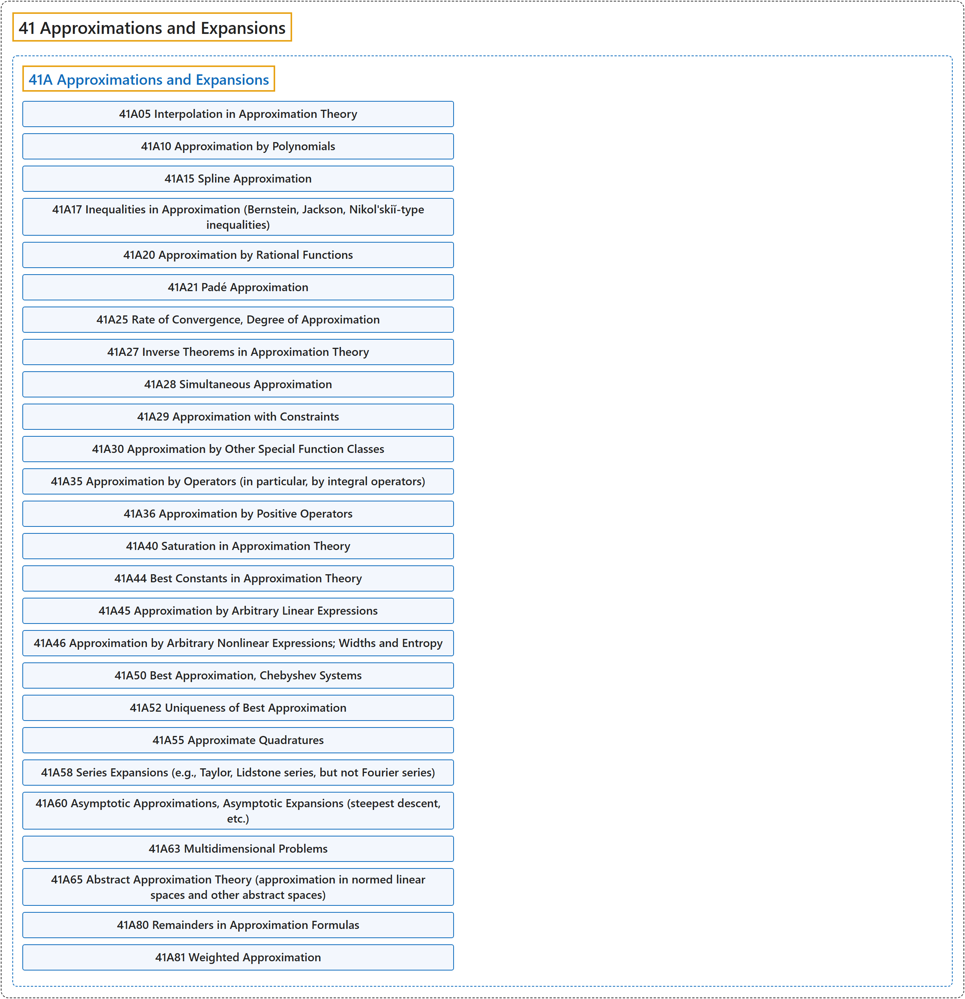

# 41 Approximations and Expansions

## Classification

## Glossary

| Term | Definition | 中文翻译 | Source |
|---|---|---|---|
| **41 Approximations and Expansions** 逼近与展开 | "The mathematical study of **how given quantities can be approximated by other (usually simpler) ones** under appropriate conditions." | 对**给定的量如何在适当条件下用其他（通常更简单的）量来近似**所作的数学研究。 | [Weisstein, n.d., "Approximation theory" entry, para. 1](https://mathworld.wolfram.com/ApproximationTheory.html#:~:text=The%20mathematical%20study%20of%20how%20given%20quantities%20can%20be%20approximated) |
| **[41A Approximations and Expansions](41a-approximations-and-expansions.md)** 逼近与展开 | (No definition) | （无定义） | [Associate Editors of Mathematical Reviews and zbMATH, 2020](https://msc2020.org/) |

## References

Associate Editors of Mathematical Reviews and zbMATH. (2020). *MSC2020: Mathematics Subject Classification system*. Retrieved October 27, 2026, from <https://msc2020.org/>

Weisstein, E. W. (n.d.). *Approximation theory*. MathWorld: A Wolfram Resource. Retrieved October 27, 2026, from <https://mathworld.wolfram.com/ApproximationTheory.html>
