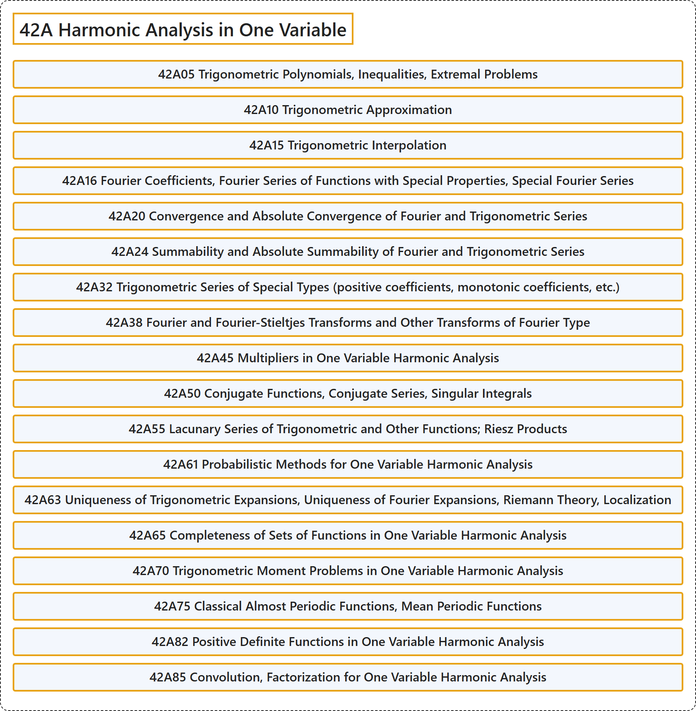

# 42A Harmonic Analysis in One Variable

## Classification

## Glossary

| Term | Definition | 中文翻译 | Source |
|---|---|---|---|
| **42A Harmonic Analysis in One Variable** 一元调和分析 | (No definition) | （无定义） | [Associate Editors of Mathematical Reviews and zbMATH, 2020](https://msc2020.org/) |
| **42A05 Trigonometric Polynomials, Inequalities, Extremal Problems** 三角多项式，不等式，极值问题 | (No definition) | （无定义） | [Associate Editors of Mathematical Reviews and zbMATH, 2020](https://msc2020.org/) |
| **42A10 Trigonometric Approximation** 三角逼近 | (No definition) | （无定义） | [Associate Editors of Mathematical Reviews and zbMATH, 2020](https://msc2020.org/) |
| **42A15 Trigonometric Interpolation** 三角插值 | (No definition) | （无定义） | [Associate Editors of Mathematical Reviews and zbMATH, 2020](https://msc2020.org/) |
| **42A16 Fourier Coefficients, Fourier Series of Functions with Special Properties, Special Fourier Series** 傅里叶系数，具有特殊性质函数的傅里叶级数，特殊傅里叶级数 | (No definition) | （无定义） | [Associate Editors of Mathematical Reviews and zbMATH, 2020](https://msc2020.org/) |
| **42A20 Convergence and Absolute Convergence of Fourier and Trigonometric Series** 傅里叶级数与三角级数的收敛与绝对收敛 | (No definition) | （无定义） | [Associate Editors of Mathematical Reviews and zbMATH, 2020](https://msc2020.org/) |
| **42A24 Summability and Absolute Summability of Fourier and Trigonometric Series** 傅里叶级数与三角级数的可和性与绝对可和性 | (No definition) | （无定义） | [Associate Editors of Mathematical Reviews and zbMATH, 2020](https://msc2020.org/) |
| **42A32 Trigonometric Series of Special Types (positive coefficients, monotonic coefficients, etc.)** 特殊类型的三角级数（正系数、单调系数等） | (No definition) | （无定义） | [Associate Editors of Mathematical Reviews and zbMATH, 2020](https://msc2020.org/) |
| **42A38 Fourier and Fourier-Stieltjes Transforms and Other Transforms of Fourier Type** 傅里叶变换与傅里叶-斯蒂尔杰斯变换及其他傅里叶型变换 | (No definition) | （无定义） | [Associate Editors of Mathematical Reviews and zbMATH, 2020](https://msc2020.org/) |
| **42A45 Multipliers in One Variable Harmonic Analysis** 一元调和分析中的乘子 | (No definition) | （无定义） | [Associate Editors of Mathematical Reviews and zbMATH, 2020](https://msc2020.org/) |
| **42A50 Conjugate Functions, Conjugate Series, Singular Integrals** 共轭函数，共轭级数，奇异积分 | (No definition) | （无定义） | [Associate Editors of Mathematical Reviews and zbMATH, 2020](https://msc2020.org/) |
| **42A55 Lacunary Series of Trigonometric and Other Functions; Riesz Products** 三角函数及其他函数的缺项级数；里斯乘积 | (No definition) | （无定义） | [Associate Editors of Mathematical Reviews and zbMATH, 2020](https://msc2020.org/) |
| **42A61 Probabilistic Methods for One Variable Harmonic Analysis** 一元调和分析的概率方法 | (No definition) | （无定义） | [Associate Editors of Mathematical Reviews and zbMATH, 2020](https://msc2020.org/) |
| **42A63 Uniqueness of Trigonometric Expansions, Uniqueness of Fourier Expansions, Riemann Theory, Localization** 三角展开的唯一性，傅里叶展开的唯一性，黎曼理论，局部化 | (No definition) | （无定义） | [Associate Editors of Mathematical Reviews and zbMATH, 2020](https://msc2020.org/) |
| **42A65 Completeness of Sets of Functions in One Variable Harmonic Analysis** 一元调和分析中函数集的完备性 | (No definition) | （无定义） | [Associate Editors of Mathematical Reviews and zbMATH, 2020](https://msc2020.org/) |
| **42A70 Trigonometric Moment Problems in One Variable Harmonic Analysis** 一元调和分析中的三角矩问题 | (No definition) | （无定义） | [Associate Editors of Mathematical Reviews and zbMATH, 2020](https://msc2020.org/) |
| **42A75 Classical Almost Periodic Functions, Mean Periodic Functions** 经典几乎周期函数，平均周期函数 | (No definition) | （无定义） | [Associate Editors of Mathematical Reviews and zbMATH, 2020](https://msc2020.org/) |
| **42A82 Positive Definite Functions in One Variable Harmonic Analysis** 一元调和分析中的正定函数 | (No definition) | （无定义） | [Associate Editors of Mathematical Reviews and zbMATH, 2020](https://msc2020.org/) |
| **42A85 Convolution, Factorization for One Variable Harmonic Analysis** 一元调和分析的卷积与因子分解 | (No definition) | （无定义） | [Associate Editors of Mathematical Reviews and zbMATH, 2020](https://msc2020.org/) |

## References

Associate Editors of Mathematical Reviews and zbMATH. (2020). *MSC2020: Mathematics Subject Classification system*. Retrieved October 27, 2026, from <https://msc2020.org/>
