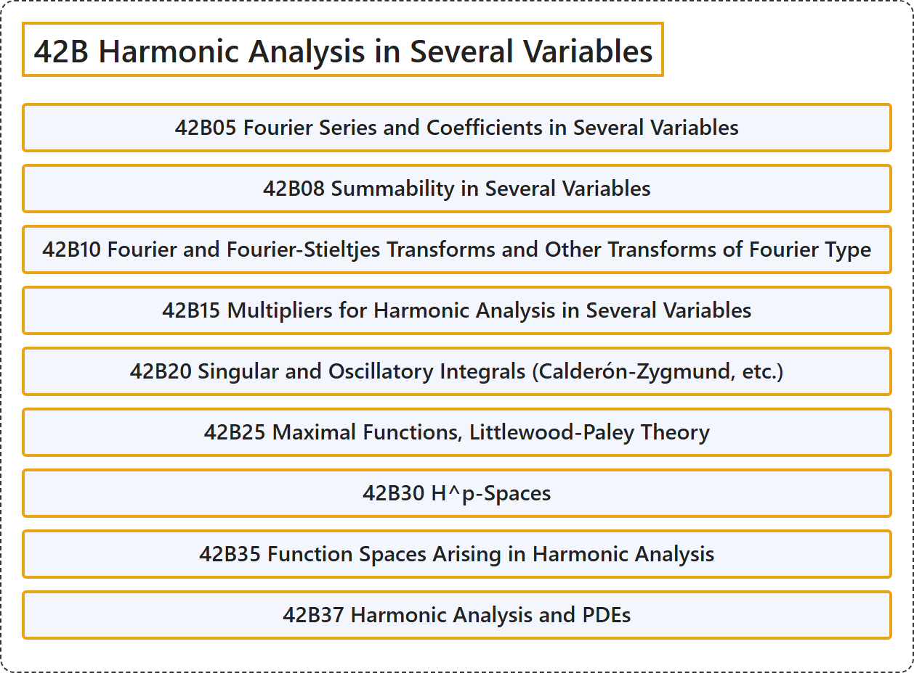

# 42B Harmonic Analysis in Several Variables

## Classification

## Glossary

| Term | Definition | 中文翻译 | Source |
|---|---|---|---|
| **42B Harmonic Analysis in Several Variables** 多元调和分析 | (No definition) | （无定义） | [Associate Editors of Mathematical Reviews and zbMATH, 2020](https://msc2020.org/) |
| **42B05 Fourier Series and Coefficients in Several Variables** 多元傅里叶级数与系数 | (No definition) | （无定义） | [Associate Editors of Mathematical Reviews and zbMATH, 2020](https://msc2020.org/) |
| **42B08 Summability in Several Variables** 多元可和性 | (No definition) | （无定义） | [Associate Editors of Mathematical Reviews and zbMATH, 2020](https://msc2020.org/) |
| **42B10 Fourier and Fourier-Stieltjes Transforms and Other Transforms of Fourier Type** 傅里叶变换与傅里叶-斯蒂尔杰斯变换及其他傅里叶型变换 | (No definition) | （无定义） | [Associate Editors of Mathematical Reviews and zbMATH, 2020](https://msc2020.org/) |
| **42B15 Multipliers for Harmonic Analysis in Several Variables** 多元调和分析的乘子 | (No definition) | （无定义） | [Associate Editors of Mathematical Reviews and zbMATH, 2020](https://msc2020.org/) |
| **42B20 Singular and Oscillatory Integrals (Calderón-Zygmund, etc.)** 奇异积分与振荡积分（卡尔德隆-赞格蒙德等） | (No definition) | （无定义） | [Associate Editors of Mathematical Reviews and zbMATH, 2020](https://msc2020.org/) |
| **42B25 Maximal Functions, Littlewood-Paley Theory** 极大函数，李特尔伍德-佩利理论 | (No definition) | （无定义） | [Associate Editors of Mathematical Reviews and zbMATH, 2020](https://msc2020.org/) |
| **42B30 H^p-Spaces** H^p 空间 | (No definition) | （无定义） | [Associate Editors of Mathematical Reviews and zbMATH, 2020](https://msc2020.org/) |
| **42B35 Function Spaces Arising in Harmonic Analysis** 调和分析中产生的函数空间 | (No definition) | （无定义） | [Associate Editors of Mathematical Reviews and zbMATH, 2020](https://msc2020.org/) |
| **42B37 Harmonic Analysis and PDEs** 调和分析与 PDE | (No definition) | （无定义） | [Associate Editors of Mathematical Reviews and zbMATH, 2020](https://msc2020.org/) |

## References

Associate Editors of Mathematical Reviews and zbMATH. (2020). *MSC2020: Mathematics Subject Classification system*. Retrieved October 27, 2026, from <https://msc2020.org/>
