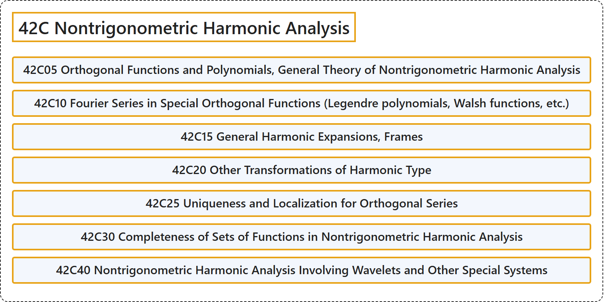

# 42C Nontrigonometric Harmonic Analysis

## Classification

## Glossary

| Term | Definition | 中文翻译 | Source |
|---|---|---|---|
| **42C Nontrigonometric Harmonic Analysis** 非三角调和分析 | (No definition) | （无定义） | [Associate Editors of Mathematical Reviews and zbMATH, 2020](https://msc2020.org/) |
| **42C05 Orthogonal Functions and Polynomials, General Theory of Nontrigonometric Harmonic Analysis** 正交函数与正交多项式，非三角调和分析的一般理论 | (No definition) | （无定义） | [Associate Editors of Mathematical Reviews and zbMATH, 2020](https://msc2020.org/) |
| **42C10 Fourier Series in Special Orthogonal Functions (Legendre polynomials, Walsh functions, etc.)** 特殊正交函数（勒让德多项式、沃尔什函数等）的傅里叶级数 | (No definition) | （无定义） | [Associate Editors of Mathematical Reviews and zbMATH, 2020](https://msc2020.org/) |
| **42C15 General Harmonic Expansions, Frames** 一般调和展开，框架 | (No definition) | （无定义） | [Associate Editors of Mathematical Reviews and zbMATH, 2020](https://msc2020.org/) |
| **42C20 Other Transformations of Harmonic Type** 其他调和型变换 | (No definition) | （无定义） | [Associate Editors of Mathematical Reviews and zbMATH, 2020](https://msc2020.org/) |
| **42C25 Uniqueness and Localization for Orthogonal Series** 正交级数的唯一性与局部化 | (No definition) | （无定义） | [Associate Editors of Mathematical Reviews and zbMATH, 2020](https://msc2020.org/) |
| **42C30 Completeness of Sets of Functions in Nontrigonometric Harmonic Analysis** 非三角调和分析中函数集的完备性 | (No definition) | （无定义） | [Associate Editors of Mathematical Reviews and zbMATH, 2020](https://msc2020.org/) |
| **42C40 Nontrigonometric Harmonic Analysis Involving Wavelets and Other Special Systems** 涉及小波及其他特殊系统的非三角调和分析 | (No definition) | （无定义） | [Associate Editors of Mathematical Reviews and zbMATH, 2020](https://msc2020.org/) |

## References

Associate Editors of Mathematical Reviews and zbMATH. (2020). *MSC2020: Mathematics Subject Classification system*. Retrieved October 27, 2026, from <https://msc2020.org/>
